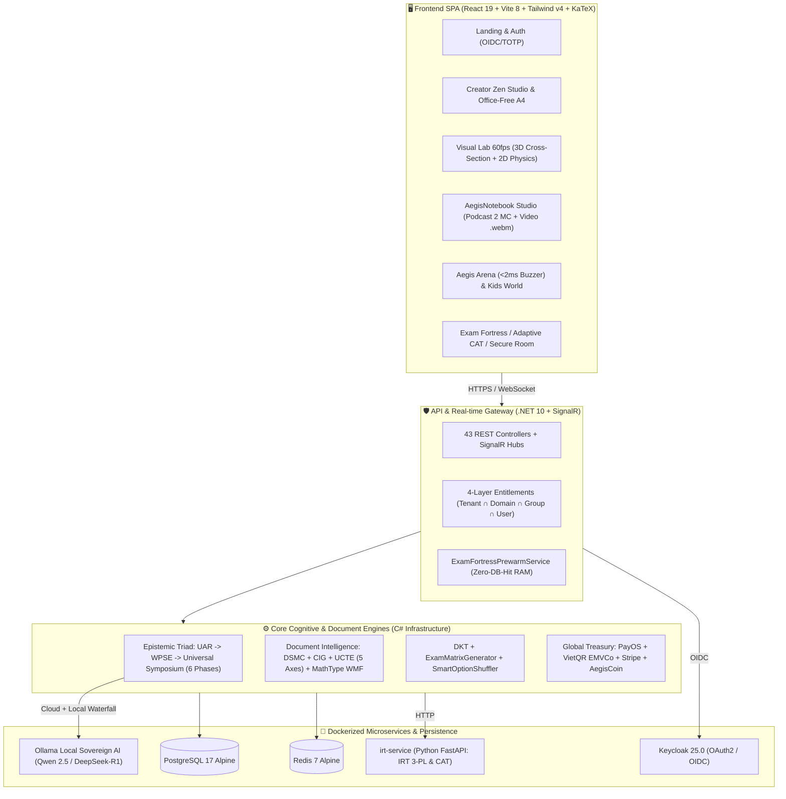

# 🌐 AEGIS GLOBAL (AGCI) — HỒ SƠ KHÁM PHÁ, ĐÁNH GIÁ TOÀN DIỆN & KIẾN TRÚC TỔNG THỂ (IT · AI · EDTECH)

> **Chuẩn tài liệu**: **ALDS v1.0** ([`AEGIS_LIVING_DOCUMENTATION_STANDARD.md`](file:///d:/Cuong/DuAn/mybank/AegisGlobal/docs/standards/AEGIS_LIVING_DOCUMENTATION_STANDARD.md))  
> **Phạm vi khảo sát**: Toàn bộ mã nguồn Backend (.NET 10), Frontend (React 19 + TypeScript + Vite 8), IRT Microservice (Python FastAPI), Hạ tầng Docker Compose & Hệ thống Tài liệu.  
> **Mốc kiểm chứng mã nguồn**: Commit [`587450a`](file:///d:/Cuong/DuAn/mybank/AegisGlobal/Frontend/src/components/notebooks/NotebookVideoOverviewPlayer.tsx) (nhánh `main`, cập nhật 2026-11-18).

---

## I. TỔNG QUAN ĐỊNH LƯỢNG HỆ SINH THÁI (VERIFIED CODEBASE TELEMETRY)

Qua kiểm kê trực tiếp trên cây thư mục thực thi của **AegisGlobal**, quy mô kỹ thuật của nền tảng đạt tầm vóc một **Cognitive Learning & Assessment OS** hoàn chỉnh:

| Chỉ số Thành phần | Số lượng Thực tế | Đường dẫn Gốc Xác minh |
|---|---:|---|
| **Backend Source (`.cs`)** | **417 files** | [`Backend/src/`](file:///d:/Cuong/DuAn/mybank/AegisGlobal/Backend/src) |
| **API Controllers** | **43 controllers** | [`Backend/src/Aegis.API/Controllers/`](file:///d:/Cuong/DuAn/mybank/AegisGlobal/Backend/src/Aegis.API/Controllers) |
| **Domain Entities** | **39 entities** | [`Backend/src/Aegis.Domain/Entities/`](file:///d:/Cuong/DuAn/mybank/AegisGlobal/Backend/src/Aegis.Domain/Entities) |
| **Frontend Source (`.ts` / `.tsx`)** | **515 files** | [`Frontend/src/`](file:///d:/Cuong/DuAn/mybank/AegisGlobal/Frontend/src) |
| **Frontend Page Modules** | **17 phân hệ** | [`Frontend/src/pages/`](file:///d:/Cuong/DuAn/mybank/AegisGlobal/Frontend/src/pages) |
| **Unit Test Suites (`.cs`)** | **85 test files** | [`Backend/tests/Aegis.UnitTests/`](file:///d:/Cuong/DuAn/mybank/AegisGlobal/Backend/tests/Aegis.UnitTests) |
| **Microservice Tâm trắc học** | **Python FastAPI (IRT/CAT)** | [`irt-service/main.py`](file:///d:/Cuong/DuAn/mybank/AegisGlobal/irt-service/main.py) |
| **Tài liệu Kỹ thuật (`.md`)** | **95 files** | [`docs/`](file:///d:/Cuong/DuAn/mybank/AegisGlobal/docs) |

---

## II. TRỤ CỘT 1: KIẾN TRÚC TỔNG THỂ & HẠ TẦNG PHÂN TÁN (BLUEPRINT)

**AegisGlobal** vận hành theo kiến trúc **CLEAR / Clean Architecture** (`Presentation -> Application -> Domain <- Infrastructure`) kết hợp **Cognitive Dual-Space Architecture (CDSA)** — cho phép một lõi duy nhất phục vụ đồng thời **Không gian Cá nhân (PLG)** và **Pháo đài Doanh nghiệp/Nhà trường (Multi-Tenant B2B)** với cô lập dữ liệu 3 tầng (`TenantMiddleware` $\rightarrow$ `EF Global QueryFilter` $\rightarrow$ `PostgreSQL`).

### Stack Công Nghệ Thực Thi (Verified từ [`docker-compose.yml`](file:///d:/Cuong/DuAn/mybank/AegisGlobal/docker-compose.yml), [`Aegis.Infrastructure.csproj`](file:///d:/Cuong/DuAn/mybank/AegisGlobal/Backend/src/Aegis.Infrastructure/Aegis.Infrastructure.csproj), [`package.json`](file:///d:/Cuong/DuAn/mybank/AegisGlobal/Frontend/package.json)):
* **Backend**: C# **.NET 10**, EF Core `10.0.5`, Npgsql PostgreSQL `10.0.1`, StackExchangeRedis `10.0.5`, Serilog `10.0.0`, NPOI `2.7.6`, PdfPig `0.1.16`, SkiaSharp `2.88.9` (kèm `NativeAssets.Linux.NoDependencies` cho Docker Linux).
* **Frontend**: React `19.2.4`, TypeScript `~5.9.3`, Vite `8.0.1`, Tailwind CSS `4.2.2`, TanStack Query `5.95.2`, SignalR `10.0.11`, KaTeX `0.18.5`, Recharts `3.8.1`, `i18next` `26.4.0`, Vitest `5.0.4`.
* **Container Topology**: `aegis-backend` (`:5080->8080`), `aegis-frontend` (`:3000->3000` Nginx proxy), `aegis-irt-service` (`:8001`), `aegis-postgres` (`postgres:17-alpine`), `aegis-redis` (`redis:7-alpine`), `aegis-keycloak` (`quay.io/keycloak/keycloak:25.0`), `aegis-local-ai` (`ollama/ollama:latest`).

---

## III. TRỤ CỘT 2: KHÁM PHÁ SÂU 6 PHÂN HỆ CỐT LÕI (LIVE CODE VERIFICATION)

### 1. Hệ Ba Ngôi Trí Tuệ Nhân Tạo Biện Chứng (Aegis Epistemic Triad)
Khác với các hệ thống EdTech chỉ gọi 1 API LLM đơn lẻ, AegisGlobal xây dựng kiến trúc **3 tầng nhận thức kiểm chứng chéo**:
* **Tầng 1 — Định tuyến Pareto FinOps ([`UniversalAiRouter.cs`](file:///d:/Cuong/DuAn/mybank/AegisGlobal/Backend/src/Aegis.Infrastructure/AI/UniversalAiRouter.cs))**: Định tuyến thông minh qua đa nhà cung cấp (Google Gemini, Anthropic Claude, OpenAI-compatible, Replicate, và Local Sovereign Ollama) qua [`IModelProtocolDriver.cs`](file:///d:/Cuong/DuAn/mybank/AegisGlobal/Backend/src/Aegis.Infrastructure/AI/ProtocolDrivers/IModelProtocolDriver.cs) cùng cơ chế xoay vòng key [`AiKeyPoolManager.cs`](file:///d:/Cuong/DuAn/mybank/AegisGlobal/Backend/src/Aegis.Infrastructure/AI/AiKeyPoolManager.cs).
* **Tầng 2 — Bầy Sói Đồng Thuận ([`WolfPackSwarmEngine.cs`](file:///d:/Cuong/DuAn/mybank/AegisGlobal/Backend/src/Aegis.Infrastructure/AI/WolfPackSwarmEngine.cs))**: Phối hợp đa tác tử bảo toàn chuỗi suy luận (`UniversalCoTPreservationStrategy`) và chuyển giao ngữ cảnh nhanh (`CognitiveHandoffDispatcher`).
* **Tầng 3 — Đại Hội Thảo Hàn Lâm 6 Pha ([`UniversalSymposiumEngine.cs`](file:///d:/Cuong/DuAn/mybank/AegisGlobal/Backend/src/Aegis.Infrastructure/AI/UniversalSymposiumEngine.cs))**: Lắp ghép prompt phân tầng qua [`SymposiumPromptComposer.cs`](file:///d:/Cuong/DuAn/mybank/AegisGlobal/Backend/src/Aegis.Infrastructure/AI/PromptComposition/SymposiumPromptComposer.cs) với 3 plugin triết học khoa học: [`FormalFalsifiabilityPlugin.cs`](file:///d:/Cuong/DuAn/mybank/AegisGlobal/Backend/src/Aegis.Infrastructure/AI/PromptComposition/FormalFalsifiabilityPlugin.cs) (Popperian), [`BayesianBeliefRevisionPlugin.cs`](file:///d:/Cuong/DuAn/mybank/AegisGlobal/Backend/src/Aegis.Infrastructure/AI/PromptComposition/BayesianBeliefRevisionPlugin.cs), và [`PeirceanAbductiveGenesisPlugin.cs`](file:///d:/Cuong/DuAn/mybank/AegisGlobal/Backend/src/Aegis.Infrastructure/AI/PromptComposition/PeirceanAbductiveGenesisPlugin.cs), kết hợp trinh sát tài liệu [`EpistemicDeepResearchScout.cs`](file:///d:/Cuong/DuAn/mybank/AegisGlobal/Backend/src/Aegis.Infrastructure/AI/Research/EpistemicDeepResearchScout.cs).

### 2. Tam Giác Vàng Bóc Tách Tài Liệu, Toán Học & Chuẩn Xuất Đề
Đây là một trong những điểm mạnh kỹ thuật sâu nhất của AegisGlobal:
* **DOCX Pipeline**: [`DocxStateMachineClassifier.cs`](file:///d:/Cuong/DuAn/mybank/AegisGlobal/Backend/src/Aegis.Infrastructure/Services/Docx/DocxStateMachineClassifier.cs) + [`DynamicQuestionIngestionEngine.cs`](file:///d:/Cuong/DuAn/mybank/AegisGlobal/Backend/src/Aegis.Infrastructure/Services/DynamicQuestionIngestionEngine.cs) + [`UniversalCoordinateTaxonomyEngine.cs`](file:///d:/Cuong/DuAn/mybank/AegisGlobal/Backend/src/Aegis.Infrastructure/Services/UniversalCoordinateTaxonomyEngine.cs) (5 trục tọa độ trực giao, xoay trục Pivot $O(1)$).
* **Giải mã Toán học Đa định dạng**:
  * OMML $\rightarrow$ LaTeX qua [`OmmlToLatexConverter.cs`](file:///d:/Cuong/DuAn/mybank/AegisGlobal/Backend/src/Aegis.Infrastructure/Services/OmmlToLatexConverter.cs).
  * MathType nhị phân (MTEF/WMF) $\rightarrow$ LaTeX / Vector SVG qua [`MtefToLatexConverter.cs`](file:///d:/Cuong/DuAn/mybank/AegisGlobal/Backend/src/Aegis.Infrastructure/Services/Docx/MtefToLatexConverter.cs) & [`MathTypeWmfEngine.cs`](file:///d:/Cuong/DuAn/mybank/AegisGlobal/Backend/src/Aegis.Infrastructure/Services/MathTypeWmfEngine.cs).
  * Chuẩn hóa ký pháp Việt–Quốc tế qua [`MathLocaleNormalizer.cs`](file:///d:/Cuong/DuAn/mybank/AegisGlobal/Backend/src/Aegis.Infrastructure/Services/Docx/MathLocaleNormalizer.cs).
* **PDF Pipeline**: [`PdfParserService.cs`](file:///d:/Cuong/DuAn/mybank/AegisGlobal/Backend/src/Aegis.Infrastructure/Services/PdfParserService.cs), [`PdfSpatialMathReconstructor.cs`](file:///d:/Cuong/DuAn/mybank/AegisGlobal/Backend/src/Aegis.Infrastructure/Services/Docx/PdfSpatialMathReconstructor.cs), [`PdfToMarkdownTranspilerService.cs`](file:///d:/Cuong/DuAn/mybank/AegisGlobal/Backend/src/Aegis.Infrastructure/Services/Docx/PdfToMarkdownTranspilerService.cs) và [`PdfHybridVisionFallbackService.cs`](file:///d:/Cuong/DuAn/mybank/AegisGlobal/Backend/src/Aegis.Infrastructure/Services/Docx/PdfHybridVisionFallbackService.cs).
* **Excel UCIS & Chuẩn Quốc tế**: [`ExcelParserService.cs`](file:///d:/Cuong/DuAn/mybank/AegisGlobal/Backend/src/Aegis.Infrastructure/Excel/ExcelParserService.cs) hỗ trợ ma trận cột ngữ nghĩa rộng; xuất chuẩn QTI 3.0, Moodle XML, GIFT, SCORM 1.2 qua [`UniversalExamTranspilerService.cs`](file:///d:/Cuong/DuAn/mybank/AegisGlobal/Backend/src/Aegis.Infrastructure/Transpiler/UniversalExamTranspilerService.cs) và kết nối LMS qua [`Lti13Service.cs`](file:///d:/Cuong/DuAn/mybank/AegisGlobal/Backend/src/Aegis.Infrastructure/Services/Lti13Service.cs).

### 3. Khoa Học Tâm Trắc, Khảo Thí Tốc Độ Cao & AegisNotebook Sovereign
* **Tâm trắc học IRT 3-PL & CAT**: Microservice Python [`irt-service/main.py`](file:///d:/Cuong/DuAn/mybank/AegisGlobal/irt-service/main.py) kết nối với [`IrtClientService.cs`](file:///d:/Cuong/DuAn/mybank/AegisGlobal/Backend/src/Aegis.Infrastructure/Services/IrtClientService.cs) và [`DktEngine.cs`](file:///d:/Cuong/DuAn/mybank/AegisGlobal/Backend/src/Aegis.Infrastructure/Services/DktEngine.cs) (Deep Knowledge Tracing).
* **Exam Fortress Zero-DB-Hit**: [`ExamFortressPrewarmService.cs`](file:///d:/Cuong/DuAn/mybank/AegisGlobal/Backend/src/Aegis.Infrastructure/Services/ExamFortressPrewarmService.cs) nạp trước đề thi vào RAM/Redis để chịu tải phòng thi đồng thời lớn; chống gian lận & đồng bộ thời gian NTP qua [`ProctorService.cs`](file:///d:/Cuong/DuAn/mybank/AegisGlobal/Backend/src/Aegis.Infrastructure/Services/ProctorService.cs) và [`NtpTimeSyncService.cs`](file:///d:/Cuong/DuAn/mybank/AegisGlobal/Backend/src/Aegis.Infrastructure/Services/NtpTimeSyncService.cs).
* **AegisNotebook Studio (Vượt chuẩn NotebookLM)**: [`NotebookProcessingService.cs`](file:///d:/Cuong/DuAn/mybank/AegisGlobal/Backend/src/Aegis.Infrastructure/Services/NotebookProcessingService.cs) & [`NotebookStudioPanel.tsx`](file:///d:/Cuong/DuAn/mybank/AegisGlobal/Frontend/src/components/notebooks/NotebookStudioPanel.tsx) hỗ trợ 8 loại Studio Artifact: Podcast 2 MC Neural TTS, **Video Tổng quan (`VIDEO_OVERVIEW` — slide hoạt họa 60fps + xuất `.webm` qua [`NotebookVideoOverviewPlayer.tsx`](file:///d:/Cuong/DuAn/mybank/AegisGlobal/Frontend/src/components/notebooks/NotebookVideoOverviewPlayer.tsx))**, Mind Map, Study Guide, Briefing, FAQ, Timeline, Flashcards, đồng thời nối thẳng sang Đề thi Bloom 5–6 và Office Studio.

### 4. Office-Free Studio, Visual Learning Lab 60fps, Arena & Kids World
* **Office-Free Studio**: [`OfficeWorkspacePage.tsx`](file:///d:/Cuong/DuAn/mybank/AegisGlobal/Frontend/src/pages/office/OfficeWorkspacePage.tsx) + [`OfficeDocumentWorkspaceService.cs`](file:///d:/Cuong/DuAn/mybank/AegisGlobal/Backend/src/Aegis.Infrastructure/Services/OfficeDocumentWorkspaceService.cs) soạn thảo Word/Excel/PDF trực tiếp trên trình duyệt với phân trang A4 rời rạc, chế độ 2 cột đề thi, giải mã OMML/MathType/ảnh gốc từ DOCX/PDF, cùng AI Office Co-Pilot.
* **Visual Learning Lab 60fps**: [`VisualLearningLabPage.tsx`](file:///d:/Cuong/DuAn/mybank/AegisGlobal/Frontend/src/pages/visual-lab/VisualLearningLabPage.tsx) mô phỏng Đồ thị Toán–Lý biến thiên theo thời gian, **Hình học Không gian 3D (Mặt cắt 3D, Hình chiếu trực giao xuống mặt đáy, Tự động xoay 60fps)** và **Lab Va chạm Vật lý 2D tương tác**, kèm thuyết minh Neural TTS, xuất ảnh PNG và nhúng vào Office Studio.
* **Aegis Arena & Kids World**: [`ArenaRoomManager.cs`](file:///d:/Cuong/DuAn/mybank/AegisGlobal/Backend/src/Aegis.Infrastructure/Arena/ArenaRoomManager.cs) (Gameshow thời gian thực qua SignalR) và [`KidsCurriculumService.cs`](file:///d:/Cuong/DuAn/mybank/AegisGlobal/Backend/src/Aegis.Infrastructure/Services/KidsCurriculumService.cs) (thế giới học tập & di sản cho trẻ 3–11 tuổi).

### 5. An Ninh Mạng, Mật Mã Học & Kinh Tế Học Nền Tảng (FinOps & Treasury)
* **Bảo mật Đa tầng**: Keycloak OIDC (`keycloak:25.0`), TOTP 2FA Step-Up ([`TotpSecurityHelper.cs`](file:///d:/Cuong/DuAn/mybank/AegisGlobal/Backend/src/Aegis.Infrastructure/Security/TotpSecurityHelper.cs)), mã hóa BYOK API Keys ([`ApiKeyEncryptionHelper.cs`](file:///d:/Cuong/DuAn/mybank/AegisGlobal/Backend/src/Aegis.Infrastructure/Security/ApiKeyEncryptionHelper.cs)), chống IDOR qua Scoped RBAC và nhật ký kiểm toán băm bất biến ([`ExamAuditService.cs`](file:///d:/Cuong/DuAn/mybank/AegisGlobal/Backend/src/Aegis.Infrastructure/Services/ExamAuditService.cs)).
* **Thanh toán & Tokenomics**: [`PaymentOrchestratorService.cs`](file:///d:/Cuong/DuAn/mybank/AegisGlobal/Backend/src/Aegis.Infrastructure/Payments/PaymentOrchestratorService.cs) tích hợp PayOS, VietQR EMVCo Fallback ([`VietQrEmvCoGenerator.cs`](file:///d:/Cuong/DuAn/mybank/AegisGlobal/Backend/src/Aegis.Infrastructure/Payments/VietQrEmvCoGenerator.cs)), Stripe quốc tế và ví [`AegisCoinService.cs`](file:///d:/Cuong/DuAn/mybank/AegisGlobal/Backend/src/Aegis.Infrastructure/Services/AegisCoinService.cs).

---

## IV. TRỤ CỘT 3: ĐÁNH GIÁ KHÁCH QUAN, KHOA HỌC & ĐỊNH LƯỢNG

### 1. Bảng Chấm Điểm Chuyên Gia Đa Chiều (Objective Scorecard)

| Trục Đánh Giá | Điểm (/10) | Nhận Định Chuyên Môn Khách Quan |
|---|:---:|---|
| **1. Kiến trúc Phần mềm (IT Architecture)** | **9.3 / 10** | Phân tách CLEAR chuẩn mực; CAS/COW khử trùng lặp; 0 dependency ngoại lai ở Domain; CDSA kết hợp B2C PLG + B2B Enterprise rất sắc sảo. |
| **2. Trí tuệ Nhân tạo (AI Engineering)** | **9.4 / 10** | Vượt xa mức "wrapper": có FinOps router đa nhà cung cấp, cơ chế bầy đàn WPSE, Đại hội thảo 6 pha có kiểm chứng Popper/Bayes, hỗ trợ Local Ollama bảo mật dữ liệu. |
| **3. Khoa học Đào tạo & Khảo thí (EdTech)** | **9.5 / 10** | Hội tụ đủ bộ vũ khí chuẩn quốc tế: IRT 3-PL (Python microservice), CAT, DKT, Bloom 5–6, QTI 3.0 / LTI 1.3, Visual Lab 3D + AegisNotebook Studio Video/Podcast. |
| **4. Xử lý Tài liệu & Toán học (Doc Intelligence)** | **9.4 / 10** | Giải quyết được bài toán gai góc nhất tại Việt Nam: DOCX OMML + MathType nhị phân WMF/MTEF + PdfPig không gian + Excel đa cột + giữ nguyên định dạng minh họa. |
| **5. Trải nghiệm & Frontend (UX / Craft)** | **8.8 / 10** | Code-splitting qua `lazyRetry`, KaTeX chuẩn xác, `Office Studio` & `Visual Lab` ấn tượng; tuy nhiên mật độ tính năng rất lớn đòi hỏi tối ưu onboarding theo từng vai trò. |
| **6. Vận hành, Kiểm thử & Production Readiness** | **8.3 / 10** | Có 85 file Unit Test Backend + Vitest + Docker Compose đầy đủ; điểm cần gia cố là tự động hóa E2E CI/CD và tách worker cho tác vụ nặng. |
| **ĐIỂM TỔNG HỢP HỆ SINH THÁI** | **9.1 / 10** | **Cấp độ Nền tảng Hạ tầng Tri thức Toàn cầu (Enterprise & Sovereign-Ready).** |

### 2. Phân Tích Điểm Mạnh Cốt Lõi vs. Khoảng Trống & Rủi Ro Kỹ Thuật (Honest Gaps)
* **Điểm mạnh dị biệt (Competitive Moats)**:
  1. **End-to-End Vertical Integration**: Hiếm có nền tảng nào gom trọn vòng đời từ *Bóc tách đề Word/PDF toán học phức tạp $\rightarrow$ Soạn thảo trên Office Studio $\rightarrow$ Giảng dạy trực quan 3D 60fps $\rightarrow$ Nghiên cứu đa nguồn Notebook (Podcast + Video) $\rightarrow$ Thi thích ứng IRT/CAT*.
  2. **Sovereign Hybrid AI**: Vừa tận dụng tốc độ/chi phí Cloud (Gemini/Claude/Groq/Cerebras) vừa chạy được Offline/On-Premise qua Ollama (`Qwen 2.5` / `DeepSeek-R1`) — cực kỳ phù hợp cho tổ chức giáo dục công lập, ngân hàng, cơ quan nhà nước.
* **Khoảng trống & Nợ kỹ thuật cần lưu ý (Technical Risks & Recommendations)**:
  1. **Độ rộng bề mặt (Feature Surface Area)**: 43 controllers và 17 phân hệ trang có thể làm tăng chi phí bảo trì nếu thiếu bản đồ kiểm thử hồi quy tự động (E2E Playwright/Cypress chạy trên CI).
  2. **Export Video `.webm` phía Client**: Hiện tại [`NotebookVideoOverviewPlayer.tsx`](file:///d:/Cuong/DuAn/mybank/AegisGlobal/Frontend/src/components/notebooks/NotebookVideoOverviewPlayer.tsx) quay Canvas trực tiếp trên trình duyệt (tốc độ nhanh, 0 tải server), nhưng file `.webm` xuất ra chưa mux track âm thanh TTS vào trong file tải về (âm thanh phát live qua trình duyệt). Nếu muốn xuất MP4/WebM có sẵn giọng đọc nhúng, cần bổ sung Web Audio capture hoặc server-side FFmpeg worker.
  3. **Tách Queue cho Batch Nặng**: Các tác vụ bóc tách hàng loạt PDF/DOCX lớn hoặc Symposium 6 pha nên đẩy qua message queue (Redis Streams/Hangfire) thay vì giữ HTTP connection dài dù Nginx đã đặt `proxy_read_timeout 300s`.
  4. **Quản trị Tài liệu Sống**: Đang có 95 file `.md` trong `docs/` — cần duy trì chỉ mục tập trung để tránh chồng chéo giữa các bản Blueprint `v2.0`, `v3.0` và tài liệu module mới.

---

## V. TRỤ CỘT 4: CĂN CỨ THỊ GIÁC THỰC NGHIỆM (VISUAL PROOF-OF-WORK)

Hệ thống đã lưu trữ đầy đủ bộ ảnh chụp nghiệm thu trên trình duyệt thực tế (`http://localhost:3000`) trong [`docs/assets/walkthroughs/`](file:///d:/Cuong/DuAn/mybank/AegisGlobal/docs/assets/walkthroughs):

* **Bóc tách DOCX & Ngữ cảnh Chia sẻ**: [`02_shared_stimulus_context_modal.png`](file:///d:/Cuong/DuAn/mybank/AegisGlobal/docs/assets/walkthroughs/docx_ingestion/02_shared_stimulus_context_modal.png), [`03_question_editor_provenance_modal.png`](file:///d:/Cuong/DuAn/mybank/AegisGlobal/docs/assets/walkthroughs/docx_ingestion/03_question_editor_provenance_modal.png)
* **Ma trận Excel UCIS v4.0 & Phân loại 5 Trục UCTE**: [`01_ucis_modal_opened.png`](file:///d:/Cuong/DuAn/mybank/AegisGlobal/docs/assets/walkthroughs/ucis_v4/01_ucis_modal_opened.png), [`09_ucis_extended_27_roles.png`](file:///d:/Cuong/DuAn/mybank/AegisGlobal/docs/assets/walkthroughs/ucis_v4/09_ucis_extended_27_roles.png)
* **Nghiệm thu Trải nghiệm Thi Di động Đa dạng Câu hỏi**: [`mobile_result_multi_tf_matrix.png`](file:///d:/Cuong/DuAn/mybank/AegisGlobal/docs/assets/walkthroughs/acceptance-2026-10/mobile_result_multi_tf_matrix.png), [`mobile_ordering_interactive.png`](file:///d:/Cuong/DuAn/mybank/AegisGlobal/docs/assets/walkthroughs/acceptance-2026-10/mobile_ordering_interactive.png)
* **Thanh toán VietQR Vector & Tri ân Cộng đồng**: [`buy_coffee_modal_qr_vector.png`](file:///d:/Cuong/DuAn/mybank/AegisGlobal/docs/assets/walkthroughs/buy_coffee_modal_qr_vector.png), [`admin_payments_gratitude.png`](file:///d:/Cuong/DuAn/mybank/AegisGlobal/docs/assets/walkthroughs/admin_payments_gratitude.png)

---

## VI. TRỤ CỘT 5: VẾT KIỂM TOÁN & LỘ TRÌNH NÂNG CẤP (AUDIT TRAIL)

| Phiên Bản / Commit | Ngày Cập Nhật | Hạng Mục Tiến Hóa Trọng Tâm | Trạng Thái Xác Minh |
|:---:|:---:|---|:---:|
| `d9a4fff` – `71b9634` | 2026-11-18 | **Office-Free Studio A4**: Giải mã OMML/MathType/ảnh gốc từ DOCX/PDF, phân trang A4, 2 cột đề thi & AI Co-Pilot. | Verified |
| `5ebbc3e` – `d981ac2` | 2026-11-18 | **Visual Learning Lab 60fps**: Neural TTS, chiếu bảng, mặt cắt 3D, hình chiếu trực giao, tự động xoay 60fps & Lab va chạm 2D. | Verified |
| `f77bb87` | 2026-11-18 | **AegisNotebook Studio**: Podcast 2 MC Neural TTS, Mind Map, Study Guide, FAQ, Flashcards & cầu nối Office Studio. | Verified |
| `587450a` | 2026-11-18 | **Video Overview (`VIDEO_OVERVIEW`)**: Slide Canvas 60fps + thuyết minh đồng bộ + xuất `.webm` trực tiếp trên trình duyệt. | Verified |
| *Sovereign Evolution* | 2026-11-18 | **Audio-Muxed Video `.webm` + Quality Gate + Docs SSoT**: Ghép giọng đọc Neural TTS (`/api/kids/tts`) + Canvas 60fps qua Web Audio API (`videoOverviewExporter.ts`), tách Zero-Monolith `NotebookVideoOverviewPlayer.tsx`, chuẩn hóa `docs/INDEX.md` & `scripts/verify-aegis-smoke.ps1`. | **Verified (`40/40` Scoped Tests + `tsc -b` + 3/3 Docker Health HTTP 200)** |
| *Roadmap Tiếp theo* | Q4/2026 | Tích hợp Background Worker Queue (Redis Streams/Hangfire) cho Batch PDF/DOCX quy mô lớn & Playwright E2E CI. | Planned |
