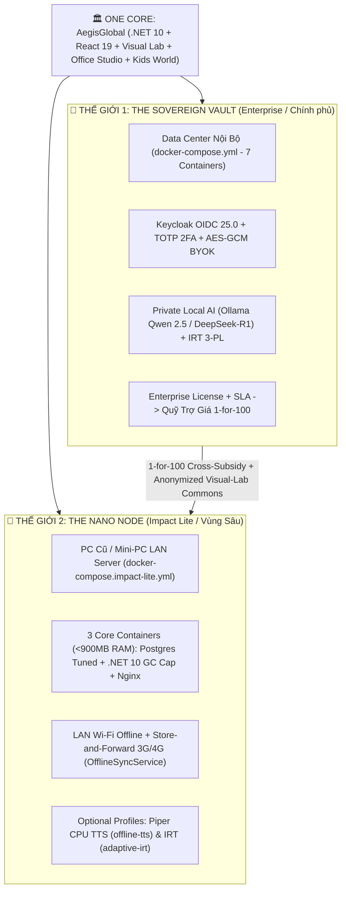

# ⚖️ HIẾN CHƯƠNG CHIẾN LƯỢC AEGIS GLOBAL: "MỘT LÕI – HAI THẾ GIỚI" (THE GREAT EQUALIZER)

> **Chuẩn tài liệu**: **ALDS v1.0** ([`AEGIS_LIVING_DOCUMENTATION_STANDARD.md`](file:///d:/Cuong/DuAn/mybank/AegisGlobal/docs/standards/AEGIS_LIVING_DOCUMENTATION_STANDARD.md))  
> **Định vị**: Biến công nghệ thành **"Trục cân bằng" (The Great Equalizer)** — giới tinh hoa trả phí cho **Chủ quyền & Bất khả xâm phạm**, còn người yếu thế nhất sở hữu **Hạt giống Sinh tồn** chạy offline trên phần cứng cũ với chi phí tiệm cận `0`.

---

## I. TRỤ CỘT 1: KIẾN TRÚC "MỘT LÕI – HAI THẾ GIỚI" (ONE CORE – TWO WORLDS)

Cùng một lõi mã nguồn **AegisGlobal** (`.NET 10` + `React 19`), hệ thống phân tách thành **2 cấu hình triển khai đối xứng** phục vụ hai cực của thế giới:



### Bảng Đối Chiếu Kỹ Thuật Thực Thi

| Chiều So Sánh | **The Sovereign Vault** (`docker-compose.yml`) | **The Nano Node** (`docker-compose.impact-lite.yml`) |
|---|---|---|
| **Đối tượng** | Trường quốc tế, Tập đoàn, Bộ/Sở Giáo dục | Trường vùng cao, vùng sâu, NGO, khu vực thiếu điện/mạng |
| **Số Container Mặc định** | **7 containers** (Backend, Frontend, IRT, Postgres, Redis, Keycloak, Ollama) | **3 containers** (Backend GC-capped, Frontend Nginx, Postgres 17 tuned) |
| **Ngân sách RAM Tối thiểu** | 8 GB – 32 GB+ RAM (có GPU cho Ollama) | **~750 MB – 1.2 GB RAM** (chạy mượt trên PC 10 năm tuổi 2–4 GB RAM) |
| **Xác thực & Cache** | Keycloak 25.0 OIDC + Redis 7 phân tán | Built-in JWT + In-Memory Cache (`ExamFortressPrewarmService`) |
| **Giọng nói & AI** | Edge Neural TTS + Cloud Waterfall + Ollama GPU | Web Speech / **Piper CPU TTS** (`--profile offline-tts`) + Gói nội dung tải sẵn |
| **Đồng bộ Mạng** | Real-time SignalR & PostgreSQL | **LAN-First** + đồng bộ gói tin text vài KB qua [`OfflineSyncService.cs`](file:///d:/Cuong/DuAn/mybank/AegisGlobal/Backend/src/Aegis.Infrastructure/Services/OfflineSyncService.cs) |

---

## II. TRỤ CỘT 2: CÁC ĐIỂM NEO MÃ NGUỒN SỐNG (LIVE CODE GROUNDING)

Chiến lược này không nằm trên giấy mà đứng trực tiếp trên các phân hệ đã vận hành trong AegisGlobal:
1. **Cấu hình Nano Node**: [`docker-compose.impact-lite.yml`](file:///d:/Cuong/DuAn/mybank/AegisGlobal/docker-compose.impact-lite.yml) (đã tối ưu `mem_limit`, `DOTNET_GCHeapHardLimit`, PostgreSQL `shared_buffers=64MB`, và Docker `profiles`).
2. **Đồng bộ Ngoại tuyến (Store-and-Forward)**: [`OfflineSyncService.cs`](file:///d:/Cuong/DuAn/mybank/AegisGlobal/Backend/src/Aegis.Infrastructure/Services/OfflineSyncService.cs) & [`OfflineSyncController.cs`](file:///d:/Cuong/DuAn/mybank/AegisGlobal/Backend/src/Aegis.API/Controllers/OfflineSyncController.cs).
3. **Phòng thi Không cần DB Nặng**: [`ExamFortressPrewarmService.cs`](file:///d:/Cuong/DuAn/mybank/AegisGlobal/Backend/src/Aegis.Infrastructure/Services/ExamFortressPrewarmService.cs) nạp sẵn đề vào RAM phục vụ cả phòng máy LAN `<5ms`.
4. **Học liệu Chạy Thuần Trình Duyệt (0đ Cloud API)**: [`VisualLearningLabPage.tsx`](file:///d:/Cuong/DuAn/mybank/AegisGlobal/Frontend/src/pages/visual-lab/VisualLearningLabPage.tsx) (3D/2D 60fps), [`OfficeWorkspacePage.tsx`](file:///d:/Cuong/DuAn/mybank/AegisGlobal/Frontend/src/pages/office/OfficeWorkspacePage.tsx) (A4 Studio), [`vosQuantumSynth.ts`](file:///d:/Cuong/DuAn/mybank/AegisGlobal/Frontend/src/components/music/vosQuantumSynth.ts) (432Hz/528Hz Synth).
5. **Tương thích Giọng nói Offline**: [`KidsVoiceService.cs`](file:///d:/Cuong/DuAn/mybank/AegisGlobal/Backend/src/Aegis.Infrastructure/Services/KidsVoiceService.cs) (Tier 1 `AEGIS_TTS_ENDPOINT` tự động kết nối tới Piper TTS cục bộ khi bật profile `offline-tts`).

---

## III. TRỤ CỘT 3: MÔ HÌNH KINH TẾ "ROBIN HOOD" & QUẢN TRỊ GLOBAL COMMONS

1. **Cam kết Tài chính `1-for-100`**:
   * 1 Giấy phép **Enterprise Sovereign** (triển khai Data Center nội bộ + SLA kỹ thuật + Private AI) tạo biên lợi nhuận phần mềm ~85–90%, tài trợ trọn vẹn chi phí duy trì cập nhật OTA & hạ tầng điều phối cho **100 điểm trường Impact Lite**.
2. **Bình đẳng Tri thức (`Visual-Lab Global Commons`)**:
   * **Nguyên tắc Opt-in & Zero-Leak**: Dữ liệu trường Enterprise mặc định khóa kín 100%. Chỉ khi giáo viên chủ động bấm *Chia sẻ Cộng đồng*, hệ thống mới chạy **Sanitization** (gỡ bỏ `TenantId`, tên trường, thông tin học sinh) trước khi đưa bài giảng 3D/đề thi vào kho chung để các Nano Node tải về khi có 3G/4G.
3. **Vận hành Bền vững (Zero-Touch Support)**:
   * Các Nano Node tự vá schema khi nâng cấp qua `DatabasePatcher`, không đòi hỏi nhân sự IT chuyên trách tại điểm trường vùng sâu.

---

## IV. TRỤ CỘT 4 & 5: LỆNH TRIỂN KHAI NANO NODE & VẾT KIỂM TOÁN

```bash
# 1. Chế độ Siêu Nhẹ Tối Đa (3 container, ~750MB RAM - cho PC cũ 2-4GB RAM)
docker compose -f docker-compose.impact-lite.yml up -d

# 2. Bật thêm Giọng đọc Offline CPU (Piper TTS) cho Kids World & Đọc bài
docker compose -f docker-compose.impact-lite.yml --profile offline-tts up -d

# 3. Bật thêm Khảo thí Thích ứng IRT 3-PL (khi máy chủ có >= 4GB RAM)
docker compose -f docker-compose.impact-lite.yml --profile adaptive-irt up -d
```

| Phiên Bản | Ngày | Nội Dung | Xác Minh |
|:---:|:---:|---|:---:|
| `v1.0` | 2026-11-19 | Khởi tạo Hiến chương **The Great Equalizer** & cấu hình [`docker-compose.impact-lite.yml`](file:///d:/Cuong/DuAn/mybank/AegisGlobal/docker-compose.impact-lite.yml). | **Verified (`docker compose config`)** |
