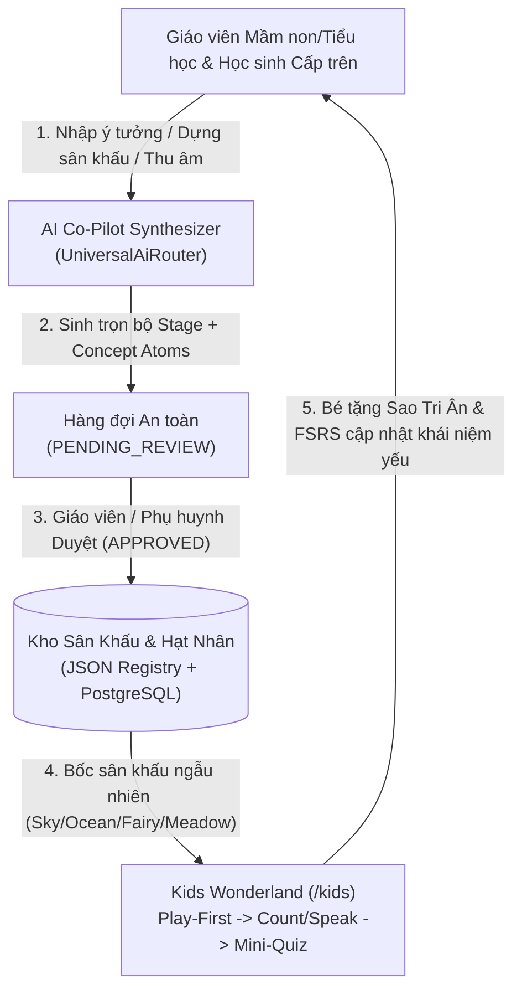

# 🦉 AEGIS KIDS WORLD — TUYÊN NGÔN, PHƯƠNG PHÁP LUẬN & CẨM NANG VẬN HÀNH TOÀN DIỆN

> **Hệ sinh thái**: **AEGIS GLOBAL COGNITIVE INFRASTRUCTURE (AGCI)**  
> **Phân hệ**: **Aegis Kids Wonderland (`/kids`) — Thế Giới Tuổi Thơ & Đồng Sáng Tạo Liên Thế Hệ**  
> **Chuẩn tài liệu**: **ALDS v1.0 (Aegis Living Documentation Standard)**

---

## PHẦN I. TUYÊN NGÔN KHAI SINH, SỨ MỆNH & Ý NGHĨA THỜI ĐẠI

### 1. Tuyên ngôn Khai sinh (The Kids World Manifesto)
> *"Mỗi đứa trẻ bước vào thế giới không phải là một chiếc bình rỗng để nhồi nhét câu hỏi trắc nghiệm, mà là một nhà thám hiểm đang chờ được chạm vào điều kỳ diệu. Và mỗi thế giới quan, mỗi ước mơ của thầy cô hay anh chị đi trước — khi được kể lại bằng âm thanh, sắc màu và lòng yêu thương — sẽ trở thành tài sản vô giá nuôi dưỡng tâm hồn của cả một thế hệ."*

**Aegis Kids World** ra đời không nhằm tạo ra thêm một ứng dụng học vẹt đóng kín, mà để kiến tạo một **Vũ trụ Tuổi thơ Sống động**, nơi:
- **Trẻ nhỏ (3–11 tuổi)** được **chơi trước – khám phá sau** trong bầu không khí tràn ngập lời ca tiếng hát, muôn thú, đồ chơi và phép màu cổ tích.
- **Giáo viên Mầm non & Tiểu học** trở thành **Kiến trúc sư Sân khấu Tuổi thơ**, được AI Co-Pilot hỗ trợ biến mọi ý tưởng giáo án thành trải nghiệm đa giác quan chỉ trong vài giây.
- **Học sinh cấp trên (THCS, THPT, Sinh viên)** trở thành **Tác giả Trẻ (Youth Storytellers)**, chia sẻ thế giới quan, tranh vẽ, giọng kể và ước mơ của mình cho các lớp đàn em.

### 2. Vai trò, Mục đích & Giá trị Xã hội
| Chiều kích | Vai trò & Giá trị Cốt lõi |
| :--- | :--- |
| **Giáo dục sớm (Early Childhood)** | Khơi dậy tò mò tự nhiên, phát triển ngôn ngữ song ngữ, tư duy số đếm, cảm thụ âm nhạc và tình yêu thiên nhiên không áp lực điểm số. |
| **Công bằng Tri thức (Equity)** | Mở ra kho sân khấu, bài hát, câu chuyện miễn phí, đa ngôn ngữ, nơi mọi trẻ em ở thành thị hay nông thôn đều được tiếp cận môi trường giáo dục chuẩn mực. |
| **Sư phạm Liên thế hệ (Social Impact)** | Kết nối **Giáo viên – Học sinh lớn – Phụ huynh – Em nhỏ** thành vòng tuần hoàn tri ân: học sinh lớn dạy lại điều mình biết (*The Protégé Effect*), em nhỏ gửi sao cảm ơn, cả cộng đồng cùng lớn lên. |

---

## PHẦN II. PHƯƠNG PHÁP LUẬN KHOA HỌC & KIẾN TRÚC VẬN HÀNH

### 1. Bốn Trụ Cột Khoa Học Nhận Thức
1. **Play-First Curiosity Reveal (Chơi Trước $\rightarrow$ Bung Tri Thức Sau)**:
   - Trái ngược với cách hiển thị chữ khô khan ngay từ đầu, Kids World đưa trẻ vào sân khấu tương tác (**bóng bay sắc màu, viên kẹo ngọt, sinh vật biển, bạn thú**). Trẻ tự chọn vật phẩm mình thích, nghe âm thanh phản hồi tức thì (`pop`, `unwrap`, `splash`, `bounce`), rồi tri thức mới bung mở đầy bất ngờ.
2. **Thuyết Mã Hóa Kép (Paivio Dual-Coding) & Tải Nhận Thức Tối Ưu (Sweller)**:
   - Mỗi màn hình chỉ truyền tải **1 hạt nhân khái niệm (`Concept Atom`)** kết hợp đồng thời **Hình ảnh/Emoji/Tranh vẽ + Giọng đọc bản xứ/Giọng kể thật + Âm nhạc Web Audio 0ms + Thao tác chạm**.
3. **Cognitive Genesis Engine (Hạt Nhân Tri Thức $\rightarrow$ Đa Hoạt Động)**:
   - Thay vì nhập từng câu hỏi rời rạc, hệ thống lưu **Hạt nhân Tri thức (`Concept Atom`)**, sau đó **Procedural Activity Synthesizer** tự động biến hóa thành chuỗi 4 pha:
     `Khám phá Bất ngờ (Play-First)` $\rightarrow$ `Chạm Đếm / Đọc To` $\rightarrow$ `Thử thách Kho Báu` $\rightarrow$ `Ôn tập FSRS` (ưu tiên các khái niệm bé còn yếu).
4. **Lá Chắn An Toàn Trẻ Em 2 Lớp (Child-Safe Governance)**:
   - Mọi sáng tác từ cộng đồng đi vào trạng thái **`PENDING_REVIEW`**, chỉ hiển thị công khai trên `/kids` sau khi được **Giáo viên / Phụ huynh phê duyệt (`APPROVED`)**. Khi bé muốn thoát về chế độ người lớn phải vượt qua **Khóa Phụ Huynh (Parent Gate)**.

### 2. Kiến trúc Vận hành Khép kín (End-to-End Flow)

---

## PHẦN III. HƯỚNG DẪN SỬ DỤNG CHI TIẾT THEO TỪNG ĐỐI TƯỢNG (TỪ CƠ BẢN ĐẾN CHUYÊN GIA)

### CẤP ĐỘ 1: PHỤ HUYNH & BÉ (TRẢI NGHIỆM 1 CHẠM — ZERO SETUP)

#### Bước 1: Mở Thế Giới Tuổi Thơ
- Bấm **Kids World** ngay trên thanh menu chính ở đầu trang (Desktop) hoặc thanh dưới cùng (Mobile), hoặc bấm **🌈 Kids World** từ Zen Studio / Practice, hoặc truy cập trực tiếp `/kids`.

#### Bước 2: Phiêu lưu 4 Vương Quốc & Rạp Phim
- **Chọn Vương Quốc**: **🎵 Lời Ca Tiếng Hát**, **🦁 Thế Giới Muôn Thú**, **🧸 Thế Giới Đồ Chơi**, **🧚 Thế Giới Thần Tiên**.
- **Chơi Play-First**: Khi sân khấu hiện ra (lúc trên bầu trời bóng bay, lúc dưới đáy biển, lúc trong rừng kẹo cổ tích), bé **chạm tự do vào từng quả bóng / viên kẹo / bạn thú** để nghe âm thanh vui tai và mở ra bài học giấu bên trong.
- **Tương tác & Rèn luyện**: Chạm từng đồ vật để đếm (`1, 2, 3...`), bấm đọc to cùng Cú Mèo AstroOwl, chọn đáp án Kho Báu để tích **Sao Trí Tuệ (`⭐`)** nuôi thú cưng tiến hóa (`🥚 -> 🐣 -> 🐉 -> 🦉`).
- **Rạp Phim & Đàn Cầu Vồng**: Bấm **🎬 Rạp Phim & Đàn** để xem truyện hoạt họa tự chạy hoặc tự gõ 8 nốt nhạc Đồ–Rê–Mi–Pha–Son–La–Si–Đố.
- **Ví dụ thực tế (Bé 4 tuổi)**: Mẹ mở `/kids`, chọn lứa tuổi `3–5`, bấm vào **🦁 Thế Giới Muôn Thú**. Bé chạm quả bóng/con vật trên màn hình để nghe tiếng và biết thêm *"Chú Voi Con Bản Đôn"*, tích đủ 5 sao để nở trứng thành **🐣 Gà Con Thông Thái**. Khi cần trả máy lại cho mẹ, bấm **🔒 Phụ huynh** và giải nhanh phép tính nhỏ (`6 + 7 = ?`).

---

### CẤP ĐỘ 2: HỌC SINH CẤP TRÊN / YOUTH STORYTELLER (SÁNG TẠO TRONG 3 PHÚT)

#### Quy trình 4 bước chia sẻ câu chuyện & thế giới quan cho đàn em
1. Tại `/kids`, bấm nút **✍️ Sáng Tác** ở thanh trên cùng.
2. Điền **Tên tác giả**, **Lớp / Trường** và **Ước mơ / Lời nhắn gửi các em nhỏ**.
3. *(Tùy chọn)* Đặt tên một **Sân khấu riêng**, chọn không gian (`Bầu Trời` / `Đáy Biển` / `Cổ Tích` / `Thảo Nguyên`), nhập danh sách emoji vật phẩm hoặc tải ảnh nền tự vẽ.
4. Viết nội dung bài học / câu chuyện, tải tranh minh họa và bấm **Thu âm giọng kể** để gửi giọng đọc thật ấm áp của chính mình $\rightarrow$ bấm **Gửi Đóng Góp**.

> **Ví dụ thực tế (Học sinh Lớp 10A2)**:
> - Tác giả: `Minh Anh` — `Lớp 10A2` | Ước mơ: *"Chúc các em nhỏ luôn yêu quý và bảo vệ thiên nhiên!"*
> - Sân khấu: `Khu Vườn Đom Đóm` (`🧚 Cổ Tích`, vật phẩm: `🦋,🌸,✨,🐞`)
> - Bài học: `🐞 Bọ rùa xinh (Ladybug)` + thu âm 15 giây giọng đọc câu chuyện về chú bọ rùa bảo vệ vườn hoa $\rightarrow$ gửi vào hàng đợi duyệt.

---

### CẤP ĐỘ 3: GIÁO VIÊN MẦM NON & TIỂU HỌC (SOẠN GIẢNG ĐA GIÁC QUAN VỚI AI CO-PILOT)

#### Quy trình 3 bước biến 1 ý tưởng giáo án thành Sân khấu Sống động
1. Bấm **🌈 Kids Studio** ngay trong **Creator Zen Studio** (hoặc nút **✍️ Sáng Tác** tại `/kids`).
2. Nhập 1 dòng chủ đề giáo án vào ô **✨ AI Dựng Sân Khấu & Giáo Án** $\rightarrow$ AI Co-Pilot tự động sinh trọn bộ **Sân Khấu** (tiêu đề song ngữ, không gian, hiệu ứng hạt, vật phẩm) + **Hạt nhân Tri thức** (từ khóa, lời kể, fun fact, lời chúc).
3. Cô giáo tinh chỉnh câu chữ theo đúng giáo án lớp mình, bấm **Thu âm giọng kể** của cô $\rightarrow$ gửi xuất bản. Sau đó mở nút **🛡️ Duyệt Bài** để phê duyệt tác phẩm của chính mình hoặc của học sinh lớn đưa vào kho chung.

> **Ví dụ thực tế (Cô giáo Mầm non dạy chủ đề "Bốn Mùa Xuân Hạ Thu Đông")**:
> - Nhập `Bốn Mùa Xuân Hạ Thu Đông` vào ô AI Co-Pilot $\rightarrow$ bấm **AI Dựng Sân Khấu & Giáo Án**.
> - Sau 2 giây, AI tự điền Sân khấu + Vật phẩm `🌸,☀️,🍂,❄️` + Câu chuyện mẫu + Lời chúc. Cô giáo ghi âm giọng kể dịu dàng 20 giây $\rightarrow$ gửi và bấm **🛡️ Duyệt Bài** để toàn bộ trẻ trong trường cùng học ngay lập tức.

---

### CẤP ĐỘ 4: CHUYÊN GIA / NHÀ PHÁT TRIỂN & QUẢN TRỊ HỆ SINH THÁI (MỞ RỘNG OCP KHÔNG GIỚI HẠN)

#### 1. Mở rộng Kho Sân Khấu & Concept Atoms qua JSON Registry (Zero Code Change)
- Thêm sân khấu mới tại [default_kids_stages.json](file:///d:/Cuong/DuAn/mybank/AegisGlobal/Backend/src/Aegis.Application/Resources/Taxonomies/default_kids_stages.json) (`Environment`: `SKY`, `OCEAN`, `FAIRYTALE`, `MEADOW`; `ParticleMode`: `sky`, `ocean`, `fairy`, `meadow`; `SfxType`: `pop`, `splash`, `unwrap`, `bounce`).
- Thêm Concept Atoms tại [default_kids_concept_atoms.json](file:///d:/Cuong/DuAn/mybank/AegisGlobal/Backend/src/Aegis.Application/Resources/Taxonomies/default_kids_concept_atoms.json).

#### 2. Mở rộng Động từ Database & Tích hợp Đa Khách Thuê (Multi-Tenant APIs)
- `GET /api/kids/locales` & `POST /api/kids/locales`: Hệ thống đăng ký ngôn ngữ & văn hóa mở theo chuẩn **BCP-47 không giới hạn** ([default_kids_locales.json](file:///d:/Cuong/DuAn/mybank/AegisGlobal/Backend/src/Aegis.Application/Resources/Taxonomies/default_kids_locales.json)), hỗ trợ tự động đảo chiều **LTR/RTL**, giọng đọc bản xứ và chọn **Âm giai Văn hóa** (*Western Major*, *Ngũ cung Á Đông*, *Japanese Hirajoshi*) — bất kỳ quốc gia/vùng miền nào cũng có thể thêm ngôn ngữ mới vào DB mà không cần sửa mã nguồn.
- `GET /api/kids/stages?includePending=false` & `POST /api/kids/stages`: Đọc/Lưu sân khấu theo `TenantId` trong bảng `TenantCoordinatePresets` (`CoordinateType = "KIDS_STAGE_THEME"`).
- `POST /api/kids/daily-adventure`: Tổng hợp bài học + bốc sân khấu động + ưu tiên `weakAtomCodes` theo trí nhớ FSRS.
- `POST /api/kids/ai-synthesize-bundle`: Gọi `UniversalAiRouter` sinh bản nháp giáo án + sân khấu hoàn chỉnh.
- `POST /api/kids/creator/submit-bundle`, `POST /api/kids/contributions/{code}/moderate`, `POST /api/kids/contributions/{code}/gratitude`: Chu trình đóng góp $\rightarrow$ kiểm duyệt $\rightarrow$ tri ân.

> **Ví dụ thực tế (Quản trị Trường Quốc tế Song ngữ)**:
> Dùng `POST /api/kids/stages` để tạo sân khấu thương hiệu riêng của trường (*"Không Gian Vũ Trụ STEM"*, `badgeEmoji: "🪐"`, `props: ["🪐","🚀","🌟","🛸"]`), cô lập 100% theo `TenantId` của trường mà không ảnh hưởng tới các trường khác.

---

## PHẦN IV. TẦM NHÌN, TRIỂN VỌNG TƯƠNG LAI & KẾT LUẬN

**Aegis Kids World** không dừng lại ở một phân hệ dành cho thiếu nhi, mà đặt nền móng cho **Đường ống Tri thức Liên thế hệ (Intergenerational Cognitive Pipeline)** từ **3 tuổi $\rightarrow$ 18 tuổi $\rightarrow$ Doanh nghiệp**:
- **Ngắn hạn**: Trở thành công cụ giảng dạy trực quan đa giác quan hàng đầu cho giáo viên Mầm non & Tiểu học, giúp biến mọi bài học thành cuộc phiêu lưu âm thanh – sắc màu.
- **Trung hạn**: Kết nối đồng bộ với `AegisCoin` và **Hồ sơ Tác động Cộng đồng**, ghi nhận đóng góp sáng tạo của hàng vạn học sinh cấp trên và giáo viên toàn quốc.
- **Dài hạn**: Xây dựng thư viện Thế giới Tuổi Thơ đa ngôn ngữ do chính nhân loại đồng sáng tạo — nơi mỗi nền văn hóa, mỗi câu chuyện cổ tích địa phương và mỗi ước mơ đều được AI chuyển hóa thành trải nghiệm học tập sống động cho trẻ em toàn cầu.

---

## PHẦN V. BẢNG LIÊN KẾT MÃ NGUỒN SỐNG (ALDS v1.0)

| Thành phần | Chức năng | Liên kết mã nguồn |
| :--- | :--- | :--- |
| **Trang Độc lập `/kids`** | Không gian 4 Vương quốc, Rạp phim & Studio | [KidsWorldPage.tsx](file:///d:/Cuong/DuAn/mybank/AegisGlobal/Frontend/src/pages/kids/KidsWorldPage.tsx) |
| **Play-First Surprise Stage** | Sân khấu chạm bóng bay/kẹo/muôn thú mở tri thức | [KidsSurpriseStage.tsx](file:///d:/Cuong/DuAn/mybank/AegisGlobal/Frontend/src/components/kids/KidsSurpriseStage.tsx) |
| **Trình Chơi Đa Giác Quan** | 4 pha chơi, đếm vật thể, nói & tặng sao tri ân | [KidsLessonPlayer.tsx](file:///d:/Cuong/DuAn/mybank/AegisGlobal/Frontend/src/components/kids/KidsLessonPlayer.tsx) |
| **Xưởng Sáng Tạo + AI Co-Pilot** | Giáo viên & Youth Creator dựng sân khấu, thu âm | [YouthCreatorStudioModal.tsx](file:///d:/Cuong/DuAn/mybank/AegisGlobal/Frontend/src/components/kids/YouthCreatorStudioModal.tsx) |
| **Rạp Phim & Nhạc Cụ Web Audio** | Giai điệu thiếu nhi, đàn Xylophone 8 nốt, SFX 0ms | [KidsTheaterModal.tsx](file:///d:/Cuong/DuAn/mybank/AegisGlobal/Frontend/src/components/kids/KidsTheaterModal.tsx), [kidsMusicEngine.ts](file:///d:/Cuong/DuAn/mybank/AegisGlobal/Frontend/src/components/kids/kidsMusicEngine.ts) |
| **Cổng Duyệt & Khóa Phụ Huynh** | Kiểm duyệt an toàn 2 lớp & Parent Gate | [KidsReviewModal.tsx](file:///d:/Cuong/DuAn/mybank/AegisGlobal/Frontend/src/components/kids/KidsReviewModal.tsx), [KidsParentGateModal.tsx](file:///d:/Cuong/DuAn/mybank/AegisGlobal/Frontend/src/components/kids/KidsParentGateModal.tsx) |
| **Điểm Vào Toàn Hệ Thống** | Menu Header, Mobile Nav & Zen Studio | [NavMenu.tsx](file:///d:/Cuong/DuAn/mybank/AegisGlobal/Frontend/src/widgets/app-header/NavMenu.tsx), [CreatorZenStudioPage.tsx](file:///d:/Cuong/DuAn/mybank/AegisGlobal/Frontend/src/pages/creator/studio/CreatorZenStudioPage.tsx) |
| **Backend Genesis & Stages** | Service, Controller, DTOs & Embedded Registries | [KidsCurriculumService.cs](file:///d:/Cuong/DuAn/mybank/AegisGlobal/Backend/src/Aegis.Infrastructure/Services/KidsCurriculumService.cs), [KidsWorldController.cs](file:///d:/Cuong/DuAn/mybank/AegisGlobal/Backend/src/Aegis.API/Controllers/KidsWorldController.cs), [default_kids_stages.json](file:///d:/Cuong/DuAn/mybank/AegisGlobal/Backend/src/Aegis.Application/Resources/Taxonomies/default_kids_stages.json) |
| **Unit Tests Khoanh Vùng** | 6 test cases kiểm chứng toàn bộ luồng Kids World | [KidsCurriculumServiceTests.cs](file:///d:/Cuong/DuAn/mybank/AegisGlobal/Backend/tests/Aegis.UnitTests/KidsCurriculumServiceTests.cs) |
