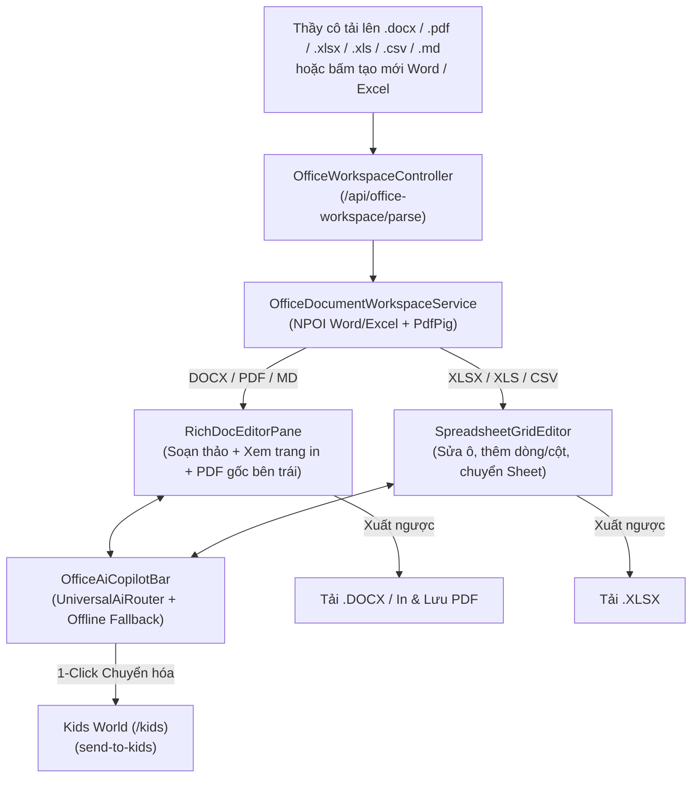

# 📄 AEGIS OFFICE-FREE STUDIO & AI OFFICE CO-PILOT — PHÂN TÍCH KIẾN TRÚC & CẨM NANG THỰC HÀNH

> **Hệ sinh thái**: **AEGIS GLOBAL COGNITIVE INFRASTRUCTURE (AGCI)**  
> **Phân hệ**: **Office-Free Document & Spreadsheet Studio (`/office-studio`)**  
> **Chuẩn tài liệu**: **ALDS v1.0 (Aegis Living Documentation Standard)**

---

## I. ĐẶT VẤN ĐỀ & TRIẾT LÝ KIẾN TRÚC (WHY OFFICE-FREE STUDIO?)

Trong thực tế giảng dạy tại nhiều trường học, thầy cô thường xuyên gặp 3 rào cản:
1. **Máy tính phòng máy / máy chiếu không cài sẵn Microsoft Office** hoặc hết hạn bản quyền, không mở hoặc sửa nhanh được giáo án `.docx` hay bảng điểm `.xlsx`.
2. **Tài liệu PDF chỉ đọc được, rất khó trích xuất để soạn lại giáo án hoặc tạo câu hỏi trắc nghiệm** (phải copy-paste thủ công dễ vỡ định dạng).
3. **Thao tác lặp lại tốn thời gian**: Sau khi có nội dung Word/PDF/Excel, thầy cô lại phải mất thêm hàng giờ để tóm tắt, soạn đề kiểm tra, dịch song ngữ hoặc phân tích điểm số từng học sinh.

**Aegis Office-Free Studio** giải quyết triệt để cả 3 bài toán theo nguyên lý **Gọn nhẹ Tối đa — Không Phụ thuộc Office (Zero MS Office, Zero Extra Container)**:
* **Tận dụng lõi thư viện thuần server sẵn có**: Dùng `NPOI 2.7.6` (đọc/ghi `.docx`, `.xlsx`, `.xls`) và `PdfPig 0.1.16` (bóc tách `.pdf`) ngay trong .NET Backend mà không cần cài MS Office hay dựng thêm container nặng nề.
* **Chỉnh sửa theo Cấu trúc Ngữ nghĩa (Structured Editing)**: Tự động chuyển tài liệu Word/PDF thành Markdown sạch (giữ nguyên tiêu đề `H1/H2/H3`, danh sách, bảng biểu, công thức Toán `$...$`) và chuyển Excel thành lưới bảng tính trực quan.
* **Tích hợp AI Co-Pilot & Hệ sinh thái Aegis 1 chạm**: Biến tài liệu tĩnh thành **Giáo án chuẩn sư phạm**, **Bộ câu hỏi trắc nghiệm**, **Báo cáo phân tích bảng điểm**, hoặc **Bài học tương tác Kids World (`/kids`)**.

---

## II. KIẾN TRÚC HỆ THỐNG & LUỒNG XỬ LÝ (ALDS v1.0)

### Cơ chế Tự phục hồi Khi Mất Mạng / Chưa Cấu hình LLM (Resilient Fallback)
Mọi yêu cầu tới `POST /api/office-workspace/ai-assist` đều đi qua `IUniversalAiRouter`. Nếu hệ thống đang chạy offline hoặc chưa cấu hình khóa API LLM bên ngoài, `OfficeDocumentWorkspaceService.RunAiAssistAsync` tự động kích hoạt **Offline Assistant**:
* Với bảng tính (`ANALYZE_SHEET`): Tự động quét toàn bộ ô số, tính toán **số lượng bản ghi, điểm trung bình, điểm cao nhất, điểm thấp nhất** và xuất báo cáo Markdown chuẩn xác.
* Với văn bản (`POLISH_LESSON`, `GENERATE_QUIZ`, `SUMMARIZE`): Tự động đóng khung cấu trúc sư phạm chuẩn từ nội dung gốc để thầy cô luôn có bản nháp chỉnh sửa ngay.

---

## III. CHI TIẾT 6 NĂNG LỰC AI OFFICE CO-PILOT

| Chế độ (`Action`) | Nút trên giao diện | Đầu vào | Đầu ra & Giá trị Sư phạm |
| :--- | :--- | :--- | :--- |
| `POLISH_LESSON` | **✨ Chuẩn hóa Giáo án** | Văn bản thô / PDF trích xuất | Cấu trúc lại thành giáo án chuẩn: *Mục tiêu $\rightarrow$ Khởi động $\rightarrow$ Hoạt động Khám phá $\rightarrow$ Tổng kết & Dặn dò*. |
| `GENERATE_QUIZ` | **📝 Sinh 5 Câu Trắc nghiệm** | Nội dung bài đọc / Word / PDF | Tạo ngay 5 câu hỏi 4 lựa chọn (`A, B, C, D`) kèm **Đáp án đúng** và **Giải thích ngắn gọn**. |
| `SUMMARIZE` | **📌 Tóm tắt** | Tài liệu dài nhiều trang | Rút gọn thành các ý trọng tâm (bullet points) và bảng thuật ngữ cần nhớ. |
| `TRANSLATE_BILINGUAL` | **🌐 Song ngữ Việt–Anh** | Giáo án / Phiếu bài tập | Chuyển sang bản song ngữ Việt – Anh rõ ràng, giữ nguyên tiêu đề và bảng biểu. |
| `ANALYZE_SHEET` | **📊 Phân tích Bảng điểm / Số liệu** | Bảng tính Excel nhiều dòng/cột | Thống kê xu hướng, chỉ ra học sinh nổi bật, nhóm cần hỗ trợ và đề xuất biện pháp bồi dưỡng. |
| `CUSTOM` | **🪄 AI Thực hiện** | Yêu cầu tự do của thầy cô | Thực thi mọi chỉ dẫn riêng (VD: *"Chuyển thành kịch bản kể chuyện 5 phút cho học sinh lớp 2"*). |

Ngoài ra, nút **🌈 Tạo bài Kids World** (`POST /api/office-workspace/send-to-kids`) kết nối trực tiếp với `IKidsCurriculumService`, tự động sinh các Hạt nhân Tri thức (`Concept Atoms`) để học sinh tiểu học/mầm non vào `/kids` chơi tương tác ngay.

---

## IV. HƯỚNG DẪN THỰC HÀNH QUA 3 VÍ DỤ CỤ THỂ

### Ví dụ 1: Biến 1 file PDF tài liệu Lịch sử thành Giáo án Word + Đề trắc nghiệm + Bài Kids World
* **Tình huống**: Cô giáo có sẵn file PDF `HaiBaTrung.pdf` tải trên mạng, máy tính lớp không có MS Word và không sửa được file PDF.
* **Các bước thực hiện (trong 30 giây)**:
  1. Mở **Office Studio** (`/office-studio`) trên thanh menu.
  2. Bấm **Mở File Office / PDF** $\rightarrow$ chọn `HaiBaTrung.pdf`.
  3. Màn hình tự động chia đôi: **bên trái hiển thị trang PDF gốc**, **bên phải là toàn bộ chữ đã bóc tách**.
  4. Trên thanh **AI Office Co-Pilot**, bấm **✨ Chuẩn hóa Giáo án** $\rightarrow$ xem kết quả gợi ý $\rightarrow$ bấm **Thay thế văn bản**.
  5. Bấm tiếp **📝 Sinh 5 Câu Trắc nghiệm** $\rightarrow$ bấm **Chèn xuống cuối** để ghép luôn 5 câu kiểm tra cuối giáo án.
  6. Bấm **Tải `.DOCX`** để lưu về máy file Word hoàn chỉnh (hoặc bấm **🌈 Tạo bài Kids World** để cho học sinh chơi ngay trên `/kids`).

### Ví dụ 2: Sửa & Phân tích Bảng điểm Excel (`BangDiem_Lop3A.xlsx`) không cần MS Excel
* **Tình huống**: Thầy giáo cần cập nhật điểm cho 2 học sinh mới và viết nhận xét cuối tháng từ file `BangDiem_Lop3A.xlsx`.
* **Các bước thực hiện**:
  1. Bấm **Mở File Office / PDF** $\rightarrow$ chọn `BangDiem_Lop3A.xlsx`.
  2. Hệ thống mở **Bảng tính trực quan (`SpreadsheetGridEditor`)**: bấm trực tiếp vào ô điểm để sửa, hoặc bấm **+ Thêm dòng** để bổ sung học sinh mới.
  3. Trên thanh **AI Office Co-Pilot**, bấm **📊 Phân tích Bảng điểm / Số liệu** $\rightarrow$ AI tính ngay điểm trung bình, chỉ ra em nào cần kèm thêm và gợi ý hoạt động nhóm.
  4. Bấm **Tải `.XLSX`** để xuất ra file Excel mới hoàn chỉnh mang đi nộp hoặc lưu trữ.

### Ví dụ 3: Soạn Giáo án Toán mới từ đầu có công thức & In ra PDF
* **Tình huống**: Cần soạn nhanh phiếu bài tập Toán trên máy tính không cài Office.
* **Các bước thực hiện**:
  1. Bấm **Word Mới** trên thanh công cụ.
  2. Dùng các nút nhanh trên thanh soạn thảo: **H1** (Tiêu đề), **Danh sách**, **Bảng**, **Công thức** (chèn `$a^2 + b^2 = c^2$`).
  3. Bật chế độ **Song song** để vừa gõ bên trái vừa xem bố cục trang in bên phải.
  4. Bấm **In / Lưu PDF** (chọn *Save as PDF* của trình duyệt) hoặc **Tải `.DOCX`**.

---

## V. BẢNG LIÊN KẾT MÃ NGUỒN SỐNG & BẰNG CHỨNG KIỂM CHỨNG (ALDS v1.0)

| Thành phần | Vai trò | Liên kết mã nguồn |
| :--- | :--- | :--- |
| **Interface & DTOs** | Hợp đồng Parse, Export DOCX/XLSX, AI Assist, Send-to-Kids | [IOfficeDocumentWorkspaceService.cs](file:///d:/Cuong/DuAn/mybank/AegisGlobal/Backend/src/Aegis.Application/Interfaces/IOfficeDocumentWorkspaceService.cs) |
| **Core Service & AI** | Đọc/ghi `NPOI`, giải mã OMML/MathType/ảnh qua `DocxParserService` & `IPdfToMarkdownTranspilerService`, `IUniversalAiRouter` + Offline Fallback | [OfficeDocumentWorkspaceService.cs](file:///d:/Cuong/DuAn/mybank/AegisGlobal/Backend/src/Aegis.Infrastructure/Services/OfficeDocumentWorkspaceService.cs), [DocxParserService.cs](file:///d:/Cuong/DuAn/mybank/AegisGlobal/Backend/src/Aegis.Infrastructure/Services/DocxParserService.cs) |
| **REST Controller** | 5 endpoints `/api/office-workspace/*` (`parse`, `export-docx`, `export-xlsx`, `ai-assist`, `send-to-kids`) | [OfficeWorkspaceController.cs](file:///d:/Cuong/DuAn/mybank/AegisGlobal/Backend/src/Aegis.API/Controllers/OfficeWorkspaceController.cs) |
| **Trang Office Studio** | Giao diện chính `/office-studio` (PDF Split-Screen, Auto-Save, Export `.docx`/`.xlsx`, In PDF) | [OfficeWorkspacePage.tsx](file:///d:/Cuong/DuAn/mybank/AegisGlobal/Frontend/src/pages/office/OfficeWorkspacePage.tsx) |
| **Soạn thảo Google Docs & Phân trang A4** | Soạn trực quan WYSIWYG (`VisualDocsCanvas`), Phân trang A4 (`Trang i / N`, 2 cột đề thi, căn lề, giãn dòng), Dàn ý tự động & Tìm/Thay thế | [RichDocEditorPane.tsx](file:///d:/Cuong/DuAn/mybank/AegisGlobal/Frontend/src/components/office/RichDocEditorPane.tsx), [VisualDocsCanvas.tsx](file:///d:/Cuong/DuAn/mybank/AegisGlobal/Frontend/src/components/office/VisualDocsCanvas.tsx), [PaginatedA4Viewer.tsx](file:///d:/Cuong/DuAn/mybank/AegisGlobal/Frontend/src/components/office/PaginatedA4Viewer.tsx), [DocumentOutlineSidebar.tsx](file:///d:/Cuong/DuAn/mybank/AegisGlobal/Frontend/src/components/office/DocumentOutlineSidebar.tsx), [FindReplaceBar.tsx](file:///d:/Cuong/DuAn/mybank/AegisGlobal/Frontend/src/components/office/FindReplaceBar.tsx) |
| **Render Toán & Ảnh Kích Thước Thật** | Render LaTeX/KaTeX + mhchem, giữ nguyên kích thước thật của ảnh minh họa raster (`PNG`/`JPEG`) | [MathRenderer.tsx](file:///d:/Cuong/DuAn/mybank/AegisGlobal/Frontend/src/components/common/MathRenderer.tsx), [mathHtmlCompiler.ts](file:///d:/Cuong/DuAn/mybank/AegisGlobal/Frontend/src/shared/lib/quiz/mathHtmlCompiler.ts), [MathFormulaStudioModal.tsx](file:///d:/Cuong/DuAn/mybank/AegisGlobal/Frontend/src/components/common/math-studio/MathFormulaStudioModal.tsx) |
| **Thanh AI Co-Pilot & Bảng Tính** | 6 hành động AI (render KaTeX trực tiếp), Send to Kids & Lưới Excel trực quan | [OfficeAiCopilotBar.tsx](file:///d:/Cuong/DuAn/mybank/AegisGlobal/Frontend/src/components/office/OfficeAiCopilotBar.tsx), [SpreadsheetGridEditor.tsx](file:///d:/Cuong/DuAn/mybank/AegisGlobal/Frontend/src/components/office/SpreadsheetGridEditor.tsx) |
| **Service Client & Routing** | Gọi API tải Blob & đăng ký route lazy `/office-studio` | [officeWorkspace.service.ts](file:///d:/Cuong/DuAn/mybank/AegisGlobal/Frontend/src/services/officeWorkspace.service.ts), [App.tsx](file:///d:/Cuong/DuAn/mybank/AegisGlobal/Frontend/src/App.tsx), [NavMenu.tsx](file:///d:/Cuong/DuAn/mybank/AegisGlobal/Frontend/src/widgets/app-header/NavMenu.tsx) |
| **Unit Tests Khoanh Vùng** | 3/3 test cases Passed (Round-trip DOCX, XLSX & AI Assist) | [OfficeDocumentWorkspaceServiceTests.cs](file:///d:/Cuong/DuAn/mybank/AegisGlobal/Backend/tests/Aegis.UnitTests/OfficeDocumentWorkspaceServiceTests.cs) |
