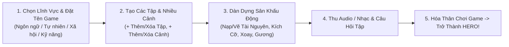

# 🦉 CẨM NANG THỰC HÀNH KIDS DYNAMIC STAGE & HERO GAME STUDIO (`/kids`)

> **Hệ sinh thái**: **AEGIS GLOBAL COGNITIVE INFRASTRUCTURE (AGCI)**  
> **Đối tượng sử dụng**: **Học sinh (3–11 tuổi & Học sinh lớn)** • **Thầy / Cô giáo Mầm non, Tiểu học, STEM** • **Phụ huynh**  
> **Chuẩn tài liệu**: **ALDS v1.0 (Aegis Living Documentation Standard)**

---

## I. TỔNG QUAN KHÔNG GIAN SÁNG TẠO `/kids`

Tại **`/kids`**, giao diện được thiết kế tinh gọn theo 3 lớp rõ ràng:
1. **Thanh Điều Hướng Trên Cùng (`KidsHeaderBar`)**:
   - **🏠 Trang chính**: Quay về màn hình chính của hệ thống bất cứ lúc nào.
   - **✨ Xưởng Sáng Tạo (`Maker Studio`)**: Mở Xưởng Đạo Diễn Sân Khấu Động 6 Lớp & Tạo Game Đa Tập.
   - **🏅 Hồ Sơ Bé & Bảo Tàng**: Đổi hồ sơ nhiều bé trên cùng 1 máy (không cần mật khẩu), xem Bảo tàng tác phẩm, Đại sảnh Hero và **Xuất/Nạp Băng Học Liệu Offline**.
   - **🟢 Online / 🟠 Offline**: Tự động hoạt động **100% không cần Internet** nhờ Service Worker & IndexedDB.
   - **⚙️ Giáo viên / Ba mẹ ▼**: Chứa AI Tạo Bài, Sân Khấu (DB), Duyệt Bài, Chọn Giọng Đọc/Tốc độ, và chuyển nhanh sang **Office Studio**.
2. **Sân Khấu Động 6 Lớp (`KidsDynamicStageCanvas`)**:
   - **Lớp 1 — Phông nền**: Gradient, Ảnh upload hoặc Video nền lặp (`MP4/WebM`).
   - **Lớp 2 — Hoạt cảnh chuyển động 60fps**: `☁️ Mây trôi ngang`, `🌧️ Mưa rơi`, `☀️ Mặt trời chiếu`, `🫧 Bọt biển nổi`, `🌸 Hoa lá bay`, `✨ Sao lấp lánh`.
   - **Lớp 3–6 — Phụ cảnh, Nhân vật Phụ, Nhân vật Chính (Hóa thân Hero) & Bổ trợ**: Có thể đặt tên riêng, kéo-thả vị trí, **phóng to/thu nhỏ (`0.4x – 2.2x` tạo chiều sâu gần–xa)**, **xoay góc (`-180° – 180°`)**, **lật gương (`Gương ↔`)**, gán chuyển động (`Nhún nhảy`, `Bay lơ lửng`, `Vẫy chào`) và viết bong bóng thoại.

---

## II. HƯỚNG DẪN CHI TIẾT CHO HỌC SINH (LÀM GAME ĐA TẬP HÓA THÂN HERO)

### Ví dụ thực hành: Em tạo bài học / game *"Hành Trình Trồng Cây Ăn Quả — Từ Hạt Giống Đến Mùa Quả Ngọt"* (3 Tập)

#### Bước 1: Mở Xưởng & Khởi tạo Game
1. Vào `/kids`, bấm nút **✨ Xưởng Sáng Tạo** trên thanh đầu trang (hoặc nút **+ Tạo Game / Khóa Học Mới** ở mục *Game Phiêu Lưu Đa Tập*).
2. Ở hàng trên cùng:
   - Chọn lĩnh vực: **`🌿 Học Tự Nhiên & STEM`**.
   - Đặt tên bài học/game: **`Hành Trình Trồng Cây Ăn Quả`**.
   - Đặt danh hiệu khi phá đảo: **`Kỹ Sư Vườn Cây Nhí`**.

#### Bước 2: Dựng Tập 1 — *Gieo Hạt Giống* (gồm 2 Cảnh)
* **Cảnh 1: Chuẩn bị đất & gieo hạt**
  1. Ở ô tên tập và tên cảnh, nhập **`Tập 1: Gieo Hạt Giống`** và **`Cảnh 1: Làm đất gieo hạt`**.
  2. Chọn Hoạt cảnh: **`☀️ Mặt trời chiếu`**.
  3. Bấm **Kho Tài Nguyên** $\rightarrow$ Tab **🏞️ Phông Nền** $\rightarrow$ chọn **Thảo Nguyên Nắng**.
  4. Bấm **Kho Tài Nguyên** $\rightarrow$ Tab **🌳 Phụ Cảnh** $\rightarrow$ Tạo nhanh emoji **`🌱`** với tên **`Hạt Giống Xoài`** (hoặc bấm **Tự Vẽ Mới** để tự vẽ hạt giống trên bảng vẽ!).
  5. Chạm vào **`Hạt Giống Xoài`** trên sân khấu, dùng thanh trượt **Kích cỡ** kéo xuống **`0.6x`** (nhỏ xíu nằm trên mặt đất), bấm vào vị trí gần giữa dưới sân khấu để đặt hạt.
  6. Chạm vào **Nhân Vật Chính** (`🦉` hoặc nhân vật em chọn), đặt tên **`Bé Nông Dân`** và gõ bong bóng thoại: *"Mình cùng gieo hạt giống xuống đất tơi xốp nhé!"*.
* **Cảnh 2: Tưới nước cho hạt**
  1. Bấm **+ Thêm Cảnh** $\rightarrow$ đặt tên **`Cảnh 2: Tưới nước mỗi ngày`**.
  2. Chọn Hoạt cảnh: **`🌧️ Mưa rơi`** (hoặc giữ trời nắng và thêm phụ cảnh bình tưới `🚿`).
  3. Bấm **Kho Tài Nguyên** $\rightarrow$ thêm một **Nhân vật Phụ** (ví dụ `🐰 Thỏ Con`), bấm nút **Gương ↔** để Thỏ Con quay mặt sang phía Nhân vật Chính đối thoại.
  4. Bấm **Thu Audio** để ghi âm giọng kể của chính em (ví dụ 10 giây kể về việc tưới nước đủ ẩm cho hạt nảy mầm).
  5. Nhập câu hỏi thử thách cuối Tập 1: *"Sau khi gieo hạt xuống đất, cây cần gì đầu tiên để nảy mầm?"*

#### Bước 3: Dựng Tập 2 — *Chăm Sóc & Nảy Mầm*
1. Bấm **+ Thêm Tập** $\rightarrow$ đặt tên **`Tập 2: Chăm Sóc Cây Con`**.
2. Thêm cây non (`🌿` hoặc `🌳`), kéo thanh **Kích cỡ** lên **`1.1x`** để thấy cây đã lớn hơn Tập 1!
3. Bấm **🪄 Rải Phụ Cảnh Ngẫu Nhiên** để tự động tạo thêm hoa, bướm, cỏ xanh xung quanh khu vườn cho sinh động.
4. Chọn một bông hoa hoặc con bướm không ưng ý rồi bấm biểu tượng **Thùng rác (Xóa)** nếu muốn dọn bớt, hoặc bấm **Nhân bản** để tạo thêm bụi hoa giống hệt rồi kéo ra góc xa (`0.6x`) tạo chiều sâu gần–xa.
5. Chọn Hoạt cảnh **`🌸 Hoa lá bay`** và viết lời dẫn: *"Nhờ ánh nắng và chăm bắt sâu, cây con đã vươn cao xanh tốt!"*.

#### Bước 4: Dựng Tập 3 — *Cây Cho Hoa Kết Trái*
1. Bấm **+ Thêm Tập** $\rightarrow$ đặt tên **`Tập 3: Mùa Quả Ngọt`**.
2. Phóng to cây ăn quả lên **`1.7x`**, thêm các phụ cảnh quả ngọt (`🥭`, `🍎`, `🍊`) và dùng nút **Nhân bản** để gắn nhiều quả lên tán cây (có thể **Xoay góc $15^\circ$ / $-15^\circ$** cho các quả nghiêng tự nhiên!).
3. Gõ câu hỏi cuối game: *"Để cây ăn quả ra nhiều hoa và kết trái ngọt, em cần làm gì?"*.

#### Bước 5: Hóa Thân Chơi Thử & Trở Thành Hero
1. Bấm **▶ Hóa Thân Chơi Thử**.
2. Nhập tên của em (VD: **`Minh Khôi`**), chọn hình đại diện (hoặc tranh em tự vẽ) rồi bấm **Bắt Đầu Hóa Thân — Tập 1**.
3. Nhân vật của em sẽ trực tiếp xuất hiện trên sân khấu qua cả 3 tập! Khi vượt qua câu hỏi cuối Tập 3, pháo hoa sẽ nổ tung và em chính thức nhận danh hiệu Hero **`"Kỹ Sư Vườn Cây Nhí"`** lưu vào Bảo Tàng!

---

## III. HƯỚNG DẪN CHI TIẾT CHO THẦY / CÔ GIÁO (SOẠN BÀI GIẢNG KHOA HỌC ĐỘNG & DẠY OFFLINE)

### Ví dụ thực hành: Cô giáo tạo bài giảng *"Chu Kỳ Của Nước Luân Chuyển Trên Trái Đất"* (4 Tập)

#### Bước 1: Cấu trúc Khóa học
1. Mở **✨ Xưởng Sáng Tạo**, chọn lĩnh vực **`🌿 Học Tự Nhiên & STEM`**.
2. Đặt tên bài giảng: **`Chu Kỳ Tuần Hoàn Của Nước`** • Danh hiệu Hero: **`Nhà Khí Tượng Học Nhí`**.

#### Bước 2: Thiết kế 4 Tập mô phỏng đúng quy luật Tự nhiên
| Tập & Cảnh | Hoạt cảnh (`Ambient`) | Sắp xếp Lớp Sân Khấu & Biến đổi (Kích cỡ / Xoay / Gương) | Lời giảng & Âm thanh |
| :--- | :--- | :--- | :--- |
| **Tập 1: Bốc Hơi** | `☀️ Mặt trời chiếu` | • Phông nền: **Đại Dương Sâu** • Nhân vật Bổ trợ: `☀️ Mặt Trời` đặt góc trên phải (`1.6x`) • Nhân vật Phụ: các giọt nước `💧` (bấm **Nhân bản** thành 3 giọt, gán chuyển động **Bay lơ lửng**, đặt kích cỡ `0.7x – 1.0x`) | Cô bấm **Thu Audio** giảng: *"Dưới sức nóng của Mặt Trời, nước biển bốc hơi bay lên cao!"* |
| **Tập 2: Ngưng Tụ Thành Mây** | `☁️ Mây trôi ngang` | • Phông nền: **Bầu Trời Xanh** • Phụ cảnh: `☁️ Đám Mây` (**Nhân bản** 3 đám mây: mây ở xa `0.6x`, mây ở gần `1.5x`, đặt tên `Mây Tầng Cao`, `Mây Tích Nước`) | Lời dẫn: *"Hơi nước lên cao gặp lạnh, ngưng tụ thành những đám mây bồng bềnh."* |
| **Tập 3: Mưa Rơi** | `🌧️ Mưa rơi` | • Phông nền: **Thảo Nguyên Nắng** (hoặc ảnh núi rừng cô tải lên từ **Kho Tài Nguyên**) • Phụ cảnh: `⛰️ Núi Đồi` (`1.4x`), `🌳 Cây Xanh`, dùng **🪄 Rải Phụ Cảnh Ngẫu Nhiên** tạo thảm thực vật | Câu hỏi cuối tập: *"Khi mây nặng trĩu giọt nước gặp lạnh sẽ tạo thành gì?"* (`Mưa rơi` / `Cầu vồng`) |
| **Tập 4: Dòng Chảy Về Biển** | `🫧 Bọt biển nổi` hoặc `☀️ Mặt trời chiếu` | • Có thể nạp **Video `.mp4` ngắn** dòng sông chảy ra biển qua **Kho Tài Nguyên $\rightarrow$ 🎬 Video** • Nhân vật Chính (`Hero`): `💧 Giọt Nước Nhí` lật **Gương ↔** chỉ hướng về biển khơi | Câu hỏi kết thúc: *"Chu kỳ của nước khép kín như thế nào?"* $\rightarrow$ Trao danh hiệu **`Nhà Khí Tượng Học Nhí`**! |

#### Bước 3: Tối ưu cho Lớp học Không Có Internet (Vùng sâu / Phòng máy Offline)
1. Bấm **💾 Lưu Khóa Học / Game** — bài giảng được lưu ngay vào bộ nhớ cục bộ (IndexedDB/LocalStorage) của máy giáo viên.
2. Nếu lớp học chỉ có **1 máy tính bảng / laptop dùng chung**: Cô mở **🏅 Hồ Sơ Bé & Bảo Tàng**, tạo sẵn các hồ sơ Avatar cho từng nhóm/học sinh (`Tổ 1 🦉`, `Tổ 2 🦊`, `Tổ 3 🐼`) để các em lần lượt hóa thân làm Hero và lưu thành tích riêng.
3. Để chép sang các máy khác không có Wi-Fi: Bấm **Xuất Băng Offline (`.aegis-pack.json`)**, copy qua USB/Bluetooth, rồi bấm **Nạp Băng Học Liệu** trên máy học sinh.

---

## IV. HƯỚNG DẪN TẠO BÀI HỌC NGÔN NGỮ: *"NGÔI NHÀ CỦA BÉ (MY SWEET HOME)"* & BỘ QUIZ ĐỒ VẬT

### 1. Hướng dẫn dàn dựng bài học Ngôn ngữ song ngữ Việt–Anh (3 Tập)
1. Mở **✨ Xưởng Sáng Tạo** $\rightarrow$ Chọn lĩnh vực **`🗣️ Học Ngôn Ngữ`**.
2. Đặt tên khóa học/game: **`Ngôi Nhà Của Bé (My Sweet Home)`** • Danh hiệu Hero: **`Đại Sứ Ngôn Ngữ Nhí`**.
3. Tạo **3 Tập** tương ứng với 3 căn phòng quen thuộc:
   * **Tập 1 — Phòng Khách Ấm Áp (`Living Room`)**:
     * *Phông nền*: Chọn nền sáng hoặc upload ảnh phòng khách từ **Kho Tài Nguyên**.
     * *Nhân vật Chính*: `🦉 Bé Na` (đặt lời thoại: *"Welcome to my living room!"*).
     * *Nhân vật Phụ*: `👩 Mẹ` (bấm **Gương ↔** để mẹ và bé quay mặt đối thoại).
     * *Phụ cảnh (đặt tên song ngữ trực tiếp)*: `🛋️ Ghế Sofa (Sofa)` (`1.3x`), `📺 Tivi (Television)` (`1.2x`), `🕰️ Đồng Hồ (Clock)` (`0.8x`), `🪴 Chậu Cây (Plant)` (`0.9x`).
     * *Audio*: Bấm **Thu Audio** đọc chậm rõ từng cặp từ (*"Sofa — Ghế sô pha, Clock — Đồng hồ"*).
   * **Tập 2 — Phòng Ngủ & Góc Học Tập (`Bedroom & Study`)**:
     * Thêm **2 Cảnh**: *Cảnh 1 (Ban ngày học bài)* chọn hoạt cảnh `☀️ Mặt trời chiếu` với `🪑 Bàn Ghế (Desk)` + `📖 Quyển Sách (Book)`; *Cảnh 2 (Ban đêm đi ngủ)* chọn hoạt cảnh `✨ Sao lấp lánh` với `🛏️ Giường Ngủ (Bed)` + `💡 Đèn Bàn (Lamp)`.
   * **Tập 3 — Gian Bếp Yêu Thương (`Kitchen`)**:
     * Thêm phụ cảnh: `🍽️ Bàn Ăn (Table)`, `🧊 Tủ Lạnh (Fridge)`, `☕ Tách Trà (Cup)`.

### 2. Bộ Bài Quiz Tương Tác Về Tên Các Đồ Vật Trong Nhà (Dán trực tiếp vào Câu hỏi Thử Thách)

Thầy cô hoặc phụ huynh có thể dán từng câu dưới đây vào ô **Câu hỏi thử thách cuối tập** trong Studio (hoặc dùng **AI Tạo Bài** tại `/kids` / **Office Studio** để tự động sinh thêm biến thể):

| Câu | Câu hỏi (Tiếng Việt / Song ngữ) | Các lựa chọn | Đáp án đúng & Gợi ý giải thích |
| :---: | :--- | :--- | :--- |
| **1** | Đồ vật nào trong phòng khách giúp cả nhà ngồi xem phim cùng nhau (`Sofa`)? | A. `🛋️ Ghế Sofa (Sofa)` B. `🧊 Tủ Lạnh (Fridge)` C. `🛏️ Giường Ngủ (Bed)` | **Đáp án A (`Sofa`)** — Chiếc ghế dài êm ái đặt ở phòng khách. |
| **2** | Đồ vật nào treo trên tường giúp bé xem giờ (`Clock`)? | A. `📺 Tivi (TV)` B. `🕰️ Đồng Hồ (Clock)` C. `💡 Đèn Bàn (Lamp)` | **Đáp án B (`Clock`)** — Đồng hồ có kim giờ và kim phút chỉ thời gian. |
| **3** | Khi học bài buổi tối, bé bật đồ vật nào để chiếu sáng trang sách (`Lamp`)? | A. `💡 Đèn Bàn (Lamp)` B. `🪴 Chậu Cây (Plant)` C. `🍽️ Bàn Ăn (Table)` | **Đáp án A (`Lamp`)** — Đèn bàn giúp bảo vệ đôi mắt khi đọc sách. |
| **4** | Trong phòng ngủ, bé nằm nghỉ ngơi trên đồ vật nào (`Bed`)? | A. `🪑 Ghế Tựa (Chair)` B. `🛏️ Giường Ngủ (Bed)` C. `📖 Quyển Sách (Book)` | **Đáp án B (`Bed`)** — Giường ngủ êm ấm giúp bé ngủ ngon mỗi tối. |
| **5** | Trong gian bếp, thiết bị nào giữ cho hoa quả và sữa luôn mát lạnh (`Fridge`)? | A. `☕ Tách Trà (Cup)` B. `📺 Tivi (TV)` C. `🧊 Tủ Lạnh (Fridge)` | **Đáp án C (`Fridge`)** — Tủ lạnh bảo quản thực phẩm tươi ngon cho cả nhà. |

---

## V. LIÊN KẾT MÃ NGUỒN SỐNG (ALDS v1.0)

| Thành phần | Chức năng | Mã nguồn |
| :--- | :--- | :--- |
| **Dynamic Course & Asset Registry** | Quản lý 4 lĩnh vực, Tập $\rightarrow$ Nhiều Cảnh, 6 loại Asset & Hall of Heroes | [kidsStudioRegistry.ts](file:///d:/Cuong/DuAn/mybank/AegisGlobal/Frontend/src/components/kids/kidsStudioRegistry.ts) |
| **Sân khấu Động 6 Lớp** | Render Phông nền/Video, Hoạt cảnh CSS Keyframe 60fps, Scale/Rotate/FlipX | [KidsDynamicStageCanvas.tsx](file:///d:/Cuong/DuAn/mybank/AegisGlobal/Frontend/src/components/kids/KidsDynamicStageCanvas.tsx) |
| **Xưởng Đạo Diễn Studio** | Tạo/Xóa Tập & Cảnh, Nhân bản, Rải phụ cảnh ngẫu nhiên, Thu âm | [KidsMakerStudioModal.tsx](file:///d:/Cuong/DuAn/mybank/AegisGlobal/Frontend/src/components/kids/KidsMakerStudioModal.tsx) |
| **Điều khiển Biến đổi & Đặt tên** | Kích cỡ (`0.4x–2.2x`), Xoay (`-180°–180°`), Gương, Đặt tên & Thoại | [KidsEntityTransformBar.tsx](file:///d:/Cuong/DuAn/mybank/AegisGlobal/Frontend/src/components/kids/KidsEntityTransformBar.tsx) |
| **Kho Tài Nguyên Mở** | Upload Ảnh/Video/Music/Audio, Tự vẽ Canvas, Tạo nhanh | [KidsAssetDrawer.tsx](file:///d:/Cuong/DuAn/mybank/AegisGlobal/Frontend/src/components/kids/KidsAssetDrawer.tsx) |
| **Trình Chơi Game Hóa Thân Hero** | Chọn Avatar hóa thân, vượt từng cảnh/tập, Lễ phong tước Hero | [KidsGameHeroPlayerModal.tsx](file:///d:/Cuong/DuAn/mybank/AegisGlobal/Frontend/src/components/kids/KidsGameHeroPlayerModal.tsx) |
| **Bảo Tàng & Offline Vault** | Multi-Kid Profiles, IndexedDB, Offline Fallback & Băng Học Liệu | [KidsCreativeMuseumModal.tsx](file:///d:/Cuong/DuAn/mybank/AegisGlobal/Frontend/src/components/kids/KidsCreativeMuseumModal.tsx), [kidsOfflineVault.ts](file:///d:/Cuong/DuAn/mybank/AegisGlobal/Frontend/src/components/kids/kidsOfflineVault.ts), [sw.js](file:///d:/Cuong/DuAn/mybank/AegisGlobal/Frontend/public/sw.js) |
