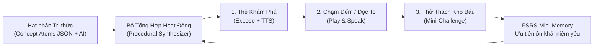

# 🦉 AEGIS KIDS WORLD & BỘ SINH ĐỀ MA TRẬN CHUẨN — HƯỚNG DẪN SỬ DỤNG TOÀN DIỆN

> **Hệ sinh thái**: **Aegis Global Cognitive Infrastructure (AGCI)**  
> **Đối tượng sử dụng**: Phụ huynh & Trẻ em (3–11 tuổi) · Học sinh THCS/THPT · Giáo viên · Bộ phận Đào tạo Doanh nghiệp  
> **Chuẩn tài liệu**: **ALDS v1.0 (Aegis Living Documentation Standard)**

---

## PHẦN I. AEGIS KIDS WORLD — HỌC TẬP ĐA GIÁC QUAN CHO TRẺ EM (3–11 TUỔI)

Khác với kho đề thi trắc nghiệm dành cho người lớn, **Kids World** vận hành bằng động cơ **Kids Cognitive Genesis Engine**: chỉ từ các **Hạt nhân Tri thức (`Concept Atoms`)**, hệ thống tự động biến hóa thành chuỗi trò chơi 4 pha giúp trẻ tiếp nhận tự nhiên qua **Hình ảnh $\rightarrow$ Âm thanh $\rightarrow$ Vận động $\rightarrow$ Phản xạ**.

### 1. Cách mở Kids World (1 Chạm)
- **Cách 1**: Mở trang luyện tập [`/practice`](http://localhost:3000/practice), bấm nút **🌈 Kids World** ở góc trên bên phải.
- **Cách 2**: Truy cập trực tiếp đường dẫn **`/practice?mode=kids`** (khuyên dùng để ghim thành lối tắt trên iPad / máy tính bảng cho bé).

### 2. Bản đồ 4 Đảo Phiêu Lưu & Hệ thống Thú Cưng
| Đảo Học Tập | Nhóm tuổi | Nội dung cốt lõi |
| :--- | :--- | :--- |
| **🦁 Đảo Tiếng Anh Kỳ Diệu** | 3–5, 6–8, 9–11 | Từ vựng song ngữ, phiên âm IPA, câu mẫu & luyện đọc to |
| **🧮 Đảo Toán Nhí Thông Minh** | 3–5, 6–8, 9–11 | Chạm đếm đồ vật trực quan, phép cộng/trừ/nhân cơ bản |
| **🚀 Đảo Khoa Học Khám Phá** | 3–5, 6–8, 9–11 | Mặt Trời, Hệ Mặt Trời, cây xanh, vòng tuần hoàn nước |
| **🌈 Đảo Cầu Vồng Tổng Hợp** | 3–5, 6–8, 9–11 | An toàn giao thông, đội mũ bảo hiểm, tái chế, kỹ năng sống |

- **Hệ thống Sao Trí Tuệ (`⭐`) & Tiến hóa Thú Cưng**: Mỗi bước hoàn thành mang lại `+1 ⭐`, giúp thú cưng đồng hành của bé tiến hóa qua 4 cấp: `🥚 Trứng Kỳ Diệu` $\rightarrow$ `🐣 Gà Con Thông Thái (5⭐)` $\rightarrow$ `🐉 Rồng Nhí Trí Tuệ (20⭐)` $\rightarrow$ `🦉 Vệ Binh Ngôi Sao (50⭐)`.

### 3. Trải nghiệm 4 Pha Sư phạm Trong Mỗi Chặng (3–4 phút)
1. **Khám phá (Discover & Listen)**: Thẻ chữ + Emoji lớn kèm giọng đọc tự động (hỗ trợ Tiếng Việt, Tiếng Anh và đa ngôn ngữ theo cấu hình hệ thống) và sự thật thú vị (`💡 Fun Fact`).
2. **Chạm Đếm / Đọc To (`INTERACT_COUNT` / `SPEAK_ECHO`)**:
   - Với **Toán nhí**: Bé chạm vào từng đồ vật trên màn hình để hệ thống đếm to `1, 2, 3...` rồi chọn số tương ứng.
   - Với **Ngôn ngữ / Khoa học**: Bé bấm nút **Bé Đọc To** cùng bạn Cú AstroOwl.
3. **Thử thách Kho Báu (`MINI_CHALLENGE`)**: Câu hỏi biến thể chọn thẻ hình lớn, nổ pháo giấy khi đúng và khích lệ nhẹ nhàng (không báo lỗi đỏ) khi bé chọn nhầm; đồng thời ghi nhận vào bộ nhớ **FSRS** để ngày hôm sau ưu tiên ôn lại đúng khái niệm bé còn yếu.

### 4. AI Tạo Chương Trình Mới (Dành cho Phụ huynh & Giáo viên)
1. Tại màn hình chính **Kids World**, bấm nút **🪄 AI Tạo Bài Mới** (`AI Builder`).
2. Nhập chủ đề bất kỳ (VD: *Khủng long kỷ Jura*, *Động vật dưới đáy biển*, *Phép cộng phạm vi 20*).
3. Chọn **Đảo**, **Nhóm tuổi (`3-5`, `6-8`, `9-11`)** và **Số hạt nhân (2–6)** $\rightarrow$ bấm **Sinh Chương Trình & Chơi Ngay**. Bộ hạt nhân mới được lưu cô lập theo từng Tenant/Đơn vị để bé chơi lại nhiều lần.

### 5. Khóa Phụ Huynh (Parent Gate)
Khi đang ở **Kids World**, bấm **🌈 Thoát Kids** ở thanh trên cùng, hệ thống yêu cầu giải nhanh một phép tính nhỏ (VD: `7 + 8 = ?`) để tránh trẻ em bấm nhầm thoát ra giao diện người lớn.

---

## PHẦN II. BỘ SINH ĐỀ MA TRẬN CHUẨN BỘ GD&ĐT & QUY CHUẨN CÔNG TY

Phân hệ này hoạt động song song tại **Creator Zen Studio** (dành cho Giáo viên / Chuyên viên đào tạo soạn & xuất bản đề) và **Practice** (dành cho Học sinh / Nhân viên vào thi thử ngay).

### 1. Kiến trúc Khung Ma trận × Tọa độ Động
- Hệ thống tách **Khung cấu trúc đề** (Số phần, Dạng câu hỏi, Tỷ lệ Bloom, Thời gian) khỏi **Tọa độ Môn học & Khối lớp**:
  - **Chuẩn Bộ GD&ĐT (GDPT 2025)**: Hỗ trợ cấu trúc 3 phần (Trắc nghiệm 1 đáp án `SINGLE` + Đúng/Sai chùm `MULTI_TRUE_FALSE` + Trả lời ngắn `SHORT_ANSWER`) cho Toán, Vật Lý, Hóa Học, Sinh Học, Tiếng Anh và khung THCS 45p dùng chung Lớp 6–9.
  - **Quy chuẩn Công ty**: Sát hạch Tín dụng & AML (`BANKING`), An toàn thông tin ISO 27001 (`IT_SECURITY`), An toàn Lao động (`HSE`), và cho phép từng Công ty **tự thiết kế & lưu bộ quy chuẩn riêng** theo `TenantId`.
- **Cô lập Môn & Khối lớp (Tokenized Coordinate Resolution)**: Toán khối 7 (`TOAN` + `K07`) tuyệt đối không trộn câu hỏi Toán khối 12 (`TOAN_K12`).
- **Soi Tồn Kho Thời Gian Thực (Live Bank Inventory)**: Hiển thị ngay số câu thật đang có trong kho theo từng phần (`25/12 ✓`, `8/4 ✓`, `12/6 ✓`) trước khi bấm sinh đề.

### 2. Hướng dẫn Sử dụng Nhanh
- **Trong Practice (`/practice`)**:
  1. Chọn tab **Thi Theo Ma Trận Chuẩn (Bộ GD&ĐT / Công ty)**.
  2. Chọn **Khung Ma trận**, **Môn học** và **Khối lớp** (các khối có dữ liệu được đánh dấu `✓`).
  3. Chọn chế độ **Thi thử (Tính giờ)** hoặc **Ôn luyện (Xem giải thích ngay)** $\rightarrow$ bấm **Vào Thi Ngay**.
- **Trong Creator Zen Studio**:
  1. Mở trình tạo đề theo Ma trận (`ExamMatrixWizardModal`).
  2. Tùy chỉnh các phần câu hỏi, tỷ lệ 4 mức Bloom (`Nhận biết`, `Thông hiểu`, `Vận dụng`, `Vận dụng cao`).
  3. Bấm **Lưu Quy Chuẩn Công Ty** để lưu mẫu dùng chung cho toàn đơn vị, hoặc bấm **Sinh Đề Từ Kho Thật** để đưa vào bảng biên tập/xuất Word/QTI/Arena của Zen Studio.

---

## PHẦN III. LIÊN KẾT MÃ NGUỒN SỐNG (ALDS v1.0)

| Thành phần | Vai trò | Mã nguồn sống |
| :--- | :--- | :--- |
| **Kho Hạt nhân Kids World** | 21+ Concept Atoms cho 4 đảo & 3 lứa tuổi | [default_kids_concept_atoms.json](file:///d:/Cuong/DuAn/mybank/AegisGlobal/Backend/src/Aegis.Application/Resources/Taxonomies/default_kids_concept_atoms.json) |
| **Kids Genesis Engine** | Tổng hợp bài học 4 pha & AI Curriculum Builder | [KidsCurriculumService.cs](file:///d:/Cuong/DuAn/mybank/AegisGlobal/Backend/src/Aegis.Infrastructure/Services/KidsCurriculumService.cs) |
| **Kids World API** | Endpoints `/api/kids/atoms`, `/daily-adventure`, `/ai-build-curriculum` | [KidsWorldController.cs](file:///d:/Cuong/DuAn/mybank/AegisGlobal/Backend/src/Aegis.API/Controllers/KidsWorldController.cs) |
| **Giao diện Kids World** | Bản đồ Đảo, Trình chơi 4 bước, TTS & Khóa Phụ Huynh | [KidsWorldHub.tsx](file:///d:/Cuong/DuAn/mybank/AegisGlobal/Frontend/src/components/kids/KidsWorldHub.tsx), [KidsLessonPlayer.tsx](file:///d:/Cuong/DuAn/mybank/AegisGlobal/Frontend/src/components/kids/KidsLessonPlayer.tsx), [KidsAiBuilderModal.tsx](file:///d:/Cuong/DuAn/mybank/AegisGlobal/Frontend/src/components/kids/KidsAiBuilderModal.tsx), [KidsParentGateModal.tsx](file:///d:/Cuong/DuAn/mybank/AegisGlobal/Frontend/src/components/kids/KidsParentGateModal.tsx) |
| **Bộ Sinh Đề Ma Trận** | Sinh đề kho thật, giải mã đa tọa độ & soi tồn kho | [ExamMatrixGeneratorService.cs](file:///d:/Cuong/DuAn/mybank/AegisGlobal/Backend/src/Aegis.Infrastructure/Services/ExamMatrixGeneratorService.cs), [PracticeMatrixLauncher.tsx](file:///d:/Cuong/DuAn/mybank/AegisGlobal/Frontend/src/components/quiz/PracticeMatrixLauncher.tsx), [ExamMatrixWizardModal.tsx](file:///d:/Cuong/DuAn/mybank/AegisGlobal/Frontend/src/pages/creator/studio/components/ExamMatrixWizardModal.tsx) |
| **Unit Tests Khoanh Vùng** | Kiểm chứng Kids Genesis (3 tests) & Ma trận (5 tests) | [KidsCurriculumServiceTests.cs](file:///d:/Cuong/DuAn/mybank/AegisGlobal/Backend/tests/Aegis.UnitTests/KidsCurriculumServiceTests.cs), [ExamMatrixGeneratorTests.cs](file:///d:/Cuong/DuAn/mybank/AegisGlobal/Backend/tests/Aegis.UnitTests/ExamMatrixGeneratorTests.cs) |
