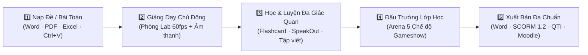

# 🎓 CẨM NANG SỬ DỤNG AEGIS GLOBAL — DÀNH CHO GIÁO VIÊN & HỌC VIÊN

> 🌐 **Cổng đào tạo trực tuyến**: **[https://daotao.dehoc.vn](https://daotao.dehoc.vn)**  
> 🎯 **Triết lý thiết kế**: *3 chạm làm chủ · Không cần kỹ thuật · Trực quan 60fps · Đa giác quan*

---

## 🗺️ BẢN ĐỒ HÀNH TRÌNH 1 PHÚT (NHÌN LÀ HIỂU NGAY)

---

## 1️⃣ BẮT ĐẦU TRONG 10 GIÂY: NẠP ĐỀ & TỰ ĐỘNG PHÂN LOẠI

- **Địa chỉ**: **[https://daotao.dehoc.vn/creator/studio](https://daotao.dehoc.vn/creator/studio)** (hoặc **Ngân hàng Câu hỏi** `/admin/questions`).
- **Thao tác 3 chạm**:
  1. Kéo-thả hoặc bấm chọn tệp **Word (`.docx`), PDF, hoặc Excel** (chứa công thức Toán/Lý/Hóa đều giữ nguyên chuẩn đẹp).
  2. Hệ thống tự động bóc tách **Đề $\rightarrow$ Phần $\rightarrow$ Câu $\rightarrow$ Ý $\rightarrow$ Đáp án & Lời giải** và tự nhận diện **5 trục tọa độ** (*Ngành, Môn + Khối lớp như `TOAN_K12`, `TIENG_ANH_K12`, Kỳ thi, Cơ quan ban hành, Năm học*).
  3. Bấm **Lưu vào Kho** để giao bài QR ngay hoặc mở **Đấu trường Arena**.

> 💡 **Mẹo lọc đề siêu nhanh**: Tại `/admin/questions`, bấm **Cây phả hệ (Pivot Tree)** hoặc **Ma trận tri thức** để lọc tức thì đúng Môn học × Khối lớp × Kỳ thi chỉ với 1 cú nhấp chuột.

---

## 2️⃣ PHÒNG LAB BÀI GIẢNG ĐỘNG 60FPS (`/visual-lab`)

> **Cách mở 1-chạm**: Bấm tab **`Phòng Lab 60fps`** ngay trên thanh điều hướng của **Zen Studio** hoặc **Menu chính** (`https://daotao.dehoc.vn/visual-lab`).

### Ba tính năng giúp tiết dạy Toán – Lý "sống động như phim khoa học"
1. **Nạp Đề / Bài Toán Bất Kỳ $\rightarrow$ Visual 60fps**:
   - Bấm nút **`Nạp Đề / Bài Toán Bất Kỳ`**.
   - **Dán trực tiếp** đề bài (hỗ trợ **`Ctrl+V` thẳng công thức từ Microsoft Word / MathType / ảnh chụp** — tự động đổi sang LaTeX và xem trước ngay) **hoặc tải lên tệp `.docx`/`.pdf`**.
   - Hệ thống tự dựng đồ thị biến đổi theo thời gian $f(x,t)$, quỹ đạo tham số $(x(t), y(t))$, họ đường cong tham số $m$, hoặc hình khối không gian **3D xoay 360°**.
2. **Điều khiển Thời gian Thực 60fps + Âm thanh Phụ họa & Thuyết minh Neural TTS**:
   - Bấm **`Chạy t` (Play)** / **`Tạm dừng`** / kéo thanh trượt **`t`** để dừng đúng khoảnh khắc mấu chốt (ví dụ vật ném xiên đạt đỉnh $v_y = 0$, hay đỉnh sóng cơ dịch chuyển).
   - Công thức **KaTeX biến đổi từng pha** bên dưới tự động chuyển cảnh đồng bộ kèm **âm thanh chuông tinh thể 0ms**. Bật thêm nút **`Thuyết minh`** để hệ thống tự đọc giải thích từng pha bằng **giọng đọc Neural tiếng Việt tự nhiên**.
3. **Chiếu Bảng Khổ Rộng, Chụp Ảnh PNG & Kết nối Office Studio**:
   - Bấm **`Chiếu bảng`** để mở rộng đồ thị (`fullWidth`) sắc nét trên máy chiếu, hoặc bấm **`📸 PNG`** ngay trên góc đồ thị để tải ảnh chất lượng cao.
   - Bấm **`Chia sẻ Link lớp`** gửi cho học sinh, hoặc bấm **`📄 Mở Office Studio`** để chuyển thẳng bài giảng cùng toàn bộ công thức KaTeX sang trang soạn thảo A4.
   - Kho bài giảng mẫu đa dạng: Sóng cơ, Ném xiên, Hàm bậc ba & Đạo hàm, Họ Parabol tham số $m$, **Đường tròn Lượng giác $(\cos t, \sin t)$**, **Dao động điều hòa**, **Hình chóp & Hình trụ 3D xoay 360°** (hỗ trợ **Mặt cắt 3D**, **Hình chiếu trực giao xuống mặt đáy**), và **Lab Va chạm Vật lý 2D**.
4. **🎬 Xuất Video Bài Giảng Dọc YouTube Shorts / TikTok (`9:16`) — 3 Bước Làm Phim Khoa Học**:
   - Bấm nút **`🎬 Xuất Video Shorts 9:16`** ngay trên thanh công cụ đầu trang `/visual-lab`.
   - Chọn **Kịch bản**: *"Cát tuyến $\rightarrow$ Tiếp tuyến ($\Delta x \to 0$)"* hoặc *"Bài giảng đang chọn"*, rồi chọn **1 trong 6 ngôn ngữ thuyết minh** (*Tiếng Việt, English, 日本語, 한국어, 中文, Français*).
   - Bấm **`Xem thử 9:16`** để kiểm tra, sau đó bấm **`Tải Shorts (.mp4)`** — hệ thống tự động ghép đồ thị biến thiên 60fps + giọng đọc AI + nhạc nền 432Hz thành file video hoàn chỉnh!

---

## 3️⃣ LUYỆN TẬP ĐA GIÁC QUAN & PHÁT ÂM AI (`/practice`)

- **Địa chỉ**: **[https://daotao.dehoc.vn/practice](https://daotao.dehoc.vn/practice)**
- Bấm **`Tùy chọn`** để tự do bật/tắt **Xáo đáp án**, **Xáo câu hỏi**, **Giới hạn thời gian từng câu** (hoạt động linh hoạt cả ở **Chế độ Trẻ em**).
- **6 Trải nghiệm tương tác vượt trội**:
  1. **⚡ Chạm từ ghép câu siêu tốc (`ORDERING`)**: Chạm từng thẻ từ để ghép câu cực nhanh (hoặc đổi sang kéo-thả).
  2. **✍️ Điền từ & Chữ cái khuyết (`FILL_BLANK`)**: Ô gõ tốc độ cao kèm gợi ý chữ cái khuyết (`c _ m p _ t _ r`).
  3. **🃏 Lật thẻ trí nhớ (`MATCHING`)**: Bấm **`Lật thẻ trí nhớ`** để biến bài ghép cặp thành trò chơi lật thẻ tìm cặp đôi.
  4. **🧠 Glenn Doman Rapid Flashcard + FSRS (`FLASHCARD_RAPID`)**: Tráo thẻ tự động `1.0s – 2.2s` kèm phát âm bản xứ và lịch nhắc ôn thông minh FSRS v5.
  5. **🖊️ Tập viết & Vẽ nét Canvas (`HANDWRITING`)**: Tập tô chữ cái, viết chữ Hán/Nhật/Hàn hoặc ký hiệu Toán theo nét mờ gợi ý.
  6. **🎙️ Speak Out AI & Shadowing (`SPEAK_OUT`)**: Hỗ trợ 6 ngôn ngữ (`EN-US`, `VI`, `JA`, `ZH`, `KO`, `FR`). Bấm **`Shadowing`** để nghe mẫu $\rightarrow$ đếm nhịp `2..1` $\rightarrow$ thu âm nhại lại tức thời và chấm `%` khớp từng từ (xanh = chuẩn, đỏ = cần sửa).

---

## 4️⃣ ĐẤU TRƯỜNG TRỰC TIẾP TRÊN LỚP — AEGIS ARENA (`/arena`)

- **Địa chỉ**: **[https://daotao.dehoc.vn/arena](https://daotao.dehoc.vn/arena)** (chi tiết luật chơi xem thêm tại [`ARENA_GAMESHOW_USER_MANUAL.md`](file:///d:/Cuong/DuAn/mybank/AegisGlobal/docs/ARENA_GAMESHOW_USER_MANUAL.md)).
- **Cách mở trong 10 giây**: Từ **Zen Studio** hoặc **Arena** $\rightarrow$ Chọn bộ đề $\rightarrow$ Chọn **1 trong 5 chế độ** $\rightarrow$ Chiếu **Mã QR** lên bảng để học sinh quét vào thi ngay:
  1. **🔔 Rung Chuông Vàng**: 30 – 10.000 học sinh thi cùng lúc, có nút **Cứu Trợ** cả lớp.
  2. **⚡ Nhanh Như Chớp**: Leo dốc 10 bậc, sai tụt về 0 — cực hợp kiểm tra 15 phút.
  3. **🏆 Olympia Supreme**: 4 đội/thí sinh qua 4 vòng truyền hình (*Khởi Động, VCNV, Tăng Tốc, Về Đích*).
  4. **👑 Ai Là Triệu Phú**: Kiểm tra miệng 1–1 với 4 quyền trợ giúp (50:50, AI, Hỏi cả lớp qua QR, Đổi câu).
  5. **🎓 Đấu Trường Đại Học**: Đối kháng 2 đội (4 vs 4) bấm chuông `<2ms`.

---

## 5️⃣ XUẤT BẢN ĐA NỀN TẢNG & TRỢ LÝ AI (`Ctrl + J`)

- **Xuất đề chuẩn quốc tế**: Hỗ trợ xuất ra **Word (`.docx`)**, **QTI 3.0** (Canvas, Blackboard), **Moodle XML / GIFT**, và **ADL SCORM 1.2 (`.scorm12.zip`)** chạy trực tiếp trên mọi hệ thống LMS trường học & doanh nghiệp.
- **Trợ lý AI Co-Pilot (`Ctrl + J`)**: Nhấn `Ctrl + J` ở bất kỳ màn hình nào để nhờ AI giải thích bài tập dễ hiểu theo cấp lớp, tạo câu hỏi mới hoặc tóm tắt kiến thức.

---

## 6️⃣ OFFICE-FREE STUDIO & AI OFFICE CO-PILOT (`/office-studio`)

- **Địa chỉ**: **Office Studio** ngay trên thanh menu chính (`/office-studio`) — xem phân tích kiến trúc & ví dụ thực hành chi tiết tại [`AEGIS_OFFICE_FREE_STUDIO_GUIDE.md`](file:///d:/Cuong/DuAn/mybank/AegisGlobal/docs/AEGIS_OFFICE_FREE_STUDIO_GUIDE.md).
- **Không cần cài Microsoft Office**:
  1. **Mở & Sửa Word (`.docx`), PDF, Excel (`.xlsx`/`.xls`/`.csv`)**: Tự động giải mã công thức Toán OMML/MathType/PDF, giữ nguyên kích thước thật hình ảnh minh họa; riêng **PDF** hiển thị song song bản gốc bên trái và vùng chỉnh sửa bên phải.
  2. **Soạn thảo chuẩn Google Docs & Phân trang A4**: Chọn **Google Docs** (sửa trực quan), **Song song LaTeX** (KaTeX + `KaTeX Studio`), hoặc **Phân trang A4** (`Trang i / N`, căn lề, giãn dòng, **2 Cột Đề thi**, `Ngắt trang`), tự động lưu liên tục, rồi bấm **Tải `.DOCX`**, **Tải `.XLSX`** hoặc **In / Lưu PDF**.
  3. **AI Office Co-Pilot 1 chạm**:
     - **✨ Chuẩn hóa Giáo án**: Biến văn bản thô thành giáo án chuẩn sư phạm.
     - **📝 Sinh 5 Câu Trắc nghiệm**: Tự động tạo câu hỏi A/B/C/D kèm đáp án từ tài liệu/PDF.
     - **📌 Tóm tắt / 🌐 Song ngữ Việt–Anh**: Rút gọn ý chính hoặc dịch song ngữ giữ nguyên bảng biểu.
     - **📊 Phân tích Bảng điểm (Excel)**: Tự động thống kê điểm trung bình, cao nhất/thấp nhất và gợi ý bồi dưỡng.
     - **🌈 Tạo bài Kids World**: Chuyển thẳng tài liệu đang soạn thành bài học tương tác trên `/kids`.

---

## 7️⃣ AEGIS NOTEBOOK STUDIO — BIẾN GIÁO TRÌNH THÀNH PODCAST & VIDEO TỔNG QUAN

- **Cách thực hiện 3 bước**:
  1. Mở **Notebooks** (`/admin/notebooks`) $\rightarrow$ Tải lên các file Word, PDF hoặc giáo trình của môn học.
  2. Tại bảng **Studio** bên phải, chọn loại học liệu muốn sinh:
     - **🎙️ Podcast 2 MC**: Tự động tạo hội thoại 2 MC (*Cô Hoài Mỹ & Chú Nam Minh*) thảo luận sâu sắc nội dung bài học.
     - **🎬 Video Tổng quan**: Sinh bộ slide hoạt họa 60fps kèm thuyết minh Neural TTS và nhạc nền 432Hz dịu nhẹ. Bấm **`Tải Video Có Tiếng (.mp4 / .webm)`** để lưu về máy gửi cho học sinh ôn bài.
     - **🧠 Sơ đồ Tư duy, Cẩm nang Ôn tập, FAQ, Dòng thời gian, Flashcards**: Tạo trong 1 chạm và chuyển thẳng sang **Office Studio** để in ấn.

---

## 8️⃣ NHẠC NỀN V-OS (`/music-studio`) & ĐỌC ĐỀ THI KỂ CẢ CÔNG THỨC TOÁN

- **Tạo nhạc nền bài giảng chuẩn 432Hz / 528Hz ([`/music-studio`](https://daotao.dehoc.vn/music-studio))**:
  1. Dán 1 đoạn thơ, lời giảng hoặc ý niệm tiếng Việt vào ô nhập.
  2. Chọn tần số **`432Hz`** (thư giãn, tập trung) hoặc **`528Hz`** $\rightarrow$ Bấm **`Biên dịch V-OS 7D & Phát Nhạc`**.
  3. Bấm **`.WAV`** để tải file nhạc nền không lời về ghép vào bài giảng, hoặc copy Prompt sang **Suno v5.5/v6+**, **Google Lyria**, **Omni Veo**.
- **Đọc Đề Thi Hỗ Trợ Học Sinh (Accessibility & Tiểu học)**:
  - Trong phòng thi/luyện tập, bấm nút **`🔊 Đọc đề`** ở góc trên bên phải mỗi câu hỏi: hệ thống tự động đọc tuần tự *Ngữ cảnh $\rightarrow$ Câu hỏi $\rightarrow$ Đáp án A, B, C, D*, **kể cả công thức Toán học LaTeX** ($\frac{a}{b}$, $x^2$, $\sqrt{x}$, $\int_0^1$) bằng **6 giọng Nam/Nữ theo độ tuổi** (*Bé Bảo Ngọc, Bé Minh Khang, Chị Linh Chi, Anh Tuấn Kiệt, Cô Hoài Mỹ, Chú Nam Minh*).

---

## 📋 BẢNG TRA CỨU NHANH 1 CHẠM

| Mục tiêu của bạn | Truy cập nhanh |
|---|---|
| Đọc/Sửa Word, Excel, PDF không cần MS Office + AI Co-Pilot | [`/office-studio`](https://daotao.dehoc.vn/office-studio) |
| Thế Giới Tuổi Thơ 5 Vương quốc & AI Huyền tích (6 giọng đọc) | [`/kids`](https://daotao.dehoc.vn/kids) |
| Trình chiếu 60fps (3D Mặt cắt, Va chạm 2D) & **Xuất Video Shorts 9:16** | [`/visual-lab`](https://daotao.dehoc.vn/visual-lab) |
| Tạo **Nhạc nền 432Hz/528Hz (.WAV)** & Prompt Suno v6 / Lyria / Veo | [`/music-studio`](https://daotao.dehoc.vn/music-studio) |
| Soạn & nạp đề Word/PDF/Excel trong 10 giây | [`/creator/studio`](https://daotao.dehoc.vn/creator/studio) |
| Quản lý kho câu hỏi, lọc Cây Phả Hệ & Ma trận | [`/admin/questions`](https://daotao.dehoc.vn/admin/questions) |
| Học sinh tự luyện đa giác quan, Flashcard, SpeakOut & **Đọc đề Toán** | [`/practice`](https://daotao.dehoc.vn/practice) |
| Tổ chức Gameshow thi đấu trực tiếp cả lớp | [`/arena`](https://daotao.dehoc.vn/arena) |
