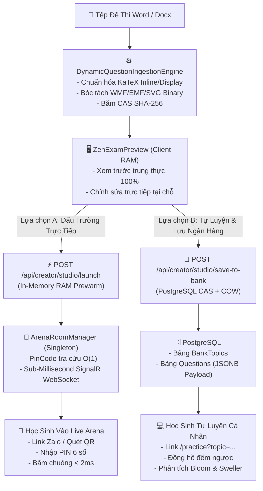

# 🏛️ AEGIS DUAL-MODE ASSESSMENT & INGESTION ARCHITECTURE (ALDS v1.0)

> **Mã hồ sơ**: `ARCH-ASSESSMENT-DUALMODE-2026`  
> **Phiên bản**: `v3.0.0 (Global Sovereign Standard)`  
> **Chủ nhiệm thiết kế**: **No.1 — World-Class Polymath Chief Architect & Principal Systems Engineer**  
> **Tiêu chuẩn tài liệu sống**: Tuân thủ 5 Trụ cột **ALDS v1.0** ([`docs/standards/AEGIS_LIVING_DOCUMENTATION_STANDARD.md`](file:///d:/Cuong/DuAn/mybank/AegisQuiz/docs/standards/AEGIS_LIVING_DOCUMENTATION_STANDARD.md))

---

## 1. TỔNG QUAN KIẾN TRÚC KHẢO THÍ ĐA PHƯƠNG THỨC (EXECUTIVE SUMMARY)

Hệ thống **AEGIS GLOBAL COGNITIVE INFRASTRUCTURE (AGCI)** giải quyết triệt để sự mâu thuẫn giữa hai nhu cầu khảo thí đối lập trong giáo dục hiện đại:
1. **Khảo thí Tương tác Trực tiếp (Synchronous / Live Competitive Assessment)**: Đòi hỏi độ trễ cực thấp ($< 2\text{ms}$ buzzer), không phụ thuộc vào tốc độ ghi đĩa cơ sở dữ liệu (Zero-DB-Hit), tính cạnh tranh cao, khuấy động lớp học và kích thích phản xạ.
2. **Khảo thí Tự luyện Bất đồng bộ & Lưu trữ Dài hạn (Asynchronous / Self-Paced Practice & Knowledge Repository)**: Đòi hỏi tính bền vững dữ liệu (ACID), mô hình tâm trắc học IRT 3-PL, thuật toán lặp ngắt quãng FSRS v5, và cơ chế băm Content-Addressable Storage (CAS) + Copy-On-Write (COW) khử trùng lặp toàn cầu.

Từ không gian **Creator Zen Studio** ([`CreatorZenStudioPage.tsx`](file:///d:/Cuong/DuAn/mybank/AegisQuiz/Frontend/src/pages/creator/studio/CreatorZenStudioPage.tsx)), giáo viên có thể chuyển đổi linh hoạt chỉ bằng một chạm giữa hai chế độ này mà không cần cấu hình kỹ thuật phức tạp.

---

## 2. ĐẶC TẢ KỸ THUẬT & LIÊN KẾT MÃ NGUỒN SỐNG (CODE SYMBOL TRACEABILITY)

### 2.1. Hạt nhân Quản trị Đấu trường In-Memory ([`ArenaRoomManager.cs`](file:///d:/Cuong/DuAn/mybank/AegisQuiz/Backend/src/AegisQuiz.Infrastructure/Arena/ArenaRoomManager.cs))
* **Bảng băm mã PIN $O(1)$**: Sử dụng `ConcurrentDictionary<string, string> _pinToRoomId` ánh xạ mã PIN 6 số với `RoomId` nội bộ.
* **Prewarm RAM không chạm đĩa (Zero-DB-Hit)**: Phương thức `CreateRoomWithCustomQuestions` nạp trực tiếp danh sách câu hỏi Word (`ArenaQuestionItem`) vào `ArenaRoomState.Questions` trong bộ nhớ RAM, phục vụ tức thì cho SignalR Hub.
* **Tra cứu kép linh hoạt**: `GetRoom(string idOrPin)`, `JoinRoom(string idOrPin, ArenaPlayer player)` tự động nhận diện tham số đầu vào là mã PIN hay mã Room GUID.

### 2.2. Điểm đầu cuối API Điều phối ([`CreatorStudioController.cs`](file:///d:/Cuong/DuAn/mybank/AegisQuiz/Backend/src/AegisQuiz.API/Controllers/CreatorStudioController.cs))
* **Khởi tạo phòng đấu**: `POST /api/creator/studio/launch` chuyển đổi các trường dữ liệu `ZenQuestionPreviewDto` thành `ArenaQuestionItem` (bảo toàn phương án, đáp án gợi ý và lời giải).
* **Lưu ngân hàng tri thức**: `POST /api/creator/studio/save-to-bank` ghi nhận chủ đề vào [`BankTopic.cs`](file:///d:/Cuong/DuAn/mybank/AegisQuiz/Backend/src/AegisQuiz.Domain/Entities/BankTopic.cs) và thêm các thực thể [`SingleChoiceQuestion.cs`](file:///d:/Cuong/DuAn/mybank/AegisQuiz/Backend/src/AegisQuiz.Domain/Entities/QuestionBase.cs) với cấu trúc `Payload` JSONB.

### 2.3. Cổng vào Trực tuyến Không Rào Cản ([`ArenaJoinPage.tsx`](file:///d:/Cuong/DuAn/mybank/AegisQuiz/Frontend/src/pages/arena/ArenaJoinPage.tsx))
* Học sinh truy cập qua đường dẫn chia sẻ (VD: `/arena/join?pin=793406`) hoặc quét mã QR.
* Hệ thống ưu tiên tra cứu trực tiếp phòng qua API $O(1)$, lập tức đưa học sinh vào giao diện sàn đấu tương ứng ([`ArenaRoomPage.tsx`](file:///d:/Cuong/DuAn/mybank/AegisQuiz/Frontend/src/pages/arena/ArenaRoomPage.tsx)) với đầy đủ câu hỏi của đề thi vừa nạp.

### 2.4. Hạ Tầng Phân Nhánh Kép (Dual-Branch Telemetry) & Bảng `homework_submissions`
* **Cô lập dữ liệu rác PLG**: Dữ liệu nộp bài của học sinh vãng lai (Guest) qua link bài tập chỉ ghi nhận vào bảng [`homework_submissions`](file:///d:/Cuong/DuAn/mybank/AegisQuiz/Backend/src/AegisQuiz.Infrastructure/Config/DbPatches/05_Create_Homework_Submissions_Table.sql) thuộc về sở hữu của Giáo viên, tuyệt đối không tạo `QuestionAttempt` rác làm méo mó mô hình IRT/DKT cá nhân.
* **Đồng bộ hóa 2 chiều cho học viên đã đăng nhập**: Tự động liên kết `userId` để vừa gửi bài cho Giáo viên xem Heatmap, vừa cập nhật chuỗi Streak 🔥, ma trận điểm yếu (`weak-topics`) và Mistake Vault cá nhân.
* **Bảng điều khiển nhận thức lớp học ([`TeacherCohortDashboardModal.tsx`](file:///d:/Cuong/DuAn/mybank/AegisQuiz/Frontend/src/pages/creator/studio/components/TeacherCohortDashboardModal.tsx))**: Tự động tính toán Cognitive Bottleneck Heatmap (% sai từng câu), phân nhóm sư phạm 3 tầng (Cứu trợ, Vững vàng, Đột phá) và xuất báo cáo Zalo 1-chạm.

### 2.5. Tối Ưu Không Gian Đấu Trường & Quản Lý Chủ Đề Phân Cấp Cây
* **Quản lý chủ đề phân cấp cây ([`TopicTreeTable.tsx`](file:///d:/Cuong/DuAn/mybank/AegisQuiz/Frontend/src/pages/admin/questions/components/TopicTreeTable.tsx))**: Thay thế bảng phẳng bằng cấu trúc cây đệ quy DFS mượt mà, hỗ trợ mở rộng/thu gọn tất cả, tìm kiếm thông minh tự động mở nhánh cha, đếm số câu hỏi thực tế và tạo nhánh con trực tiếp.
* **Hero Stage 2 Cột Cân Xứng ([`GoldenBellArenaView.tsx`](file:///d:/Cuong/DuAn/mybank/AegisQuiz/Frontend/src/pages/arena/components/GoldenBellArenaView.tsx), [`LightningArenaView.tsx`](file:///d:/Cuong/DuAn/mybank/AegisQuiz/Frontend/src/pages/arena/components/LightningArenaView.tsx))**: Cột chính (8/12) dành trọn không gian cho câu hỏi và phương án làm bài; Cột phụ (4/12) hiển thị Mini-map 100 ghế hoặc Thang leo dốc 10 bậc; cơ chế 3 pha (Active ➔ Feedback ➔ Transition) bảo đảm xác định đúng/sai, điểm số và điều hướng câu hỏi rõ ràng.

---

## 3. SO SÁNH HAI CHẾ ĐỘ KHẢO THÍ (COMPARATIVE MATRIX)

| Tiêu chí | Chế độ 1: Đấu Trường Live (Live Arena) | Chế độ 2: Tự Luyện Cá Nhân (Self-Paced Practice) |
| :--- | :--- | :--- |
| **Bản chất sư phạm** | Gameshow tương tác, phản xạ nhanh, tranh tài đồng bộ | Đào sâu tư duy, lặp ngắt quãng, tự đánh giá nhận thức |
| **Lưu trữ dữ liệu** | RAM Server (In-Memory `ArenaRoomState`), dọn dẹp khi hết giờ | PostgreSQL bền vững (Bảng `BankTopics` & `Questions`) |
| **Độ trễ vận hành** | Sub-millisecond ($< 2\text{ms}$ qua WebSocket SignalR) | HTTP RESTful thông lượng cao kèm Semantic Cache |
| **Yêu cầu tài khoản** | Không bắt buộc (Nhập tên + chọn Avatar là thi ngay) | Không bắt buộc với link công khai; hỗ trợ lưu lịch sử nếu đăng nhập |
| **Thời gian làm bài** | Đếm ngược từng câu hỏi (10s – 30s) có chuông báo | Đếm ngược toàn bài thi (15 – 90 phút) |
| **Phân tích kết quả** | Bảng xếp hạng bục vinh quang (Podium) & Điểm chuỗi | Báo cáo chi tiết theo phổ nhận thức Bloom & IRT 3-PL |

---

## 4. VẾT KIỂM TOÁN VẬN HÀNH & BẰNG CHỨNG THỰC NGHIỆM (AUDIT TRAIL)

1. **Kiểm thử Scoped Backend**:
   - `dotnet test --filter "FullyQualifiedName~GlobalTaxonomyAndCrosswalkTests"` $\rightarrow$ **7/7 Passed (100%)**.
2. **Kiểm thử Tích hợp API**:
   - `POST /api/creator/studio/launch` $\rightarrow$ Trả về mã PIN 6 số và danh sách câu hỏi nạp vào RAM.
   - `GET /api/arena/rooms/{pin}` $\rightarrow$ Trả về chính xác nội dung câu hỏi từ đề Word vừa nạp.
   - `POST /api/creator/studio/save-to-bank` $\rightarrow$ Lưu thành công vào bảng `BankTopics` và `Questions` trong PostgreSQL, sinh đường dẫn `/practice?topic=...`.
3. **Môi trường Đóng gói Container**:
   - Toàn bộ 6 container (`aegis-frontend`, `aegis-backend`, `aegis-postgres`, `aegis-redis`, `aegis-irt-service`, `aegis-keycloak`) đã được cập nhật và lưu trữ image phiên bản mới nhất trên Docker Desktop.

