# 🌐 BÁO CÁO KIỂM TOÁN KIẾN TRÚC TOÀN DIỆN: QUY TRÌNH BÓC TÁCH ĐỀ THI WORD (.DOCX) TỪ GIAO DIỆN ĐẾN CƠ SỞ DỮ LIỆU
**Hệ sinh thái:** AEGIS Global Cognitive Infrastructure (AGCI)  
**Tác giả:** No.1 — World-Class Polymath Chief Architect & Master Living Documentarian  
**Tiêu chuẩn:** Tuân thủ 5 Trụ cột [ALDS v1.0](file:///d:/Cuong/DuAn/mybank/AegisQuiz/docs/standards/AEGIS_LIVING_DOCUMENTATION_STANDARD.md) & [Tam Giác Vàng SoC & SSoT](file:///d:/Cuong/DuAn/mybank/AegisQuiz/.agents/rules/docx_dsmc_cig_soc_ssot_rule.md)

---

## I. SƠ ĐỒ DÒNG CHẢY KIẾN TRÚC ĐA TẦNG (END-TO-END PIPELINE ARCHITECTURE)

Quy trình bóc tách tài liệu Docx của Aegis Global được thiết kế theo mô hình **Pipeline 7 Giai đoạn Độc lập (Decoupled 7-Stage Architecture)**, bảo đảm tính toàn vẹn ngữ nghĩa, giải mã phương trình toán học vector, bảo toàn thứ tự gốc phương án $O(1)$, và cam kết giao dịch cơ sở dữ liệu nguyên tử (ACID Transaction):

```mermaid
sequenceDiagram
    autonumber
    actor User as Giảng viên / Creator
    participant UI as Client Web (React/Zen Studio)
    participant Ctrl as QuestionsController (API)
    participant Unzip as DocxParserService (OOXML)
    participant Math as MathTypeWmfEngine (Vector/KaTeX)
    participant DSMC as DocxStateMachineClassifier (Skinny Orchestrator)
    participant CIG as DynamicQuestionIngestionEngine (SSoT)
    participant UCTE as UniversalCoordinateTaxonomyEngine (5-Axis)
    participant Dedup as ExamDeduplicationEngine (SHA-256)
    participant DB as PostgreSQL (JSONB + RLS)

    User->>UI: Kéo-thả / Chọn tệp .docx (Tùy chọn AI Autopilot)
    UI->>Ctrl: POST /api/quiz/questions/import-docx (Multipart Form Data)
    Ctrl->>Ctrl: Build DynamicDomainContext (Tenant Scoping & CIG Rules)
    Ctrl->>Unzip: ParseRichDocxStream(stream, domainContext)
    
    rect rgb(20, 25, 45)
    Note over Unzip,Math: GIAI ĐOẠN GIẢI MÃ OOXML & VECTOR MEDIA
    Unzip->>Unzip: ZipArchive Decompress -> word/document.xml & word/media/
    Unzip->>Math: Extract MathType OLE / WMF / OMML -> KaTeX & SVG Base64
    Unzip->>Unzip: Pre-extract Bảng đáp án ma trận (DocxTableQuestionExtractor)
    Unzip->>UCTE: FastScan 35 Nodes -> Trích xuất Tọa độ 5 trục
    end

    rect rgb(25, 40, 30)
    Note over DSMC,CIG: GIAI ĐOẠN MÁY TRẠNG THÁI & SUY LUẬN NGỮ NGHĨA
    Unzip->>DSMC: ParseParagraphList(rawTokens, config)
    DSMC->>DSMC: CognitiveScopeManager -> Cấp bậc HierarchyIndex (E_P_S_D)
    DSMC->>CIG: Dispatch token: Directive / Passage / Question / Option / Solution
    CIG->>CIG: Apply DirectiveQuestionTypeMap (8 Priority Levels) -> SINGLE, MULTI...
    CIG->>CIG: Explanation Boundary Guard (Ngắt Explanation khi gặp Directive/Passage)
    CIG->>CIG: Normalize Question Stem & Clean Option Markers (A, B, C, D)
    end

    DSMC->>Dedup: AnalyzeAndTagDuplicatesAsync(parsedQuestions)
    Dedup->>Ctrl: List<DocxImportPreviewDto> (Kèm mã băm Canonical SHA-256)
    Ctrl->>UI: HTTP 200 OK -> Hiển thị Modal Xem trước & Chỉnh sửa
    
    User->>UI: Xác nhận nhập đề (Confirm Import)
    UI->>Ctrl: POST /api/quiz/questions/confirm-import-docx
    
    rect rgb(40, 20, 30)
    Note over Ctrl,DB: GIAI ĐOẠN LƯU TRỮ NGUYÊN TỬ & DEDUPLICATION
    Ctrl->>DB: BeginTransactionAsync()
    Ctrl->>DB: Upsert QuestionContext (Deduplicated theo ContentHash)
    Ctrl->>DB: MaterializedPath Tree Sync (BankTopics: Domain -> Subject -> SubTopic)
    Ctrl->>DB: Upsert QuestionBase Entities & JSONB Metadata (27 trường)
    Ctrl->>DB: CommitTransactionAsync()
    end
    Ctrl->>UI: HTTP 200 OK -> Hoàn tất nạp ngân hàng đề thi
```

---

## II. ĐIỀU TRA CHI TIẾT 7 GIAI ĐOẠN TỪ FILE ĐẾN DATABASE

### Giai đoạn 1: Tiếp nhận Tệp & Đóng gói Ngữ cảnh tại Client
* **Thành phần thực thi:** [`DocxCigRulesPanel.tsx`](file:///d:/Cuong/DuAn/mybank/AegisQuiz/Frontend/src/pages/admin/questions/DocxCigRulesPanel.tsx) kết hợp [`QuestionTableSection.tsx`](file:///d:/Cuong/DuAn/mybank/AegisQuiz/Frontend/src/pages/admin/questions/QuestionTableSection.tsx).
* **Cơ chế hoạt động:**
  1. Kiểm tra Client-side MIME Type: `application/vnd.openxmlformats-officedocument.wordprocessingml.document` (giới hạn dung lượng an toàn $\le 50\text{MB}$).
  2. Thu thập các cờ điều khiển: `useAi` (bật mô hình AI Autopilot giải đề nếu thiếu đáp án), `domainCode` (lĩnh vực môn học định hướng), `targetLevel` (khối lớp).
  3. Gửi tệp dưới dạng `multipart/form-data` lên endpoint backend: `POST /api/quiz/questions/import-docx`.

---

### Giai đoạn 2: Định tuyến Ngữ cảnh Đa Khách thuê (Tenant Scoping)
* **Thành phần thực thi:** [`QuestionsController.cs`](file:///d:/Cuong/DuAn/mybank/AegisQuiz/Backend/src/AegisQuiz.API/Controllers/QuestionsController.cs#L623-L660).
* **Cơ chế hoạt động:**
  1. **Khởi tạo Domain Context:** Gọi `_domainContextService.BuildContextAsync(tenantId)` để nạp toàn bộ danh mục cây chủ đề (`BankTopics`), bộ từ điển nhận dạng mẫu đề thi CIG, và bảng ánh xạ `parsing_rules_registry.json`.
  2. Đọc luồng tệp tin dạng `Stream` vào bộ nhớ đệm an toàn, bảo đảm không khóa (lock) tệp tin trên đĩa hệ thống.

---

### Giai đoạn 3: Giải nén OOXML, Bóc tách Media & Giải mã Nhị phân Toán học
* **Thành phần thực thi:** [`DocxParserService.cs`](file:///d:/Cuong/DuAn/mybank/AegisQuiz/Backend/src/AegisQuiz.Infrastructure/Services/DocxParserService.cs#L80-L220) & [`MathTypeWmfEngine.cs`](file:///d:/Cuong/DuAn/mybank/AegisQuiz/Backend/src/AegisQuiz.Infrastructure/Services/MathTypeWmfEngine.cs).
* **Cơ chế hoạt động:**
  1. **Decompress OpenXML:** Dùng `System.IO.Compression.ZipArchive` để giải nén gói tin docx, trích xuất hai luồng quan trọng: `word/document.xml` và `word/_rels/document.xml.rels`.
  2. **Trích xuất Quan hệ & Media:** [`DocxRelationshipReader`](file:///d:/Cuong/DuAn/mybank/AegisQuiz/Backend/src/AegisQuiz.Infrastructure/Services/Docx/DocxRelationshipReader.cs) lập chỉ mục toàn bộ hình ảnh, biểu đồ và OLE Objects trong thư mục `word/media/` theo mã định danh quan hệ `rId`.
  3. **Giải mã Toán học Song song (Hybrid Math Transformation):**
     - **OMML (`<m:oMath>`):** Chuyển đổi trực tiếp qua XSLT / Lexer sang mã LaTeX KaTeX chuẩn dạng `$...$` hoặc `$$...$$`.
     - **MathType WMF/OLE Binary:** [`MathTypeWmfEngine.cs`](file:///d:/Cuong/DuAn/mybank/AegisQuiz/Backend/src/AegisQuiz.Infrastructure/Services/MathTypeWmfEngine.cs) phân tích header nhị phân `MTEF` (MathType Equation Format). Nếu tìm thấy chuỗi LaTeX nhúng thì ưu tiên trích xuất; nếu là đồ họa vector WMF thì chuyển đổi thành định dạng Vector SVG hoặc Base64 WebP tối ưu.
  4. **Tiền trinh sát Bảng đáp án:** [`DocxTableQuestionExtractor.ExtractAnswerTables`](file:///d:/Cuong/DuAn/mybank/AegisQuiz/Backend/src/AegisQuiz.Infrastructure/Services/Docx/DocxTableQuestionExtractor.cs) quét các bảng cuối tài liệu để xây dựng bảng tra cứu trước `answerKeyMap` (ví dụ: `1-A, 2-C, 3-B...`).
  5. **Định vị 5 Trục Tọa độ (UCTE Sniffing):** Quét 35 node đầu tài liệu để phát hiện: Tổ chức ban hành, Năm chuẩn hóa, Khối lớp và Ngôn ngữ tài liệu.

---

### Giai đoạn 4: Máy trạng thái Hạn định DSMC & Bóc tách Phân cấp (Hierarchy Index)
* **Thành phần thực thi:** [`DocxStateMachineClassifier.cs`](file:///d:/Cuong/DuAn/mybank/AegisQuiz/Backend/src/AegisQuiz.Infrastructure/Services/Docx/DocxStateMachineClassifier.cs) (Skinny Orchestrator $\le 1,200$ LOC) phối hợp [`DynamicQuestionIngestionEngine.Structure.cs`](file:///d:/Cuong/DuAn/mybank/AegisQuiz/Backend/src/AegisQuiz.Infrastructure/Services/DynamicQuestionIngestionEngine.Structure.cs).
* **Cơ chế hoạt động:**
  1. **Duyệt luồng Token (Paragraph Token Walk):** Máy trạng thái phân loại từng đoạn văn bản vào các trạng thái hạn định:
     $$\text{State} \in \{\text{EXAM}, \text{PART}, \text{SUB\_PART}, \text{DIRECTIVE}, \text{QUESTION\_STEM}, \text{OPTIONS}, \text{EXPLANATION}\}$$
  2. **Quản trị Phân cấp Nhận thức 4 Cấp (`CognitiveScopeManager`):**
     Hệ thống tính toán chỉ số tọa độ phân cấp động theo công thức:
     $$\text{HierarchyIndex} = \text{ExamRank}\_\text{PartRank}\_\text{SubPartRank}\_\text{DirectiveRank}$$
     - Khi phát hiện một Chỉ thị làm bài mới (`GROUP_DIRECTIVE`), hệ thống tăng `DirectiveRank`, đồng thời reset lại trạng thái câu hỏi bên dưới.
  3. **Ngắt biên Lời giải Bắt buộc (`Explanation Boundary Guard`):**
     Khi đang ở trạng thái tích lũy lời giải (`EXPLANATION`) của câu trước, nếu gặp bất kỳ dấu hiệu cấu trúc mới (như `GROUP_DIRECTIVE`, `PASSAGE`, `QUESTION_STEM`), hệ thống lập tức chốt và ngắt lời giải câu cũ, ngăn chặn hiện tượng văn bản bài thi phía sau bị nuốt nhầm vào phần lời giải.
  4. **Bảo toàn Thứ tự Phương án Gốc $O(1)$:**
     Bóc tách chuẩn các tiền tố phương án `A.`, `B.`, `C.`, `D.`, tách riêng phần nội dung câu hỏi và phần phương án lựa chọn, loại bỏ hoàn toàn hiện tượng trùng lặp thân câu (Stem Duplication).

---

### Giai đoạn 5: Nhận diện Loại Câu hỏi (CIG Engine) & Đối soát Đáp án
* **Thành phần thực thi:** [`DynamicQuestionIngestionEngine.Classification.cs`](file:///d:/Cuong/DuAn/mybank/AegisQuiz/Backend/src/AegisQuiz.Infrastructure/Services/DynamicQuestionIngestionEngine.Classification.cs) & [`parsing_rules_registry.json`](file:///d:/Cuong/DuAn/mybank/AegisQuiz/Backend/src/AegisQuiz.Infrastructure/Config/parsing_rules_registry.json).
* **Cơ chế hoạt động:**
  1. **8 Tầng Ưu tiên Nhận diện (8 Priority Levels):**
     Xác định câu hỏi thuộc loại: `SINGLE` (Trắc nghiệm 1 đáp án), `MULTI_TRUE_FALSE` (Đúng/Sai nhiều ý), `FILL_BLANK`, `SHORT_ANSWER`, hoặc `MATCHING`.
  2. **Ánh xạ từ Chỉ thị (Directive-Driven Type Mapping):**
     Nếu chỉ thị chứa các cụm từ như `Choose the word... whose underlined part is pronounced differently`, `Choose the best option`, `Odd one out`,... hệ thống tự động ép kiểu toàn bộ các câu hỏi thuộc phân vùng đó về `SINGLE`, ngăn chặn việc suy luận sai sang các dạng khác.
  3. **Ghép Đáp án & Lời giải:**
     Đối chiếu khóa đáp án từ bảng ma trận hoặc từ ký hiệu in đậm/gạch chân trong đề thi để xác định thuộc tính `IsCorrect` cho từng phương án.

---

### Giai đoạn 6: Phân tích Trùng lặp Nội dung Toàn cục (SHA-256 Deduplication)
* **Thành phần thực thi:** [`ExamDeduplicationEngine.cs`](file:///d:/Cuong/DuAn/mybank/AegisQuiz/Backend/src/AegisQuiz.Infrastructure/Services/ExamDeduplicationEngine.cs).
* **Cơ chế hoạt động:**
  1. **Chuẩn hóa Nội dung (Canonicalization):** Loại bỏ khoảng trắng thừa, đưa toàn bộ văn bản về chữ thường chuẩn hóa UTF-8, bóc tách công thức toán về dạng chuẩn.
  2. **Băm Nhận thức SHA-256:**
     $$\text{ContentHash} = \text{SHA256}(\text{CanonicalStem} \parallel \text{CanonicalOptions})$$
  3. **Truy vấn Đối soát Đối chiếu:** Kiểm tra xem câu hỏi đã tồn tại trong ngân hàng đề thi của cơ quan hay chưa. Nếu đã tồn tại, đánh dấu cờ `IsDuplicate = true` và ghi nhận xuất xứ (`Provenance`).
  4. **Trả kết quả Xem trước:** Trả danh sách `List<DocxImportPreviewDto>` về giao diện để người dùng rà soát chất lượng trước khi lưu.

---

### Giai đoạn 7: Lưu trữ Bất biến & Đồng bộ Cơ sở Dữ liệu (ACID Transaction)
* **Thành phần thực thi:** [`QuestionsController.cs`](file:///d:/Cuong/DuAn/mybank/AegisQuiz/Backend/src/AegisQuiz.API/Controllers/QuestionsController.cs#L850-L1200) & PostgreSQL Database.
* **Cơ chế hoạt động:**
  1. **Giao dịch Nguyên tử (Atomic Transaction):** Toàn bộ quá trình lưu hàng trăm câu hỏi được bọc trong một khối `using var transaction = await _context.Database.BeginTransactionAsync()`.
  2. **Khử trùng lặp Ngữ cảnh Dùng chung (`QuestionContext`):**
     Các đoạn văn bài đọc hiểu dài hàng ngàn ký tự chỉ được ghi vào bảng `QuestionContexts` **đúng 1 lần duy nhất** dựa trên mã băm `ContentHash`. Tất cả các câu hỏi con (ví dụ câu 28 đến 32) chỉ lưu khóa ngoại `ContextId`.
  3. **Cây Chủ đề Phân cấp Tự động (`BankTopic` Materialized Path):**
     Hệ thống tự động kích hoạt tạo mới hoặc cập nhật cây chủ đề môn học theo chuẩn Materialized Path:
     $$\text{Path} = \text{DOMAIN\_CODE} / \text{SUBJECT\_CODE} / \text{SUB\_TOPIC}$$
  4. **Đóng gói Payload JSONB 27 Trường:**
     Mỗi câu hỏi được lưu vào bảng `Questions` với mô hình đa hình:
     - Các cột lõi đánh chỉ mục: `Id`, `TenantId`, `TopicId`, `ContextId`, `QuestionType`, `HierarchyIndex`, `CreatedAt`.
     - Cột `Payload` (JSONB) chứa đầy đủ: Danh sách phương án, Đáp án đúng, Lời giải chi tiết, Tọa độ 5 trục (`IssuingOrg`, `TargetLevel`, `BenchmarkYear`,...), Xuất xứ đề gốc (`SourceExamName`, `SourceQuestionNo`), và Cấu trúc hình ảnh.
  5. **Hoàn tất Giao dịch:** `await transaction.CommitAsync()`, giải phóng bộ nhớ và đồng bộ với hàng đợi tìm kiếm toàn văn.

---

## III. BẢN ĐỒ DỮ LIỆU ĐỐI CHIẾU TRƯỚC VÀ SAU XỬ LÝ (DATA TRANSFORMATION MAP)

| Giai đoạn | Dữ liệu đầu vào (Input) | Dữ liệu đầu ra (Output) | Cơ chế bảo đảm tính toàn vẹn |
| :--- | :--- | :--- | :--- |
| **1. OOXML Decompress** | Stream file `.docx` nhị phân | XML DOM thô + Dictionary Media Stream | Xác thực MIME Type & Chống zip slip attack |
| **2. Math & Media Transpilation** | Binary OLE WMF / MathType / OMML | KaTeX LaTeX strings & Clean SVG/WebP Base64 | Bộ chuyển đổi [`MathTypeWmfEngine.cs`](file:///d:/Cuong/DuAn/mybank/AegisQuiz/Backend/src/AegisQuiz.Infrastructure/Services/MathTypeWmfEngine.cs) |
| **3. Scope Indexing** | Dòng văn bản chứa chỉ thị, phần thi | Mã tọa độ `HierarchyIndex` (Ví dụ: `7_0_0_6`) | [`CognitiveScopeManager`](file:///d:/Cuong/DuAn/mybank/AegisQuiz/Backend/src/AegisQuiz.Infrastructure/Services/DynamicQuestionIngestionEngine.Structure.cs) |
| **4. Question Block Parse** | Các dòng Paragraph chứa Stem + Options | DTO Câu hỏi tách biệt Stem và 4 Options | Chống lặp Stem, bảo toàn $O(1)$ thứ tự gốc |
| **5. Boundary Guard** | Lời giải kèm chỉ thị bài thi tiếp theo | Lời giải tinh gọn, ngắt đúng biên chỉ thị | `Explanation Boundary Guard` ngắt scope ngay lập tức |
| **6. Context Deduplication** | Bài đọc hiểu lặp lại ở nhiều câu hỏi | 1 bản ghi `QuestionContext` duy nhất | Khóa băm SHA-256 Canonical Hash |
| **7. DB Ingestion** | Danh sách DTO đã được duyệt | Bản ghi PostgreSQL + JSONB 27 trường | Giao dịch nguyên tử ACID `BeginTransactionAsync` |

---

## IV. BẢO CHỨNG KIẾN TRÚC & KHẢ NĂNG TỰ PHỤC HỒI (ARCHITECTURAL RESILIENCE)

1. **Tuân thủ Nguyên lý Trách nhiệm Đơn lẻ (SoC & SSoT):**
   - [`DocxStateMachineClassifier.cs`](file:///d:/Cuong/DuAn/mybank/AegisQuiz/Backend/src/AegisQuiz.Infrastructure/Services/Docx/DocxStateMachineClassifier.cs) giữ vững vai trò Skinny State Orchestrator ($\le 1,200$ LOC), không can thiệp sâu vào logic regex bóc tách chi tiết.
   - Toàn bộ ngữ nghĩa bóc tách và ngắt biên thuộc thẩm quyền độc quyền của [`DynamicQuestionIngestionEngine.cs`](file:///d:/Cuong/DuAn/mybank/AegisQuiz/Backend/src/AegisQuiz.Infrastructure/Services/DynamicQuestionIngestionEngine.cs).
   - Toàn bộ tri thức phân loại tọa độ 5 trục thuộc thẩm quyền độc quyền của [`UniversalCoordinateTaxonomyEngine.cs`](file:///d:/Cuong/DuAn/mybank/AegisQuiz/Backend/src/AegisQuiz.Infrastructure/Services/UniversalCoordinateTaxonomyEngine.cs).
2. **Cơ chế Phục hồi Lỗi Tự động (Fail-Safe & Auto-Heal):**
   - Khi gặp cấu trúc đề thi không chuẩn (thiếu `Part`, thiếu `SubPart`), hệ thống tự động gán rank mặc định `0`, đảm bảo mã phân cấp luôn nhất quán định dạng `E_P_S_D`.
   - Nếu tệp tin chứa hình ảnh hoặc phương trình toán học bị hỏng luồng stream, hệ thống ghi nhận log cảnh báo và thay thế bằng text fallback có ý nghĩa thay vì làm sập toàn bộ tiến trình nạp đề.
3. **Hiệu năng Tối ưu (Zero-DB-Hit in Parsing Loop):**
   - Toàn bộ vòng lặp phân tích cú pháp 100 câu hỏi diễn ra hoàn toàn trên bộ nhớ RAM (In-Memory Processing).
   - Cơ sở dữ liệu chỉ được truy vấn ở 2 thời điểm: Nạp cấu hình CIG đầu vào và Ghi nhận dữ liệu giao dịch ở đầu ra, đạt tốc độ xử lý $< 1.5\text{s}$ cho tệp đề thi 50 câu kèm hình ảnh.