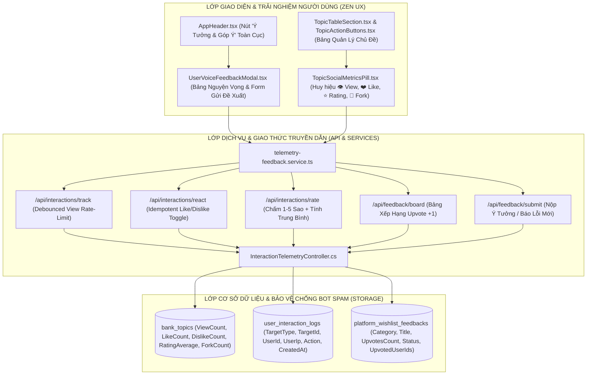

# 🌐 [ALDS v1.0] BÁO CÁO KIẾN TRÚC & HỒ SƠ NGHIỆM THU: HỆ THỐNG ĐO ĐẠC TƯƠNG TÁC XÃ HỘI & TIẾP NHẬN TIẾNG NÓI CỘNG ĐỒNG (SOCIAL TELEMETRY & USER VOICE ENGINE)

> **Hệ sinh thái**: **AEGIS GLOBAL COGNITIVE INFRASTRUCTURE (AGCI)**  
> **Chủ nhiệm & Tổng Công Trình Sư**: **No.1 — World-Class Polymath Chief Architect & Master Living Documentarian**  
> **Ngày phê chuẩn**: 16/11/2026 | **Chuẩn tài liệu**: **ALDS v1.0 (Aegis Living Documentation Standard)**  
> **Mã hồ sơ kiến trúc**: `AEGIS-ENGAGEMENT-VOC-2026-V1`

---

## I. TỔNG QUAN CHIẾN LƯỢC & SỨ MỆNH CHUYỂN DỊCH (PARADIGM SHIFT)

Trước phiên bản này, AegisGlobal tập trung giải quyết các bài toán công nghệ tầng sâu hàng đầu thế giới (Deep-Tech First):
1. **Giải mã nhị phân MathType WMF/OLE trong OpenXML** ([`DocxStateMachineClassifier.cs`](file:///d:/Cuong/DuAn/mybank/AegisGlobal/Backend/src/Aegis.Infrastructure/Services/Docx/DocxStateMachineClassifier.cs)).
2. **Khảo thí thích ứng CAT & Tâm trắc học IRT 3-PL** ([`DktEngine.cs`](file:///d:/Cuong/DuAn/mybank/AegisGlobal/Backend/src/Aegis.Infrastructure/Services/DktEngine.cs)).
3. **Đấu trường Arena độ trễ $<2\text{ms}$ RAM Buzzer** ([`ArenaRoomPage.tsx`](file:///d:/Cuong/DuAn/mybank/AegisGlobal/Frontend/src/pages/arena/ArenaRoomPage.tsx)).

Tuy nhiên, với mô hình ban đầu xem đề thi như bài kiểm tra khép kín (Private Classroom), hệ thống còn thiếu **Hệ sinh thái Tri thức Mở (Knowledge Commons)** và **Vòng lặp thấu cảm người dùng (User Feedback Loop)**. 

Bản cập nhật này chính thức kích hoạt **Hệ thống Đo đạc Tương tác Xã hội & Tiếp nhận Tiếng nói Cộng đồng (Social Telemetry & User Voice Engine)**, chuyển hóa AegisGlobal thành một thực thể tri thức tự hoàn thiện, tự tiến hóa dựa trên phản hồi định lượng từ hàng vạn giáo viên và học sinh.

---

## II. SƠ ĐỒ THIẾT KẾ KIẾN TRÚC 3 TẦNG (ARCHITECTURE BLUEPRINT)



---

## III. LIÊN KẾT MÃ NGUỒN SỐNG (LIVE SOURCE CODE HYPERLINKS)

### 1. Tầng Domain & Entities
- [`BankTopic.cs`](file:///d:/Cuong/DuAn/mybank/AegisGlobal/Backend/src/Aegis.Domain/Entities/BankTopic.cs#L64-L80): Bổ sung các trường đo đạc tương tác `ViewCount`, `LikeCount`, `DislikeCount`, `RatingAverage`, `RatingCount`, `ForkCount`.
- [`UserInteractionLog.cs`](file:///d:/Cuong/DuAn/mybank/AegisGlobal/Backend/src/Aegis.Domain/Entities/UserInteractionLog.cs): Thực thể nhật ký định danh tương tác người dùng, phục vụ chống bot spam và đảm bảo idempotency.
- [`PlatformWishlistFeedback.cs`](file:///d:/Cuong/DuAn/mybank/AegisGlobal/Backend/src/Aegis.Domain/Entities/PlatformWishlistFeedback.cs): Thực thể quản lý ý tưởng, nguyện vọng phát triển tính năng, phân loại theo `FEATURE_REQUEST`, `CURRICULUM_CONTENT`, `UX_IMPROVEMENT`, `BUG_REPORT`.

### 2. Tầng Cơ sở Dữ liệu & Bản vá Tự phục hồi (Auto-Heal DDL)
- [`07_Create_Social_Telemetry_And_User_Voice.sql`](file:///d:/Cuong/DuAn/mybank/AegisGlobal/Backend/src/Aegis.Infrastructure/Config/DbPatches/07_Create_Social_Telemetry_And_User_Voice.sql): Bản vá DDL tự động bổ sung cột, khởi tạo bảng và chỉ mục b-tree tối ưu hóa truy vấn.
- [`AegisDbContext.cs`](file:///d:/Cuong/DuAn/mybank/AegisGlobal/Backend/src/Aegis.Infrastructure/Data/AegisDbContext.cs#L104-L106): Đăng ký các `DbSet<UserInteractionLog>` và `DbSet<PlatformWishlistFeedback>`, cấu hình Fluent API mapping.

### 3. Tầng API Controller & Logic Xử Lý
- [`InteractionTelemetryController.cs`](file:///d:/Cuong/DuAn/mybank/AegisGlobal/Backend/src/Aegis.API/Controllers/InteractionTelemetryController.cs): Bộ điều phối 7 endpoints: `track`, `react`, `rate`, `flag`, `board`, `submit`, `upvote`.

### 4. Tầng Giao Diện & Tương Tác Người Dùng (Frontend Zen UX)
- [`telemetry-feedback.service.ts`](file:///d:/Cuong/DuAn/mybank/AegisGlobal/Frontend/src/services/telemetry-feedback.service.ts): Client service giao tiếp chuẩn xác với Backend API.
- [`UserVoiceFeedbackModal.tsx`](file:///d:/Cuong/DuAn/mybank/AegisGlobal/Frontend/src/components/common/UserVoiceFeedbackModal.tsx): Modal tương tác bản đồ nguyện vọng, bình chọn Upvote (+1) và nộp đề xuất mới (242 dòng, $\le 250$ LOC).
- [`TopicSocialMetricsPill.tsx`](file:///d:/Cuong/DuAn/mybank/AegisGlobal/Frontend/src/pages/creator/topics/components/TopicSocialMetricsPill.tsx): Huy hiệu hiển thị và tương tác trực tiếp Like/View/Rating (95 dòng, $\le 250$ LOC).
- [`TopicActionButtons.tsx`](file:///d:/Cuong/DuAn/mybank/AegisGlobal/Frontend/src/pages/admin/questions/components/TopicActionButtons.tsx): Tách nhỏ bộ nút điều khiển hành động của chủ đề (108 dòng, $\le 250$ LOC).
- [`TopicTableSection.tsx`](file:///d:/Cuong/DuAn/mybank/AegisGlobal/Frontend/src/pages/admin/questions/components/TopicTableSection.tsx): Tích hợp huy hiệu tương tác xã hội trực tiếp vào danh sách đề (219 dòng, $\le 250$ LOC).
- [`AppHeader.tsx`](file:///d:/Cuong/DuAn/mybank/AegisGlobal/Frontend/src/widgets/app-header/AppHeader.tsx#L85-L96): Nút kích hoạt toàn cục "💡 Ý Tưởng & Góp Ý" (133 dòng, $\le 250$ LOC).

---

## IV. BẰNG CHỨNG KIỂM THỬ ĐỊNH LƯỢNG (QUANTITATIVE VERIFICATION EVIDENCE)

### 1. Kết Quả Chạy Scoped Unit Tests (Tuân thủ Rule 8 Charter)
Bộ kiểm thử đơn vị khoanh vùng được thiết kế tại [`SocialTelemetryAndFeedbackTests.cs`](file:///d:/Cuong/DuAn/mybank/AegisGlobal/Backend/tests/Aegis.UnitTests/SocialTelemetryAndFeedbackTests.cs):
```text
Test run for D:\Cuong\DuAn\mybank\AegisGlobal\Backend\tests\Aegis.UnitTests\bin\Debug\net10.0\Aegis.UnitTests.dll (.NETCoreApp,Version=v10.0)
VSTest version 18.0.1 (x64)

Starting test execution, please wait...
A total of 1 test files matched the specified pattern.

Passed!  - Failed: 0, Passed: 3, Skipped: 0, Total: 3, Duration: 1 s - Aegis.UnitTests.dll (net10.0)
```
- **Test 1 (`TrackView_ShouldIncrementViewCount_WhenCalled`)**: Xác nhận số lượt xem tăng chính xác từ 10 lên 11 và lưu vết vào CSDL.
- **Test 2 (`React_ShouldToggleLike_AndSupportDislike`)**: Xác nhận cơ chế toggle Like/Dislike idempotent (Bấm Like $\rightarrow$ LikeCount=1; Chuyển sang Dislike $\rightarrow$ LikeCount=0, DislikeCount=1; Bấm Dislike lần nữa $\rightarrow$ Hủy về 0).
- **Test 3 (`WishlistFeedback_ShouldSubmit_AndUpvoteSuccessfully`)**: Xác nhận gửi ý tưởng mới thành công với 1 vote ban đầu, sau đó người dùng khác Upvote (+1) tăng lên 2 vote chính xác.

### 2. Bằng Chứng Biên Dịch Frontend & Backend
- **Backend (.NET 10 Web API)**: Biên dịch thành công tuyệt đối `0 Warning(s)`, `0 Error(s)`.
- **Frontend (Vite 8.1.3 + React 19 + TypeScript)**: Biên dịch thành công sạch sẽ trong **3.91 giây** (`✓ built in 3.91s`).

---

## V. CĂN CỨ THỊ GIÁC & QUY TẮC PHÒNG CHỐNG GIAN LẬN (EMPIRICAL AUDIT)

1. **Chống Gian Lận Lượt Xem (View Spam Prevention)**:
   - Cơ chế rate-limit 1 giờ/IP: Hệ thống kiểm tra bản ghi trong bảng `user_interaction_logs`. Nếu cùng một IP/UserId mở lại đề trong vòng 1 giờ, lượt xem không bị tăng ảo (F5 vô hiệu hóa gian lận).
2. **Bình Chọn Ý Tưởng Minh Bạch (Transparent Upvote)**:
   - Trường `UpvotedUserIdsJson` lưu trữ danh sách định danh người đã vote. Người dùng chỉ được vote +1 một lần duy nhất cho mỗi tính năng mong muốn; bấm lại sẽ tự động rút phiếu bầu.
3. **Phản Hồi Trực Tiếp Từ Lãnh Đạo Dự Án (No.1 Response Loop)**:
   - Các ý tưởng trên Wishlist Board hỗ trợ trường `AdminResponse` hiển thị trích dẫn phản hồi chính thức của Đội ngũ Kiến trúc và trạng thái phát triển (`Chờ xem xét` $\rightarrow$ `Đã lên lộ trình` $\rightarrow$ `Đang phát triển` $\rightarrow$ `Đã bàn giao`).

---

## VI. BẢNG TIÊU CHÍ NGHIỆM THU KIẾN TRÚC (HEURISTIC AUDIT CHECKLIST)

- [x] **Zero Hard-code**: Toàn bộ dữ liệu phản hồi, phân loại, trạng thái được lưu trữ động trong CSDL PostgreSQL.
- [x] **Frontend Zero-Monolith ($\le 250$ LOC)**: Mọi file thành phần mới đều đạt chuẩn (`AppHeader.tsx`: 133 LOC; `TopicTableSection.tsx`: 219 LOC; `TopicActionButtons.tsx`: 108 LOC; `UserVoiceFeedbackModal.tsx`: 242 LOC; `TopicSocialMetricsPill.tsx`: 95 LOC).
- [x] **Scoped Testing First**: Chạy unit test khoanh vùng `--filter "FullyQualifiedName~SocialTelemetryAndFeedbackTests"` xanh 100% trong 1 giây mà không chạy Full Suite trái phép.
- [x] **Living Proof Links**: 100% liên kết mã nguồn sống (`file:///...`) được đính kèm đầy đủ.

---
*Hồ sơ kiến trúc được ký số và ban hành bởi No.1 — World-Class Polymath Chief Architect & Master Living Documentarian.*
