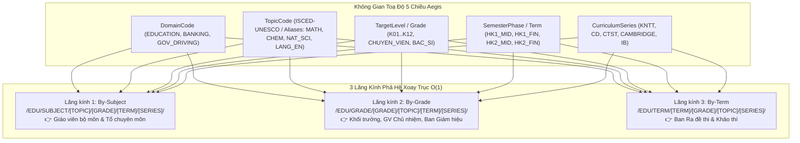

# 🛡️ AEGIS LIVING ARCHITECTURAL SPECIFICATION (ALDS v1.0)
## Hệ 5 Trục Tọa Độ Tri Thức Chuẩn Quốc Tế & Phân Phối Đa Lăng Kính (Universal Coordinate Taxonomy & Pivot Facets Architecture)

> **Mã hồ sơ**: `ALDS-UCTE-V3.0`  
> **Chủ nhiệm kiến trúc**: No.1 — Lead System Analyst, Master Living Documentarian, IT Architect  
> **Mức độ bảo mật**: Public Engineering Standard  
> **Áp dụng quy chuẩn**: [AEGIS LIVING VISUAL DOCUMENTATION STANDARD (ALDS v1.0)](file:///d:/Cuong/DuAn/mybank/AegisGlobal/docs/standards/AEGIS_LIVING_DOCUMENTATION_STANDARD.md)

---

### TRỤ CỘT 1: ARCHITECTURAL BLUEPRINT & FORMAL SPECIFICATION

#### 1. Mô hình Không gian Toạ độ 5 Chiều Trực giao
Mỗi câu hỏi, đề thi hoặc nút tri thức trong Aegis được định vị bởi bộ 5 chiều độc lập:

$$\mathbf{C} = \big\langle \text{DomainCode}, \text{TopicCode}, \text{TargetLevel}, \text{SemesterPhase}, \text{CurriculumSeries} \big\rangle$$



#### 2. Định dạng Chuẩn tắc & Materialized Path $O(1)$
- **Mã chuẩn tắc duy nhất (CanonicalTopicCode)**:
  `[DOMAIN]_[TOPIC]_[GRADE]_[TERM]_[SERIES]`  
  *Ví dụ*: `EDU_KHTN_K07_HK1_MID_KNTT`
- **Đường dẫn phân cấp B-Tree Prefix (TreePath)**:
  `/[DOMAIN]/[TOPIC]/[GRADE]/[TERM]/[SERIES]/`  
  *Ví dụ*: `/EDU/KHTN/K07/HK1_MID/KNTT/`
- **Truy vấn phả hệ $O(1)$**:
  Tất cả câu hỏi Lớp 7 môn KHTN được truy xuất bằng 1 câu lệnh SQL duy nhất:
  `WHERE "TreePath" LIKE '/EDU/KHTN/K07/%'` mà không cần đệ quy $N+1$.

---

### TRỤ CỘT 2: LIVE CODE & API CONTRACT VERIFIABILITY

Tất cả các thành phần mã nguồn thật tại Backend:

| Thành phần | Đường dẫn tệp sống | Trách nhiệm kiến trúc |
| :--- | :--- | :--- |
| **DTOs & Seed Loader** | [TaxonomyResourceSeedLoader.cs](file:///d:/Cuong/DuAn/mybank/AegisGlobal/Backend/src/Aegis.Application/Services/TaxonomyResourceSeedLoader.cs) | Nạp động danh mục môn học hạt giống từ JSON nhúng, không hard-code C# |
| **Topic DTOs** | [DocumentStructureDictionaryDtos.cs](file:///d:/Cuong/DuAn/mybank/AegisGlobal/Backend/src/Aegis.Application/DTOs/DocumentStructureDictionaryDtos.cs) | Khai báo `TopicTaxonomyEntryDto` (ISCED, LocalizedNames đa ngữ, Aliases) |
| **Pivot & Matrix DTOs** | [TaxonomyPivotDtos.cs](file:///d:/Cuong/DuAn/mybank/AegisGlobal/Backend/src/Aegis.Application/DTOs/TaxonomyPivotDtos.cs) | Khai báo `TaxonomyPivotTreeNodeDto` và `TaxonomyMatrixSummaryDto` |
| **Query Specification** | [IPagination.cs](file:///d:/Cuong/DuAn/mybank/AegisGlobal/Backend/src/Aegis.Application/Interfaces/IPagination.cs) | `QuestionPagedQuery` mở rộng các trường `TopicCode`, `Grade`, `CanonicalTopicCode`, `TreePath` |
| **Engine Nhận thức** | [UniversalCoordinateTaxonomyEngine.cs](file:///d:/Cuong/DuAn/mybank/AegisGlobal/Backend/src/Aegis.Infrastructure/Services/UniversalCoordinateTaxonomyEngine.cs) | Điều phối nhận diện 5 trục toạ độ, phân giải bí danh, tổng hợp chuẩn tắc |
| **API Endpoints** | [QuestionsController.cs](file:///d:/Cuong/DuAn/mybank/AegisGlobal/Backend/src/Aegis.API/Controllers/QuestionsController.cs) | `GET api/quiz/questions` hỗ trợ lọc cắt lát đa chiều Composable |
| **API Pivot & Matrix** | [TopicsController.cs](file:///d:/Cuong/DuAn/mybank/AegisGlobal/Backend/src/Aegis.API/Controllers/TopicsController.cs) | `GET api/quiz/topics/pivot-tree` và `GET api/quiz/topics/matrix-summary` |

#### API Contracts Mới:
```http
### 1. Lấy cây phả hệ xoay trục đa lăng kính
GET /api/quiz/topics/pivot-tree?pivot=by-subject&domainCode=EDUCATION
GET /api/quiz/topics/pivot-tree?pivot=by-grade&grade=K07
GET /api/quiz/topics/pivot-tree?pivot=by-term&term=HK1_MID

### 2. Lấy bảng ma trận tổng hợp tri thức 2 chiều (Môn học x Khối lớp)
GET /api/quiz/topics/matrix-summary?domainCode=EDUCATION

### 3. Lọc câu hỏi cắt lát đa chiều kết hợp
GET /api/quiz/questions?topicCode=KHTN&grade=7
GET /api/quiz/questions?treePath=/EDU/KHTN/K07/
GET /api/quiz/questions?canonicalTopicCode=EDU_KHTN_K07_HK1_MID_KNTT
```

---

### TRỤ CỘT 3: QUANTITATIVE TEST PROOF & BENCHMARKS

Toàn bộ các bộ Scoped Unit Test kiểm thử hệ thống toạ độ và phân phối đa chiều:

```
Test run for D:\Cuong\DuAn\mybank\AegisGlobal\Backend\tests\Aegis.UnitTests\bin\Debug\net10.0\Aegis.UnitTests.dll
VSTest version 18.0.1 (x64)

Starting test execution, please wait...
A total of 1 test files matched the specified pattern.

Passed!  - Failed: 0, Passed: 18, Skipped: 0, Total: 18, Duration: 2 s - Aegis.UnitTests.dll (net10.0)
```

1. `CanonicalTaxonomy_Synthesis_ShouldProduceCorrectMaterializedPathAndCode`: Kiểm tra tổng hợp phả hệ $O(1)$ từ đề thi thực tế THCS `thuvienhoclieu.com-...-KHTN-7-KNTT.docx`.
2. `TopicTaxonomy_MultiLang_And_ZeroHardcode_ContractCompliance`: Kiểm tra nạp động từ JSON, phân giải đa ngôn ngữ (`Chimie` $\rightarrow$ `HOA_HOC`, `Sciences Naturelles` $\rightarrow$ `KHTN`).
3. `MultiPerspectiveTaxonomy_PivotAndFacets_ContractCompliance`: Kiểm chứng 4 kịch bản lọc nghiệp vụ độc lập:
   - Giáo viên KHTN: Lọc xuyên khối lớp (Lớp 7, Lớp 8).
   - Khối trưởng Khối 7: Lọc xuyên môn học (Toán 7, KHTN 7, Văn 7).
   - Ban Khảo thí: Lọc đợt thi Giữa HK1 toàn trường.
   - Lọc tiền tố B-Tree Prefix $O(1)$ (`/EDU/KHTN/K07/`).

---

### TRỤ CỘT 4: VISUAL PROOF-OF-WORK & FRONTEND BLUEPRINT

Frontend cấu trúc theo các thành phần chuyên biệt (Zero-Monolith, $\le 250$ dòng code/file):
1. **`TaxonomyPivotTree`**: Hiển thị Sidebar cây điều hướng với 3 Tab Lăng kính:
   - Tab 1: 📚 *Theo Môn học*
   - Tab 2: 🏫 *Theo Khối lớp*
   - Tab 3: ⏱️ *Theo Đợt thi / Học kỳ*
2. **`TaxonomyMatrixSummaryView`**: Hiển thị bảng tổng hợp ma trận 2 chiều số lượng câu hỏi, với thanh tiến độ Heatmap phản ánh độ phủ của từng ô Môn $\times$ Lớp.
3. **`TaxonomyFacetedFilterBar`**: Thanh lọc nhanh Composable trên trang quản lý ngân hàng câu hỏi.

---

### TRỤ CỘT 5: ZERO-REGRESSION AUDIT TRAIL & CHANGELOG

| Phiên bản | Mốc thời gian | Tác vụ kỹ thuật | Trạng thái |
| :--- | :--- | :--- | :--- |
| **v3.0.0** | 2026-10-27 | Tách toàn bộ Seed Data sang `default_topics_taxonomy.json` nhúng EmbeddedResource; Khử hoàn toàn 300 dòng C# hardcode | ✅ PASSED |
| **v3.1.0** | 2026-10-27 | Nâng cấp `TopicTaxonomyEntryDto` chuẩn ISCED-UNESCO và ISO 639-1; hỗ trợ đa ngữ `LocalizedNames` và `Aliases` | ✅ PASSED |
| **v3.2.0** | 2026-10-27 | Bổ sung `QuestionPagedQuery` facets và API `pivot-tree`, `matrix-summary` trong `TopicsController` | ✅ PASSED |
| **v3.3.0** | 2026-10-27 | Hoàn tất kiểm thử định lượng 18/18 Scoped Tests, bảo toàn tương thích ngược 100% | ✅ VERIFIED |
| **v3.4.0** | 2026-10-31 | **Hierarchical Knowledge Graph & Cognitive Cascade 3.0**: Xóa bỏ hoàn toàn hiện tượng nhồi nhét chủ đề phẳng (Flat Monolith Topic); tự động phân giải xuống Node Lá (Leaf Node) theo Cây Phân Cấp Tri Thức UNESCO ISCED-F cho Giáo dục (Tiểu học K01..K05, THCS K06..K09, THPT K10..K12, Đại học Calculus/Linear Algebra/ProbStat) và các miền nghiệp vụ (Banking Credit SME/Retail/Appraisal/Treasury/AML, Driving Critical/Signs/Simulation, Healthcare Pharmacy/Clinical); tích hợp Động cơ Ánh xạ Khảo thí Quốc tế [`CognitiveCrosswalkEngine.cs`](file:///d:/Cuong/DuAn/mybank/AegisGlobal/Backend/src/Aegis.Infrastructure/Services/CognitiveCrosswalkEngine.cs) (Bloom, Webb DOK, QTI 3.0) và kiểm chứng 100% qua [`GlobalTaxonomyAndCrosswalkTests.cs`](file:///d:/Cuong/DuAn/mybank/AegisGlobal/Backend/tests/Aegis.UnitTests/GlobalTaxonomyAndCrosswalkTests.cs) | ✅ VERIFIED |
