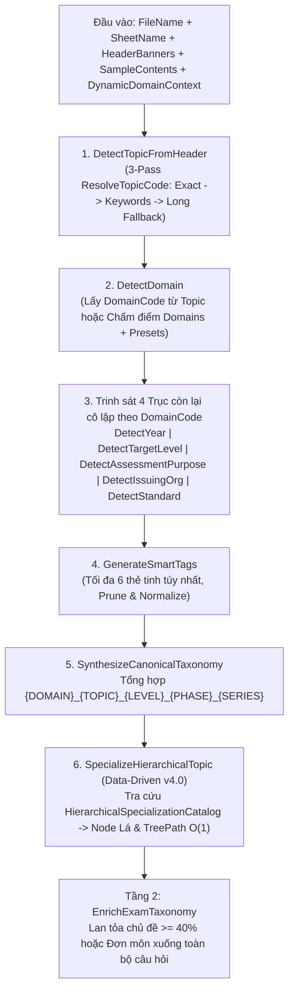

# 🌐 TÀI LIỆU KIẾN TRÚC HỆ THỐNG: UNIVERSAL COORDINATE TAXONOMY ENGINE (UCTE v4.0)

> **Mã hồ sơ**: `ALDS-UCTE-V4.0`  
> **Phân hệ**: Aegis Cognitive Ingestion & Global Taxonomy Infrastructure  
> **Tiêu chuẩn áp dụng**: [AEGIS LIVING DOCUMENTATION STANDARD (ALDS v1.0)](file:///d:/Cuong/DuAn/mybank/AegisGlobal/docs/standards/AEGIS_LIVING_DOCUMENTATION_STANDARD.md)  
> **Nguyên lý cốt lõi**: Zero Hard-code · 100% Data-Driven · Open/Closed Principle (OCP) · Multi-Tenant Isolation · Global Multi-Industry & Multi-Language  
> **Commit tham chiếu**: `995193f` (TOAN & TNPT 5-Axis Unification), `2ab0b1c` (Data-Driven `SpecializeHierarchicalTopic` & Global Multi-Industry Taxonomy)

---

## I. TỔNG QUAN & ĐỊNH VỊ KIẾN TRÚC

**Universal Coordinate Taxonomy Engine (UCTE)** là bộ não phân loại tri thức trung tâm (**Single Source of Truth — SSoT**) của hệ sinh thái **AegisGlobal**. Mọi tài liệu nạp vào hệ thống (`.docx`, `.xlsx`, `.pdf`, câu hỏi lẻ, hoặc bộ đề thi từ Ngân hàng câu hỏi) đều đi qua UCTE để tự động định vị trên **Không gian Tọa độ 5 Chiều Trực giao**:

$$\mathbf{C} = \big\langle \text{DomainCode},\ \text{TopicCode},\ \text{TargetLevel},\ \text{AssessmentPurpose},\ \text{IssuingOrg / BenchmarkStandard} \big\rangle$$

### Đặc tính thiết kế toàn cầu (Global Enterprise Design)
1. **Đa ngành nghề toàn cầu (10 Miền tri thức chuẩn + Mở rộng vô hạn)**: Phục vụ đồng thời Giáo dục phổ thông/Đại học (`EDUCATION`), Tài chính - Ngân hàng (`BANKING`), An ninh mạng & CNTT (`IT_SECURITY`), Y tế & Dược (`HEALTHCARE`), An toàn - Sức khỏe - Môi trường (`HSE`), Pháp luật & Tuân thủ (`LEGAL_COMPLIANCE`), Sát hạch Giao thông (`GOV_DRIVING`), Hàng không & Logistics (`AVIATION_LOGISTICS`), Nhân sự & Lãnh đạo (`CORPORATE_HR`) và Tổng hợp (`GENERAL`).
2. **Đa ngôn ngữ bản địa hóa (MultiLang)**: Hỗ trợ tra cứu tên miền, tên môn học, nút lá phân cấp và từ khóa nhận diện theo ngôn ngữ của ngữ cảnh (`DynamicDomainContext.Language`: `vi`, `en`, `fr`, `zh`, `ja`, `ko`, `de`...).
3. **100% Data-Driven & OCP**: Mọi danh mục Miền, Chủ đề, Preset tọa độ và Quy tắc phân rã Node Lá đều được nạp từ tài nguyên JSON nhúng hoặc ghi đè động theo từng Tenant từ DB (`DynamicDomainContext`) với cache `Lazy<T>` tốc độ $0\text{ms}$.

---

## II. SƠ ĐỒ LUỒNG VẬN HÀNH END-TO-END (2 TẦNG NHẬN THỨC)

UCTE vận hành theo mô hình **Vỏ bọc Đề thi (Tầng 1) → Lan tỏa & Chi tiết hóa Câu hỏi (Tầng 2)** nhằm ngăn ngừa hiện tượng trôi ngữ cảnh (*Cognitive Drift*) khi nội dung một câu hỏi đơn lẻ chứa từ khóa nhiễu của ngành khác.

---

## III. CHI TIẾT KỸ THUẬT CÁC THÀNH PHẦN CỐT LÕI

### 1. Bộ nạp Dữ liệu Động & Tài nguyên JSON (Data-Driven Foundation)

| Thành phần | Vai trò kiến trúc | Liên kết mã nguồn |
|---|---|---|
| **Domain Taxonomy JSON** | Định nghĩa 10 miền tri thức toàn cầu, trọng số `Weight`, tên đa ngôn ngữ và từ khóa quốc tế | [`default_domains_taxonomy.json`](file:///d:/Cuong/DuAn/mybank/AegisGlobal/Backend/src/Aegis.Application/Resources/Taxonomies/default_domains_taxonomy.json) |
| **Topic Taxonomy JSON** | Định nghĩa chủ đề/môn học, mã chuẩn quốc tế `StandardIscedCode`, `Aliases` (`TOAN` ↔ `MATH`) và `OntologicalTerms` | [`default_topics_taxonomy.json`](file:///d:/Cuong/DuAn/mybank/AegisGlobal/Backend/src/Aegis.Application/Resources/Taxonomies/default_topics_taxonomy.json) |
| **Hierarchical Specialization JSON** | Kho quy tắc phân rã Node Lá đa ngành đa ngôn ngữ thay thế toàn bộ `if/else if` cứng | [`default_hierarchical_specializations.json`](file:///d:/Cuong/DuAn/mybank/AegisGlobal/Backend/src/Aegis.Application/Resources/Taxonomies/default_hierarchical_specializations.json) |
| **Seed Resource Loader** | Đọc Embedded Resource JSON, tổng hợp `LocalizedKeywords` vào `Keywords` và cache bất biến bằng `Lazy<T>` | [`TaxonomyResourceSeedLoader.cs`](file:///d:/Cuong/DuAn/mybank/AegisGlobal/Backend/src/Aegis.Application/Services/TaxonomyResourceSeedLoader.cs) |
| **Dynamic Domain Context** | Ngữ cảnh đa ngành theo Tenant & Ngôn ngữ (`CreateDefault(language)`), chứa `Domains`, `CoordinatePresets`, `Topics`, `StructureDictionary` | [`DynamicDomainContext.cs`](file:///d:/Cuong/DuAn/mybank/AegisGlobal/Backend/src/Aegis.Application/DTOs/DynamicDomainContext.cs) |

### 2. Cơ chế Phân giải Chủ đề 3 Vòng (`ResolveTopicCode`)
Hàm [`ResolveTopicCode`](file:///d:/Cuong/DuAn/mybank/AegisGlobal/Backend/src/Aegis.Infrastructure/Services/UniversalCoordinateTaxonomyEngine.cs#L1050-L1077) thực thi đúng 3 vòng ưu tiên để triệt tiêu hoàn toàn xung đột chuỗi con (ví dụ `"TOÁN"` từng bị `"Nghiệp vụ Ngân quỹ - Kế toán"` nuốt nhầm):
1. **Pass 1 (Exact Match)**: So khớp chính xác `Code`, `Name`, hoặc `Slug` không dấu.
2. **Pass 2 (Safe Keyword Match)**: So khớp token nguyên từ (`IsSafeKeywordMatch` với ranh giới `_slug_`) trên danh sách `Keywords` của từng chủ đề.
3. **Pass 3 (Long Partial Fallback)**: Chỉ dùng `Contains` khi chuỗi đầu vào dài $\ge 6$ ký tự hoặc tên chủ đề nằm trọn trong chuỗi đầu vào.

### 3. Trinh sát 5 Trục Cô lập theo Domain & Chuẩn hóa Không dấu (`PresetMentioned`)
- Hàm [`MatchPreset`](file:///d:/Cuong/DuAn/mybank/AegisGlobal/Backend/src/Aegis.Infrastructure/Services/UniversalCoordinateTaxonomyEngine.cs#L702-L722) lọc `CoordinatePresets` theo `DomainCode` để tránh đụng độ viết tắt giữa các ngành.
- Hàm [`PresetMentioned`](file:///d:/Cuong/DuAn/mybank/AegisGlobal/Backend/src/Aegis.Infrastructure/Services/UniversalCoordinateTaxonomyEngine.cs#L724-L751) đối chiếu đồng thời trên **chuỗi gốc** và **chuỗi đã chuẩn hóa không dấu/tách gạch nối** (`NormalizeForMatching`), với kiểm tra ranh giới từ `\b...\b` cho mã ngắn ($\le 6$ ký tự như `thpt`, `bo gd`, `tnpt`, `aml`, `soc`).
- **Chuẩn quốc tế tích hợp sẵn trong `CreateDefault`**: `CEFR (A1–C2)`, `IELTS / TOEFL / SAT / ACT / GRE / GMAT / AP / IB / GCSE / A-Level`, `CISSP / CISM / CEH / NIST / OWASP / SOC 2 / ISO 27001`, `Basel III / IFRS 9 / FATF / CFA / FRM`, `OSHA / NEBOSH / ISO 45001 / ISO 14001`, `HIPAA / USMLE / OSCE / NCLEX`, `GDPR / CCPA / PDPA / ISO 37001`, `ICAO / IATA / Incoterms`, `PMP / Scrum / SHRM`.

### 4. Động cơ Phân rã Node Lá Data-Driven (`SpecializeHierarchicalTopic`)
Tại [`UniversalCoordinateTaxonomyEngine.cs`](file:///d:/Cuong/DuAn/mybank/AegisGlobal/Backend/src/Aegis.Infrastructure/Services/UniversalCoordinateTaxonomyEngine.cs#L1770-L1868), phương thức `SpecializeHierarchicalTopic` thực hiện:
1. Lọc danh sách `HierarchicalSpecializationCatalog` theo `DomainCode` (kèm điều kiện `RequireHigherEd` và `TopicCodeFilter` nếu là môn đại học).
2. Sắp xếp theo `Priority` giảm dần, tìm quy tắc khớp từ khóa đa ngôn ngữ đầu tiên (hoặc fallback `IsDefaultFallback` của domain đó).
3. Gán `TopicCode`, `ParentTopicCode`, tự động dịch `TopicName` và `ParentTopicName` qua `GetLeafDisplayName(lang)` / `GetParentDisplayName(lang)`, và xuất `TreePath` chuẩn B-Tree $O(1)$ dạng `/{DOMAIN}/{PARENT}/{LEAF}/`.
4. Nếu là Giáo dục phổ thông (`K01..K12`) chưa có rule riêng, tự động sinh node lá `{TOPIC}_K{grade:D2}` dưới nhánh `PRIMARY` / `LOWER_SEC` / `UPPER_SEC` theo ngôn ngữ `vi` hoặc `en`.

---

## IV. ĐỊNH DẠNG MÃ CHUẨN TẮC & TREEPATH $O(1)$

- **CanonicalTopicCode**: `{DOMAIN}_{TOPIC}_{GRADE}_{TERM}_{SERIES}`
  - *Giáo dục Việt Nam (TNPT)*: `EDU_TOAN_K12_THPT_NAT_CORE`, `EDU_TIENG_ANH_K12_THPT_NAT_CORE`, `EDU_KHTN_K07_HK1_MID_KNTT`
- **TreePath**: `/{ROOT}/{PARENT_TOPIC}/{LEAF_TOPIC}/`
  - *Giáo dục phổ thông*: `/EDU/TOAN/TOAN_UPPER_SEC/TOAN_K12/`
  - *An ninh mạng toàn cầu*: `/IT_SECURITY/IT_SECURITY/ITSEC_SOC_IR/`
  - *Pháp luật & Dữ liệu*: `/LEGAL_COMPLIANCE/LEGAL_COMPLIANCE/LEGAL_DATA_PRIVACY/`
  - *Tài chính Ngân hàng*: `/BANKING/BANKING/BANKING_SETTLEMENT/`
  - *Mở rộng OCP từ Tenant (Hàng không)*: `/AVIATION_LOGISTICS/AVIATION_SAFETY/AVIATION_DGR/`

---

## V. BẰNG CHỨNG KIỂM THỬ ĐỊNH LƯỢNG (LIVING VERIFICATION)

Bộ kiểm thử đơn vị khoanh vùng tại [`GlobalTaxonomyAndCrosswalkTests.cs`](file:///d:/Cuong/DuAn/mybank/AegisGlobal/Backend/tests/Aegis.UnitTests/GlobalTaxonomyAndCrosswalkTests.cs), [`DocxStateMachineClassifierArchitectureTests.cs`](file:///d:/Cuong/DuAn/mybank/AegisGlobal/Backend/tests/Aegis.UnitTests/DocxStateMachineClassifierArchitectureTests.cs), [`UniversalCigCoverageTests.cs`](file:///d:/Cuong/DuAn/mybank/AegisGlobal/Backend/tests/Aegis.UnitTests/UniversalCigCoverageTests.cs) và [`TopicPivotServiceTests.cs`](file:///d:/Cuong/DuAn/mybank/AegisGlobal/Backend/tests/Aegis.UnitTests/TopicPivotServiceTests.cs):

- **Tổng số test khoanh vùng**: **44 / 44 Passed (0 Failed)**.
- **Kiểm chứng đa ngành toàn cầu & OCP (`GlobalMultiIndustry_DataDrivenSpecialization_AndMultiLang_ShouldWorkViaOcp`)**:
  - `IT_SECURITY` (`CISSP / NIST / SOC / MITRE ATT&CK`) $\rightarrow$ `ITSEC_SOC_IR` (`SOC Operations, SIEM & Incident Response`)
  - `LEGAL_COMPLIANCE` (`GDPR / Data Privacy`) $\rightarrow$ `LEGAL_DATA_PRIVACY` (`Data Privacy & Protection (GDPR / CCPA)`)
  - `HSE` (`OSHA / LOTO / PPE`) $\rightarrow$ `HSE_OCCUPATIONAL`
  - `BANKING` (`Trade Finance / SWIFT / UCP 600`) $\rightarrow$ `BANKING_SETTLEMENT` (`International Settlement & Trade Finance`)
  - `AVIATION_LOGISTICS` (nạp nóng qua Catalog không sửa C#) $\rightarrow$ `AVIATION_DGR` (`/AVIATION_LOGISTICS/AVIATION_SAFETY/AVIATION_DGR/`)
- **Kiểm chứng thực tế 12 file `.docx` đề thi Tốt nghiệp THPT (`D:\Cuong\DuAn\DETHI\TNPT`)**: 12/12 file (Toán `TOAN`, Tiếng Anh `TIENG_ANH`, Vật Lí, Hóa học, Sinh học, Tin học) đều nhận diện đồng nhất `Domain=EDUCATION`, `TargetLevel=Lớp 12`, `AssessmentPurpose=Kỳ thi Tốt nghiệp THPT Quốc Gia`, `CanonicalTopicCode=EDU_*_K12_THPT_NAT_*`.

---

## VI. HƯỚNG DẪN MỞ RỘNG CHO KỸ SƯ & TENANT (ZERO-CODE EXTENSION)

1. **Thêm miền tri thức mới toàn cầu**: Bổ sung entry vào [`default_domains_taxonomy.json`](file:///d:/Cuong/DuAn/mybank/AegisGlobal/Backend/src/Aegis.Application/Resources/Taxonomies/default_domains_taxonomy.json) (hoặc bảng `DynamicDomains` của Tenant trong DB).
2. **Thêm nhánh chuyên môn sâu (Leaf Node) mới**: Bổ sung object quy tắc (`DomainCode`, `Priority`, `LeafTopicCode`, `LocalizedLeafNames`, `ParentTopicCode`, `LocalizedKeywords`) vào [`default_hierarchical_specializations.json`](file:///d:/Cuong/DuAn/mybank/AegisGlobal/Backend/src/Aegis.Application/Resources/Taxonomies/default_hierarchical_specializations.json) hoặc truyền qua `DynamicDomainContext.StructureDictionary.HierarchicalSpecializationCatalog`. **Tuyệt đối không thêm `if/else if` vào mã nguồn C#.**
3. **Thêm khung đánh giá / chứng chỉ mới**: Đăng ký `TenantCoordinatePresetDto` (`TARGET_LEVEL`, `ASSESSMENT_PURPOSE`, `ISSUING_ORG`, `BENCHMARK_STANDARD`) gắn đúng `DomainCode`.
