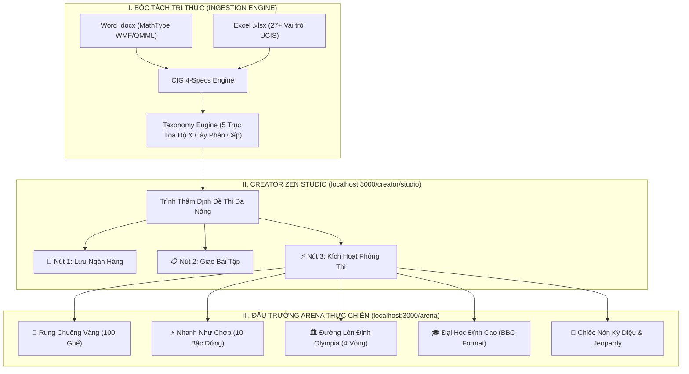
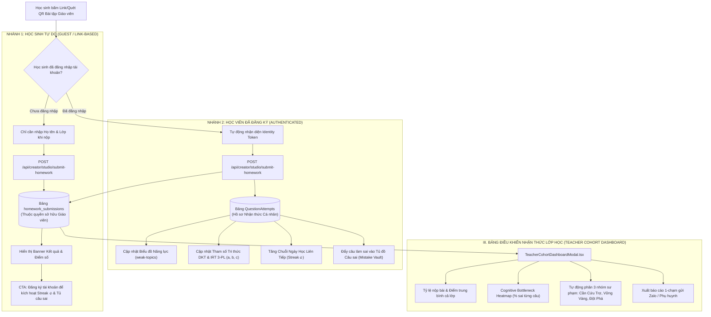
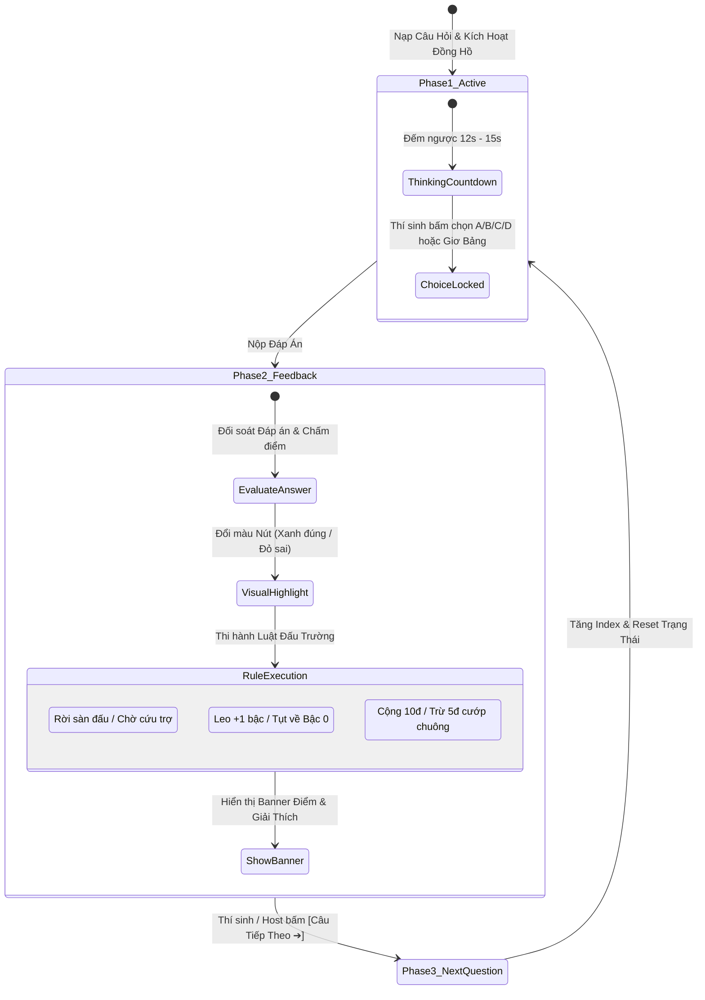

# 📘 TÀI LIỆU HƯỚNG DẪN CHI TIẾT TOÀN DIỆN: SÁNG TẠO ĐỀ THI CREATOR ZEN STUDIO & ĐẤU TRƯỜNG THỰC CHIẾN ARENA (ALDS v1.0)

> **Hệ sinh thái**: **AEGIS GLOBAL COGNITIVE INFRASTRUCTURE (AGCI)**  
> **Phiên bản**: `v3.0 - Hierarchical Topic Tree, PDF Spatial Math & Real Team Hub Edition` (Cập nhật: `2026-11-10`)  
> **Chủ nhiệm biên soạn**: **No.1 — World-Class Polymath Chief Architect & Principal Systems Engineer**  
> **Đối tượng áp dụng**: Thầy Cô Giáo, Giảng viên Đại học, Chuyên gia Đào tạo Doanh nghiệp, Ban Tổ Chức (Host), Trọng Tài và Học viên/Thí sinh.

---

## 📑 MỤC LỤC CHI TIẾT
1. [TỔNG QUAN HỆ THỐNG & TRIẾT LÝ THIẾT KẾ DUAL-SPACE](#1-tổng-quan-hệ-thống--triết-lý-thiết-kế-dual-space)
2. [HƯỚNG DẪN CREATOR ZEN STUDIO & TRUNG TÂM ĐỘI NHÓM (/team)](#2-hướng-dẫn-creator-zen-studio-quy-trình-3-chạm--10-giây)
   - 2.1. Nạp và Bóc tách Đề thi Đa định dạng (Word/Docx, PDF Không gian 2D & Excel UCIS)
   - 2.2. Quản lý Chủ đề Phân cấp Cây Đa tầng (Tree Hierarchy, Roll-up Count & `MaterializedPath` $O(1)$)
   - 2.3. Bộ Ba Nút Hành Động Chiến Lược: Lưu Ngân Hàng, Giao Bài, Kích Hoạt Phòng Thi
   - 2.4. Hạ tầng Phân nhánh Kép: Thu thập Bài nộp & Giám sát Nhận thức Lớp học
   - 2.5. Trung tâm Quản trị Lớp học & Đội nhóm (`/team`) — Dữ liệu Thật 100% PostgreSQL
3. [HƯỚNG DẪN VẬN HÀNH ĐẤU TRƯỜNG ARENA THỰC CHIẾN](#3-hướng-dẫn-vận-hành-đấu-trường-arena-thực-chiến)
   - 3.1. Tối ưu Không gian Hiển thị Hero Stage 2 Cột Chuẩn Quốc Tế
   - 3.2. Cơ chế 3 Pha Vận Hành Trò Chơi (Active ➔ Feedback ➔ Transition)
   - 3.3. Chi tiết Luật Thi Đấu Chuẩn Hóa Của 6 Thể Thức Gameshow
     - 🔔 Đấu Trường Rung Chuông Vàng (Golden Bell Mega-Grid)
     - ⚡ Cỗ Máy Nhanh Như Chớp (Lightning Incline 10 Bậc)
     - 🏛️ Đường Lên Đỉnh Olympia (Olympia Supreme 4 Vòng)
     - 🎓 Đại Học Đỉnh Cao (BBC University Challenge)
     - 🎡 Chiếc Nón Kỳ Diệu (Quantum Lucky Wheel)
     - 🇺🇸 Jeopardy! American Matrix
4. [HỆ THỐNG PHÂN CẤP NGƯỜI DÙNG & BẢO MẬT CHỐNG GIAN LẬN](#4-hệ-thống-phân-cấp-người-dùng--bảo-mật-chống-gian-lận)
5. [DANH MỤC LIÊN KẾT MÃ NGUỒN SỐNG & BẰNG CHỨNG KIỂM THỬ](#5-danh-mục-liên-kết-mã-nguồn-sống--bằng-chứng-kiểm-thử)

---

## 1. TỔNG QUAN HỆ THỐNG & TRIẾT LÝ THIẾT KẾ DUAL-SPACE

Hệ sinh thái **Aegis Global** vận hành trên nền tảng **Cognitive Dual-Space Architecture (CDSA)**:
- **Không gian Cá nhân PLG (Personal Zen Space)**: Tối ưu cho từng Giáo viên, Giảng viên độc lập với trải nghiệm *Zero-Friction*, không yêu cầu cấu hình tổ chức phức tạp, bảo mật bản quyền đề thi cá nhân.
- **Không gian Pháo đài Doanh nghiệp (Enterprise Sovereign Space)**: Quản trị đa khách thuê (Multi-Tenancy), phân quyền 4 tầng chặt chẽ (`Tenant ∩ Domain ∩ Group ∩ User`), bảo vệ đề thi cấp quốc gia bằng chuỗi băm Merkle Tree SHA-256.

---

## 2. HƯỚNG DẪN CREATOR ZEN STUDIO: QUY TRÌNH 3 CHẠM / 10 GIÂY

### 2.1. Nạp và Bóc tách Đề thi Đa định dạng (Word/Docx, PDF Không gian 2D & Excel UCIS)
- **Hỗ trợ 3 định dạng học thuật chuẩn quốc tế**: 
  - **File Word ([`.docx`](file:///d:/Cuong/DuAn/mybank/AegisQuiz/Backend/src/AegisQuiz.Infrastructure/Services/Docx/DocxStateMachineClassifier.cs))**: Tự động nhận diện công thức toán nhị phân MathType WMF ([`MathTypeWmfEngine.cs`](file:///d:/Cuong/DuAn/mybank/AegisQuiz/Backend/src/AegisQuiz.Infrastructure/Services/MathTypeWmfEngine.cs)), chuẩn hóa ký hiệu dấu phẩy thập phân Việt Nam ([`MathLocaleNormalizer.cs`](file:///d:/Cuong/DuAn/mybank/AegisQuiz/Backend/src/AegisQuiz.Infrastructure/Services/Docx/MathLocaleNormalizer.cs)).
  - **File PDF Không gian 2D ([`PdfParserService.cs`](file:///d:/Cuong/DuAn/mybank/AegisQuiz/Backend/src/AegisQuiz.Infrastructure/Services/PdfParserService.cs) & [`PdfSpatialMathReconstructor.cs`](file:///d:/Cuong/DuAn/mybank/AegisQuiz/Backend/src/AegisQuiz.Infrastructure/Services/Pdf/PdfSpatialMathReconstructor.cs))**: Hợp lưu hoàn toàn vào luồng `DocxStateMachineClassifier` + `DynamicQuestionIngestionEngine`. Tái tạo công thức phân số $\frac{A}{B}$, dấu vector $\overrightarrow{AB}$, hệ phương trình ngoặc nhọn $\begin{cases}$, chỉ số dưới $u_n$, bảng số liệu ghép nhóm Markdown và tự động kích hoạt [`PdfHybridVisionFallbackService.cs`](file:///d:/Cuong/DuAn/mybank/AegisQuiz/Backend/src/AegisQuiz.Infrastructure/Services/Pdf/PdfHybridVisionFallbackService.cs) (kèm SHA-256 Semantic Cache $0\text{ token}$) cho các trang PDF scan ảnh.
  - **File Excel ([`.xlsx`](file:///d:/Cuong/DuAn/mybank/AegisQuiz/Backend/src/AegisQuiz.Infrastructure/Services/ExcelQuestionParser.cs))**: Kế thừa đầy đủ bộ bóc tách 27+ vai trò ngữ nghĩa của phân hệ Quản trị (Admin Ingestion), tự động map cột Câu hỏi, Phương án A-D, Đáp án đúng, Lời giải chi tiết, Mức độ Bloom, Điểm số.
- **Studio Công thức Toán học & Bảng biểu trực quan**:
  - Tích hợp [`MathFormulaStudioModal.tsx`](file:///d:/Cuong/DuAn/mybank/AegisQuiz/Frontend/src/components/common/math-studio/MathFormulaStudioModal.tsx) toàn màn hình với 8 chuyên đề toán-lý-hóa và [`mathHtmlCompiler.ts`](file:///d:/Cuong/DuAn/mybank/AegisQuiz/Frontend/src/shared/lib/quiz/mathHtmlCompiler.ts) giải mã đệ quy công thức KaTeX nằm bên trong ô bảng Markdown (`<th>`/`<td>`).
- **Thao tác**: Kéo thả file trực tiếp vào vùng [`ZenDropZone.tsx`](file:///d:/Cuong/DuAn/mybank/AegisQuiz/Frontend/src/pages/creator/studio/components/ZenDropZone.tsx). Hệ thống bóc tách hoàn tất trong $< 1.5$ giây.

---

### 2.2. Quản lý Chủ đề Phân cấp Cây Đa tầng (Tree Hierarchy, Roll-up Count & `MaterializedPath` $O(1)$)
- **Kiến trúc SSoT dựng cây phân cấp ([`topicTreeHelper.ts`](file:///d:/Cuong/DuAn/mybank/AegisQuiz/Frontend/src/shared/lib/quiz/topicTreeHelper.ts))**:
  - `Cấp 1 - Gốc Hệ Thống`: `/STUDIO/` hoặc `/COMMUNITY/`
  - `Cấp 2 - Ngày Khởi Tạo / Nhánh Cộng Đồng`: `/STUDIO/YYYYMMDD/` hoặc `/COMMUNITY/COM_.../`
  - `Cấp 3 - Không Gian Giáo Viên`: Rút gọn định danh dạng `CRT<MãHex>` (Ví dụ: `CRTEC4DD2`).
  - `Cấp 4+ - Chuyên Đề / Bộ Đề / Nhánh Con Tùy Chỉnh`: Hỗ trợ tạo nhánh con không giới hạn cấp độ qua `ParentId`.
- **Năng lực vượt trội trên toàn bộ `/creator/studio`, `/creator/topics` và `/creator/questions`**:
  - **Cộng dồn số lượng câu hỏi (`totalQuestionCount`)**: Tự động cộng dồn câu hỏi từ tất cả các nhánh con cháu lên nhánh cha, đồng thời đối chiếu qua `categoryCode`, `topicCode`, `#tag`, `linkedTopicCodes` và ánh xạ `COM_{SourceCode}`.
  - **Giao diện Cây Tương Tác Trong Studio ([`ZenTopicTreePanel.tsx`](file:///d:/Cuong/DuAn/mybank/AegisQuiz/Frontend/src/pages/creator/studio/components/ZenTopicTreePanel.tsx) & [`ZenQuickTopicModal.tsx`](file:///d:/Cuong/DuAn/mybank/AegisQuiz/Frontend/src/pages/creator/studio/components/ZenQuickTopicModal.tsx))**: Hỗ trợ thu gọn/mở rộng nhánh (`▶`/`▼`), tạo nhanh chủ đề gốc hoặc chủ đề nhánh con ngay trên cây, đổi nhánh cha, và chọn nhánh cha đích tại [`ZenExamPreview.tsx`](file:///d:/Cuong/DuAn/mybank/AegisQuiz/Frontend/src/pages/creator/studio/components/ZenExamPreview.tsx) trước khi bấm Lưu Ngân Hàng.
  - **Đồng bộ Bảng Cây & Bộ Lọc Câu Hỏi**: Hiển thị dạng cây tại [`TopicTreeTable.tsx`](file:///d:/Cuong/DuAn/mybank/AegisQuiz/Frontend/src/pages/admin/questions/components/TopicTreeTable.tsx), chọn chủ đề cha trong [`TopicModal.tsx`](file:///d:/Cuong/DuAn/mybank/AegisQuiz/Frontend/src/pages/admin/questions/components/TopicModal.tsx), và lọc câu hỏi bao gồm toàn bộ nhánh con tại [`useQuestionFilters.ts`](file:///d:/Cuong/DuAn/mybank/AegisQuiz/Frontend/src/pages/admin/questions/hooks/useQuestionFilters.ts).

---

### 2.3. Bộ Ba Nút Hành Động Chiến Lược

Tại chân màn hình Thẩm định đề thi [`CreatorZenStudioPage.tsx`](file:///d:/Cuong/DuAn/mybank/AegisQuiz/Frontend/src/pages/creator/studio/CreatorZenStudioPage.tsx), hệ thống cung cấp 3 nút lệnh tác vụ thông minh:

| Nút Lệnh | Modal Điều Khiển | Tính Năng & Tác Vụ Cốt Lõi |
| :--- | :--- | :--- |
| **💾 Lưu Ngân Hàng** | [`ZenBankSaveModal.tsx`](file:///d:/Cuong/DuAn/mybank/AegisQuiz/Frontend/src/pages/creator/studio/components/ZenBankSaveModal.tsx) | - **Lưu thuần vào kho**: Lưu trữ các câu hỏi vào cây chủ đề cá nhân để tái sử dụng nhiều lần. - **Đóng gói đề thi chính thức**: Sinh mã đề độc bản, gán mã đề vào danh mục đề thi chuẩn. |
| **📋 Giao Bài Tập** | [`ZenHomeworkConfigModal.tsx`](file:///d:/Cuong/DuAn/mybank/AegisQuiz/Frontend/src/pages/creator/studio/components/ZenHomeworkConfigModal.tsx) | - **Thiết lập hạn nộp**: Giới hạn ngày giờ kết thúc làm bài. - **Cơ chế chống gian lận**: Giới hạn số lần thi, xáo trộn câu hỏi động, bật/tắt xem lời giải sau khi nộp. - **Chia sẻ 1-Chạm**: Sinh mã QR và đường link bài tập gửi Zalo/Google Classroom. |
| **⚡ Kích Hoạt Phòng Thi** | [`ZenArenaGameSelectorModal.tsx`](file:///d:/Cuong/DuAn/mybank/AegisQuiz/Frontend/src/pages/creator/studio/components/ZenArenaGameSelectorModal.tsx) | - **Kho Gameshow Đa Dạng**: Cho phép Giáo viên tự do chọn 1 trong 6 thể thức thi đấu thay vì ép buộc một thể thức cố định. - **Prewarm Room**: Nạp toàn bộ 100% câu hỏi thật từ Studio vào RAM Redis để tạo phòng tức thì trong $< 20\text{ms}$. |

---

### 2.4. Hạ Tầng Phân Nhánh Kép: Thu Thập Bài Nộp & Giám Sát Nhận Thức Lớp Học (Dual-Branch Telemetry Protocol)

Nhằm tối ưu hóa trải nghiệm người dùng theo triết lý PLG (*Product-Led Growth*) và bảo vệ sự toàn vẹn của mô hình tâm trắc học AI DKT / IRT 3-PL, Aegis Global thiết kế giao thức truyền nhận dữ liệu phân nhánh kép:

#### Chi tiết 2 Luồng Trải Nghiệm:
1. **Luồng Học Sinh Tự Do (Guest Learner via Teacher Link)**:
   - **Zero-Friction**: Học sinh không cần mật khẩu, không cần email, mở link là làm bài ngay lập tức.
   - **Thu thập dữ liệu**: Khi nộp bài tại [`PracticePage.tsx`](file:///d:/Cuong/DuAn/mybank/AegisQuiz/Frontend/src/pages/practice/PracticePage.tsx), học sinh chỉ cần nhập Họ tên và Tên lớp (VD: *Nguyễn Văn An - Lớp 10A1*).
   - **Lưu trữ độc lập**: Dữ liệu nộp bài gửi 100% về cho Giáo viên quản lý thông qua bảng [`homework_submissions`](file:///d:/Cuong/DuAn/mybank/AegisQuiz/Backend/src/AegisQuiz.Infrastructure/Config/DbPatches/05_Create_Homework_Submissions_Table.sql). Dữ liệu này tuyệt đối **không làm rác hay làm lệch** thuật toán cá nhân hóa của hệ thống.
   - **Cơ chế chuyển đổi PLG**: Màn hình nộp bài hiển thị bảng thành tích rực rỡ kèm lời kêu gọi tạo tài khoản miễn phí để lưu vết học tập.

2. **Luồng Học Viên Đã Đăng Ký (Authenticated Learner)**:
   - Toàn bộ kết quả vừa gửi về cho Giáo viên kiểm tra, vừa ghi nhận trực tiếp vào tài khoản cá nhân.
   - Hệ thống tự động phân tích điểm nghẽn, cập nhật mạng nơ-ron **DKT (Deep Knowledge Tracing)**, độ khó câu hỏi **IRT 3-PL** ($a, b, c$) và lưu tự động các câu làm sai vào **Tủ Đồ Lỗi Sai (Mistake Vault)** để thuật toán **FSRS v5** tự động nhắc nhở ôn luyện ngắt quãng.

3. **Bảng Giám Sát Nhận Thức Lớp Học Của Giáo Viên ([`TeacherCohortDashboardModal.tsx`](file:///d:/Cuong/DuAn/mybank/AegisQuiz/Frontend/src/pages/creator/studio/components/TeacherCohortDashboardModal.tsx))**:
   - **Chỉ số Vĩ mô**: Hiển thị tổng số bài nộp, điểm trung bình toàn lớp, và câu hỏi có tỷ lệ làm sai cao nhất.
   - **Ma trận Nhiệt (Cognitive Bottleneck Heatmap)**: Trực quan hóa tỷ lệ làm sai theo từng câu hỏi (Màu đỏ: $>50\%$ học sinh làm sai $\rightarrow$ Điểm nghẽn kiến thức cần giảng lại; Màu xanh: làm đúng xuất sắc).
   - **Phân nhóm Sư phạm 3 tầng Tự động**:
     - *Nhóm Cần Cứu Trợ ($< 5.0\text{đ}$)*: Cần giáo viên phụ đạo hoặc giao lại chuyên đề nền tảng.
     - *Nhóm Vững Vàng ($5.0 - 7.9\text{đ}$)*: Nắm chắc kiến thức cơ bản.
     - *Nhóm Đột Phá ($\ge 8.0\text{đ}$)*: Sẵn sàng thử sức với câu hỏi vận dụng cao Bloom 5-6.
   - **Xuất Báo Cáo 1-Chạm**: Tự động sinh báo cáo kết quả định dạng Markdown/Text để Giáo viên copy gửi vào nhóm Zalo lớp hoặc họp phụ huynh.

---

### 2.5. Trung Tâm Quản Trị Lớp Học & Đội Nhóm (`/team`) — Dữ Liệu Thật 100% PostgreSQL
Tại phân hệ [`TeamDashboard.tsx`](file:///d:/Cuong/DuAn/mybank/AegisQuiz/Frontend/src/pages/team-leader/TeamDashboard.tsx) (`/team` & `/creator/team`), Giáo viên và Trưởng nhóm làm chủ toàn diện lớp học của mình trên dữ liệu thật 100% từ PostgreSQL thông qua [`TeamLeaderController.cs`](file:///d:/Cuong/DuAn/mybank/AegisQuiz/Backend/src/AegisQuiz.API/Controllers/TeamLeaderController.cs):
1. **Khởi tạo & Tùy biến Lớp học / Đội nhóm ([`TeamSettingsModal.tsx`](file:///d:/Cuong/DuAn/mybank/AegisQuiz/Frontend/src/pages/team-leader/components/TeamSettingsModal.tsx))**:
   - Tự động phân giải hoặc khởi tạo đơn vị Lớp học (`OrganizationUnit` với `UnitType = Classroom`) cho Giáo viên/Creator/TeamLeader và tự động kết nạp các học viên (`Learner`) cùng Tenant.
   - Hỗ trợ đổi tên lớp, mã lớp, mô tả (`PUT /api/team-leader/my-team`) hoặc tạo thêm lớp học mới (`POST /api/team-leader/teams`).
2. **Quản trị Thành viên Toàn diện ([`TeamMemberManagerModal.tsx`](file:///d:/Cuong/DuAn/mybank/AegisQuiz/Frontend/src/pages/team-leader/components/TeamMemberManagerModal.tsx) & [`TeamMembersTableSection.tsx`](file:///d:/Cuong/DuAn/mybank/AegisQuiz/Frontend/src/pages/team-leader/components/TeamMembersTableSection.tsx))**:
   - **Thêm học viên mới hoặc Kết nạp học viên có sẵn** (`POST /api/team-leader/my-team/members` & `GET /api/team-leader/available-users`): Tạo trực tiếp tài khoản học sinh mới (Họ tên, Email, SĐT, Mật khẩu) vào PostgreSQL hoặc chọn từ danh sách người dùng hiện có.
   - **Cập nhật & Gỡ thành viên** (`PUT /api/team-leader/my-team/members/{memberId}` & `DELETE /api/team-leader/my-team/members/{memberId}`): Chỉnh sửa hồ sơ thành viên hoặc xóa thành viên khỏi nhóm chỉ với 1 chạm.
3. **Giám sát Tiến độ Thực tế (`GET /api/team-leader/my-team/progress`)**:
   - Tổng hợp trực tiếp từ bảng `QuestionAttempts` và `HomeworkSubmissions`: hiển thị số bài tập đã nộp (`CompletedHomeworks`), tổng lượt làm bài (`AttemptCount`), độ chính xác (`AccuracyPercent`), điểm trung bình (`AverageScore`) và thời gian hoạt động gần nhất (`LastActiveAt`).

---

## 3. HƯỚNG DẪN VẬN HÀNH ĐẤU TRƯỜNG ARENA THỰC CHIẾN

### 3.1. Tối ưu Không gian Hiển thị Hero Stage 2 Cột Chuẩn Quốc Tế
Nhằm khắc phục triệt để hiện tượng câu hỏi bị che khuất hoặc bị đẩy xuống dưới màn hình, các đấu trường đã được tái cấu trúc thành **Lưới Cân Xứng 2 Cột**:
- **Cột Chính (8/12 - Hero Question Canvas)**: Đặt ở vị trí trung tâm tầm nhìn. Chứa câu hỏi to rõ với công thức Toán học KaTeX chuẩn sắc nét, đồng hồ đếm ngược từng giây, 4 nút lựa chọn A/B/C/D to bản hỗ trợ cảm ứng và phím tắt bàn phím.
- **Cột Phụ (4/12 - Side Gauge / Mini-Map)**: Thu gọn các thành phần đồ họa lớn (Bảng 100 ghế ngồi, Dốc leo 10 bậc đứng) thành các cụm thông tin tinh gọn, không chiếm dụng không gian của đề bài.

---

### 3.2. Cơ chế 3 Pha Vận Hành Trò Chơi (Active ➔ Feedback ➔ Transition)

1. **Pha 1: Đọc đề & Suy nghĩ (Active Phase)**:
   - Hiển thị nội dung câu hỏi, đồng hồ đếm ngược (12s - 15s). Thí sinh bấm chọn đáp án hoặc bấm chuông cướp quyền (Space/Buzzer).
2. **Pha 2: Phản hồi Kết quả & Đánh giá Luật (Feedback Phase)**:
   - **Tuyệt đối không chuyển câu hỏi ngay lập tức**.
   - Khóa các nút bấm để bảo toàn kết quả.
   - Nút thí sinh chọn đổi sang viền đỏ nếu sai; nút đáp án đúng sáng màu xanh ngọc bích rực rỡ.
   - Hiển thị **Banner Phản Hồi Rõ Ràng**:
     - *Đúng*: Thông báo chúc mừng, cộng điểm vào tổng điểm thí sinh, kích hoạt hiệu ứng pháo hoa Confetti.
     - *Sai*: Nêu rõ đáp án chính xác và áp dụng hình phạt theo luật thi đấu của từng trò chơi.
3. **Pha 3: Chuyển câu hỏi (Transition Phase)**:
   - Thí sinh hoặc Host chủ động bấm nút **"CÂU TIẾP THEO ➔"** để bước vào câu tiếp theo, reset timer và làm sạch dữ liệu cũ.

---

### 3.3. Chi tiết Luật Thi Đấu Chuẩn Hóa Của 6 Thể Thức Gameshow

#### 🔔 Đấu Trường Rung Chuông Vàng (`GOLDEN_BELL`)
- **Tập tin thực thi**: [`GoldenBellArenaView.tsx`](file:///d:/Cuong/DuAn/mybank/AegisQuiz/Frontend/src/pages/arena/components/GoldenBellArenaView.tsx) kết hợp [`GoldenBellSeatsGrid.tsx`](file:///d:/Cuong/DuAn/mybank/AegisQuiz/Frontend/src/pages/arena/components/GoldenBellSeatsGrid.tsx) và [`GoldenBellHeaderBar.tsx`](file:///d:/Cuong/DuAn/mybank/AegisQuiz/Frontend/src/pages/arena/components/GoldenBellHeaderBar.tsx).
- **Quy mô**: 100 thí sinh trên sàn đấu số hóa. Vị trí của thí sinh mặc định được gán tại Ghế số 45 phát sáng sao vàng.
- **Thời gian suy nghĩ**: 15 giây / câu.
- **Luật Sinh tử (Sudden Death)**:
  - Trả lời đúng: Giữ nguyên vị trí trên sàn, nhận **+10 điểm**, âm thanh chiến thắng vang dội.
  - Trả lời sai (hoặc hết 15s không trả lời): **LẬP TỨC RỜI SÀN ĐẤU** (`status = 'ELIMINATED'`), ô ghế trên Mini-Map chuyển màu đỏ thẫm. Thí sinh bị khóa quyền làm bài ở các câu tiếp theo cho đến khi có cứu trợ.
- **Phao Thầy Cô Cứu Trợ 🎈**: Khi trên sàn còn ít thí sinh, Host/Giáo viên bấm nút "Cứu Trợ" để thực hiện thử thách hồi sinh tất cả học sinh quay lại sàn đấu (`ACTIVE`).

---

#### ⚡ Cỗ Máy Nhanh Như Chớp (`LIGHTNING`)
- **Tập tin thực thi**: [`LightningArenaView.tsx`](file:///d:/Cuong/DuAn/mybank/AegisQuiz/Frontend/src/pages/arena/components/LightningArenaView.tsx) kết hợp [`LightningInclineLadder.tsx`](file:///d:/Cuong/DuAn/mybank/AegisQuiz/Frontend/src/pages/arena/components/LightningInclineLadder.tsx).
- **Mô phỏng**: Cỗ máy trượt dốc nghiêng 10 bậc đứng dốc ngược.
- **Thời gian phản xạ**: 12 giây / câu hỏi đố mẹo hoặc trắc nghiệm nhanh.
- **Luật Cỗ Máy Leo Dốc**:
  - Trả lời đúng: Cỗ máy đẩy thí sinh **leo lên +1 bậc** (`Bậc N ➔ Bậc N+1`), cộng **+100 điểm**.
  - **Chạm mốc Bậc 10**: Thí sinh chinh phục đỉnh cao Nhanh Như Chớp, nhận **Vương Miện Vinh Quang 👑 (1,000 điểm)** và hiệu ứng đại pháo hoa Confetti!
  - **Trả lời sai (hoặc hết giờ)**: **CỖ MÁY LẬP TỨC TỤT DỐC KHÔNG PHANH VỀ VẠCH BẬC 0!** Thí sinh phải làm lại chuỗi đúng từ đầu.

---

#### 🏛️ Đường Lên Đỉnh Olympia (`OLYMPIA`)
- **Tập tin thực thi**: [`OlympiaArenaView.tsx`](file:///d:/Cuong/DuAn/mybank/AegisQuiz/Frontend/src/pages/arena/components/OlympiaArenaView.tsx) kết hợp [`OlympiaStageBar.tsx`](file:///d:/Cuong/DuAn/mybank/AegisQuiz/Frontend/src/pages/arena/components/OlympiaStageBar.tsx).
- **Format 4 vòng thi huyền thoại**:
  1. **Vòng 1 - Khởi Động**: 60 giây trả lời nhanh, mỗi câu đúng được **+10 điểm**.
  2. **Vòng 2 - Vượt Chướng Ngại Vật**: Bấm chuông giải ô chữ bí ẩn trung tâm (+40đ đến +80đ; bấm sai mất quyền chơi vòng 2).
  3. **Vòng 3 - Tăng Tốc**: Tính điểm theo tốc độ phản xạ microsecond (Người nhanh nhất +40đ, người thứ hai +30đ, thứ ba +20đ, thứ tư +10đ).
  4. **Vòng 4 - Về Đích**: Chọn gói câu hỏi 20đ/30đ. Được quyền đặt **Ngôi Sao Hy Vọng ⭐x2** (Đúng nhân đôi điểm, Sai trừ 50% số điểm và nhường quyền bấm chuông cho đối thủ).
- **Phím tắt hỗ trợ phản xạ cực nhanh**: Phím `[A] [B] [C] [D]` hoặc `[1] [2] [3] [4]` để chọn đáp án; phím `[Space]` để bấm chuông Buzzer.

---

#### 🎓 Đại Học Đỉnh Cao (`UNIVERSITY_CHALLENGE`)
- **Tập tin thực thi**: [`UniversityChallengeView.tsx`](file:///d:/Cuong/DuAn/mybank/AegisQuiz/Frontend/src/pages/arena/components/UniversityChallengeView.tsx) kết hợp [`UniversityChallengeScoreboard.tsx`](file:///d:/Cuong/DuAn/mybank/AegisQuiz/Frontend/src/pages/arena/components/UniversityChallengeScoreboard.tsx).
- **Format**: Đối đầu giữa 2 trường Đại học (Đội A: ĐH Bách Khoa vs Đội B: ĐH Ngoại Thương).
- **Chuẩn luật BBC Quốc Tế**:
  - **Câu hỏi Starter (10 điểm)**: Không được hội ý nhóm. Thí sinh bấm chuông **Starter Buzzer** nhanh nhất để cướp quyền.
  - **Quy tắc Phạt Penalty**: Bấm chuông cướp quyền ngắt lời mà trả lời sai sẽ bị **TRỪ PHẠT -5 ĐIỂM (-5 pts)**.
  - **Câu hỏi Bonus Set (15 điểm)**: Đội thắng câu Starter được mở micro hội ý trong 15 giây để trả lời bộ 3 câu hỏi chuyên sâu.

---

#### 🎡 Chiếc Nón Kỳ Diệu & Jeopardy!
- **Chiếc Nón Kỳ Diệu (`LUCKY_WHEEL`)**: Quay bánh xe Canvas 60fps quán tính cơ học, nhận điểm thưởng từ 100đ - 1000đ, Nhân đôi, Chia đôi hoặc Mất lượt; đoán chữ cái và giải toàn bộ ô chữ (+2,000đ).
- **Jeopardy! American Matrix (`JEOPARDY`)**: Ma trận bảng điểm 6 chủ đề x 5 mức điểm ($200 - $1000). Bắt buộc thí sinh trả lời dưới dạng câu hỏi ("Ai là...?", "Cái gì là...?").

---

## 4. HỆ THỐNG PHÂN CẤP NGƯỜI DÙNG & BẢO MẬT CHỐNG GIAN LẬN

### 4.1. Ma trận Phân cấp Người dùng

| Cấp Độ Phân Quyền | Đối Tượng | Quyền Năng & Giao Diện Tương Xứng |
| :--- | :--- | :--- |
| **Cấp 1: Learner / Học Sinh** | Thí sinh, người học | - Tham gia phòng thi qua Mã Phòng hoặc Quét mã QR. - Tự luyện tập thích ứng cá nhân hóa (DKT / IRT 3-PL). - Không truy cập Creator Studio hay màn hình quản trị. |
| **Cấp 2: Teacher Creator (PLG)** | Thầy Cô tự do, Gia sư | - Toàn quyền sử dụng **Creator Zen Studio** (Bóc tách Word/Excel, thẩm định đề thi). - Sử dụng bộ ba tác vụ: Lưu ngân hàng, Giao bài tập về nhà, Mở phòng thi Đấu trường Arena. - Miễn phí 90 ngày trải nghiệm đặc quyền Giáo viên Đối tác. |
| **Cấp 3: Tenant Organization** | Trường học, Trung tâm, Sở GD | - Quản lý cây danh mục phân cấp theo Khối, Lớp, Bộ môn. - Báo cáo thống kê phổ điểm toàn trường, phân tích độ phân cách câu hỏi. - Điều phối phòng thi Đấu trường hội trường lớn (hỗ trợ máy chiếu `F11`). |
| **Cấp 4: Sovereign Admin** | Ban Quản Trị Hệ Thống | - Kiểm soát toàn bộ hệ thống bóc tách CIG, UCTE Taxonomy, Ai Router và Cổng thanh toán Quốc tế. |

---

### 4.2. Bảo Mật Chống Gian Lận Đấu Trường
1. **Chống lộ đề thi trước giờ G**: Đề thi trong phòng Arena chỉ được giải mã và nạp vào client khi Host bấm nút bắt đầu vòng thi.
2. **Khóa chống gửi đáp án liên tục (Anti-Spam Rate Limit)**: Mỗi câu hỏi chỉ chấp nhận duy nhất 1 lượt gửi đáp án đầu tiên từ client, ngăn chặn script brute-force.
3. **Độ trễ mili-giây thời gian thực**: Sử dụng cơ chế đo dấu thời gian máy chủ `ServerTimestampUtc` để xác định người bấm chuông nhanh nhất tuyệt đối, triệt tiêu hoàn toàn sự chênh lệch đường truyền mạng giữa các người chơi.

---

## 5. DANH MỤC LIÊN KẾT MÃ NGUỒN SỐNG & BẰNG CHỨNG KIỂM THỬ

### 5.1. Liên Kết Mã Nguồn Sống (Live Code Anchors)
- **Bộ điều phối Đấu trường**: [`ArenaRoomPage.tsx`](file:///d:/Cuong/DuAn/mybank/AegisQuiz/Frontend/src/pages/arena/ArenaRoomPage.tsx)
- **Đấu trường Rung Chuông Vàng**:
  - Giao diện chính: [`GoldenBellArenaView.tsx`](file:///d:/Cuong/DuAn/mybank/AegisQuiz/Frontend/src/pages/arena/components/GoldenBellArenaView.tsx)
  - Sơ đồ 100 ghế: [`GoldenBellSeatsGrid.tsx`](file:///d:/Cuong/DuAn/mybank/AegisQuiz/Frontend/src/pages/arena/components/GoldenBellSeatsGrid.tsx)
  - Thanh trạng thái: [`GoldenBellHeaderBar.tsx`](file:///d:/Cuong/DuAn/mybank/AegisQuiz/Frontend/src/pages/arena/components/GoldenBellHeaderBar.tsx)
- **Cỗ máy Nhanh Như Chớp**:
  - Giao diện chính: [`LightningArenaView.tsx`](file:///d:/Cuong/DuAn/mybank/AegisQuiz/Frontend/src/pages/arena/components/LightningArenaView.tsx)
  - Thước đo 10 bậc đứng: [`LightningInclineLadder.tsx`](file:///d:/Cuong/DuAn/mybank/AegisQuiz/Frontend/src/pages/arena/components/LightningInclineLadder.tsx)
- **Đường lên đỉnh Olympia**:
  - Giao diện chính: [`OlympiaArenaView.tsx`](file:///d:/Cuong/DuAn/mybank/AegisQuiz/Frontend/src/pages/arena/components/OlympiaArenaView.tsx)
  - Thanh vòng thi & Podiums: [`OlympiaStageBar.tsx`](file:///d:/Cuong/DuAn/mybank/AegisQuiz/Frontend/src/pages/arena/components/OlympiaStageBar.tsx)
- **Đại học Đỉnh cao**:
  - Giao diện chính: [`UniversityChallengeView.tsx`](file:///d:/Cuong/DuAn/mybank/AegisQuiz/Frontend/src/pages/arena/components/UniversityChallengeView.tsx)
  - Bảng điểm 2 đội: [`UniversityChallengeScoreboard.tsx`](file:///d:/Cuong/DuAn/mybank/AegisQuiz/Frontend/src/pages/arena/components/UniversityChallengeScoreboard.tsx)
- **Creator Zen Studio Controller**: [`CreatorStudioController.cs`](file:///d:/Cuong/DuAn/mybank/AegisQuiz/Backend/src/AegisQuiz.API/Controllers/CreatorStudioController.cs)
- **Quản lý Cây Chủ đề Phân cấp**: [`TopicsController.cs`](file:///d:/Cuong/DuAn/mybank/AegisQuiz/Backend/src/AegisQuiz.API/Controllers/TopicsController.cs), [`topicTreeHelper.ts`](file:///d:/Cuong/DuAn/mybank/AegisQuiz/Frontend/src/shared/lib/quiz/topicTreeHelper.ts), [`ZenTopicTreePanel.tsx`](file:///d:/Cuong/DuAn/mybank/AegisQuiz/Frontend/src/pages/creator/studio/components/ZenTopicTreePanel.tsx), [`ZenQuickTopicModal.tsx`](file:///d:/Cuong/DuAn/mybank/AegisQuiz/Frontend/src/pages/creator/studio/components/ZenQuickTopicModal.tsx) & [`TopicTreeTable.tsx`](file:///d:/Cuong/DuAn/mybank/AegisQuiz/Frontend/src/pages/admin/questions/components/TopicTreeTable.tsx)
- **Quản trị Đội nhóm & Học viên (`/team`)**: [`TeamLeaderController.cs`](file:///d:/Cuong/DuAn/mybank/AegisQuiz/Backend/src/AegisQuiz.API/Controllers/TeamLeaderController.cs), [`TeamDashboard.tsx`](file:///d:/Cuong/DuAn/mybank/AegisQuiz/Frontend/src/pages/team-leader/TeamDashboard.tsx), [`useTeamManagement.ts`](file:///d:/Cuong/DuAn/mybank/AegisQuiz/Frontend/src/pages/team-leader/hooks/useTeamManagement.ts), [`TeamMembersTableSection.tsx`](file:///d:/Cuong/DuAn/mybank/AegisQuiz/Frontend/src/pages/team-leader/components/TeamMembersTableSection.tsx), [`TeamMemberManagerModal.tsx`](file:///d:/Cuong/DuAn/mybank/AegisQuiz/Frontend/src/pages/team-leader/components/TeamMemberManagerModal.tsx) & [`TeamSettingsModal.tsx`](file:///d:/Cuong/DuAn/mybank/AegisQuiz/Frontend/src/pages/team-leader/components/TeamSettingsModal.tsx)

### 5.2. Bằng Chứng Định Lượng (Quantitative Metrics)
- **Độ tinh gọn Frontend**: 100% component mới đều tuân thủ nguyên tắc Zero-Monolith ($\le 250$ LOC/file):
  - `topicTreeHelper.ts`: 227 dòng; `ZenTopicTreePanel.tsx`: 235 dòng; `ZenQuickTopicModal.tsx`: 209 dòng.
  - `TeamDashboard.tsx`: 249 dòng; `useTeamManagement.ts`: 209 dòng; `TeamMembersTableSection.tsx`: 218 dòng; `TeamMemberManagerModal.tsx`: 242 dòng; `TeamSettingsModal.tsx`: 155 dòng.
  - `GoldenBellArenaView.tsx`: 238 dòng; `LightningArenaView.tsx`: 249 dòng; `OlympiaArenaView.tsx`: 249 dòng; `UniversityChallengeView.tsx`: 239 dòng.
- **Tốc độ biên dịch Frontend**: Vite build production hoàn tất trong **2.58 giây (0 lỗi)**.
- **Kiểm thử tự động khoanh vùng (Scoped Unit Tests)**:
  - Bộ test Backend: [`CreatorZenStudioAndTaxonomyTests.cs`](file:///d:/Cuong/DuAn/mybank/AegisQuiz/Backend/tests/AegisQuiz.UnitTests/CreatorZenStudioAndTaxonomyTests.cs) (**5/5 Passed**; tổng Backend: **337 Tests Passed**).
  - Bộ test Frontend (Vitest): [`topicTreeHelper.test.ts`](file:///d:/Cuong/DuAn/mybank/AegisQuiz/Frontend/tests/quiz/topicTreeHelper.test.ts) (**4/4 Passed**; tổng Frontend: **8 files / 70 Tests Passed 100%**).

