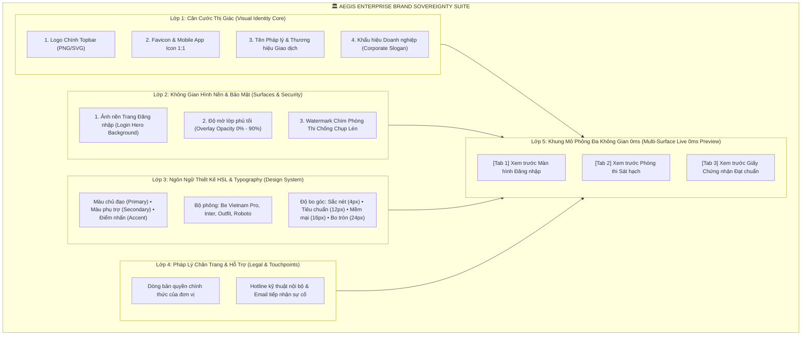

# HƯỚNG DẪN QUẢN TRỊ BẢN SẮC THƯƠNG HIỆU & WHITE-LABELING TOÀN DIỆN
## (AEGIS ENTERPRISE BRAND SOVEREIGNTY & WHITE-LABELING SUITE)
**Mã hiệu**: **AEGIS-DOC-BRAND-2026**  
**Chủ biên**: **No.1 — World-Class Polymath Chief Architect & Brand Experience Virtuoso**  
**Chuẩn mực tuân thủ**: **ALDS v1.0**, **CLEAR Architecture**, **CSS Variables HSL 0ms Hot-Reload**

---

## I. TẦM NHÌN BẢN SẮC THƯƠNG HIỆU DOANH NGHIỆP (BRAND SOVEREIGNTY)

Trong thực tế, khi các Tập đoàn lớn (như Ngân hàng Agribank, Vietcombank, Viettel, EVN) hoặc các Sở/Bộ Giáo dục sử dụng một nền tảng SaaS khảo thí, họ đòi hỏi **Quyền Sở Hữu Thương Hiệu Tuyệt Đối (Brand Sovereignty)**:
1. **Triệt tiêu cảm giác dùng nhờ bên thứ ba**: Giao diện phải mang trọn vẹn Căn cước Thị giác (Visual Identity) của chính tổ chức.
2. **Bộ Nhận Diện Đa Thể Thức**: Không chỉ đổi mỗi mã màu, mà phải bao gồm Logo ngang Topbar, Biểu tượng App Icon / Favicon 1:1, Khẩu hiệu doanh nghiệp (Corporate Slogan), và Ảnh nền phong cảnh / tòa nhà hội sở với độ mờ chuẩn mực.
3. **Watermark Bảo Mật Chống Chụp Trộm Đề Thi**: Logo và Mã nhân viên / SBD chạy chìm $45^\circ$ đằng sau đề thi, bảo vệ bí mật kinh doanh và kỷ luật phòng thi.
4. **Vinh Danh Đạt Chuẩn**: Xuất giấy chứng nhận tốt nghiệp / hoàn thành sát hạch mang đúng Quốc huy, Con dấu, Chữ ký và Bản sắc doanh nghiệp.

---

## II. MA TRẬN 5 LỚP BẢN SẮC THƯƠNG HIỆU (5-LAYER BRAND MATRIX)

---

## III. LIVE CODE & CONTRACT VERIFIABILITY

Hệ thống được nối kết sống 100% giữa Frontend, Backend và Cơ sở dữ liệu:

### 3.1 Backend Multi-Tenancy Hub
* Controller API Thương hiệu: [`TenantsController.cs`](file:///d:/Cuong/DuAn/mybank/AegisQuiz/Backend/src/AegisQuiz.API/Controllers/TenantsController.cs)
  - `GET /api/admin/tenants/branding`: Lấy cấu hình thương hiệu của Tenant (cho phép ẩn danh để nạp theme cho trang Đăng nhập).
  - `PUT /api/admin/tenants/branding`: Lưu cấu hình thương hiệu vào trường `ConfigJson`, `LogoUrl`, `PrimaryColor`, `CustomDomain` của bảng `Tenants`.
* Entity Domain: [`Tenant.cs`](file:///d:/Cuong/DuAn/mybank/AegisQuiz/Backend/src/AegisQuiz.Domain/Entities/Tenant.cs)

### 3.2 Frontend Zero-Monolith Suite ($\le 250$ LOC/file)
* Trang Điều Phối Chính: [`TenantThemeCustomizerPage.tsx`](file:///d:/Cuong/DuAn/mybank/AegisQuiz/Frontend/src/pages/admin/white-label/TenantThemeCustomizerPage.tsx) *(117 LOC)*
* Hook Quản trị Trạng thái & Tiêm CSS: [`useWhiteLabelTheme.ts`](file:///d:/Cuong/DuAn/mybank/AegisQuiz/Frontend/src/pages/admin/white-label/hooks/useWhiteLabelTheme.ts) *(118 LOC)*
* Component Căn Cước Thị Giác & Logo: [`BrandIdentityHub.tsx`](file:///d:/Cuong/DuAn/mybank/AegisQuiz/Frontend/src/pages/admin/white-label/components/BrandIdentityHub.tsx) *(176 LOC)*
* Component Không Gian Hình Nền & Watermark: [`SurfaceBackgroundConfig.tsx`](file:///d:/Cuong/DuAn/mybank/AegisQuiz/Frontend/src/pages/admin/white-label/components/SurfaceBackgroundConfig.tsx) *(144 LOC)*
* Component Khung Xem Trước Đa Chiều: [`MultiSurfaceLivePreview.tsx`](file:///d:/Cuong/DuAn/mybank/AegisQuiz/Frontend/src/pages/admin/white-label/components/MultiSurfaceLivePreview.tsx) *(250 LOC)*
* Component Pháp Lý Chân Trang: [`FooterAndLegalConfig.tsx`](file:///d:/Cuong/DuAn/mybank/AegisQuiz/Frontend/src/pages/admin/white-label/components/FooterAndLegalConfig.tsx) *(80 LOC)*
* Component Bộ Bảng Màu Doanh Nghiệp: [`ThemeColorPalettePicker.tsx`](file:///d:/Cuong/DuAn/mybank/AegisQuiz/Frontend/src/pages/admin/white-label/components/ThemeColorPalettePicker.tsx) *(162 LOC)*
* Component Phông Chữ & Bo Góc: [`ThemeFontSelector.tsx`](file:///d:/Cuong/DuAn/mybank/AegisQuiz/Frontend/src/pages/admin/white-label/components/ThemeFontSelector.tsx) *(138 LOC)*

---

## IV. QUY TRÌNH 4 BƯỚC THIẾT LẬP THƯƠNG HIỆU DOANH NGHIỆP

1. **Bước 1 — Chọn Mẫu Nhanh hoặc Nhập Thủ Công**:
   - Nhấp vào các mẫu đề xuất sẵn: **Agribank** (Đỏ bã trầu `#7b1113`), **Vietcombank** (Xanh lục `#005a36`), hoặc **Viettel** (Đỏ `#ee0033`).
   - Nhập Tên tổ chức, Tên miền riêng (`sat-hach.agribank.com.vn`), và Khẩu hiệu hành động.
2. **Bước 2 — Cấu hình Logo & Favicon**:
   - Dán URL Logo chính (định dạng PNG trong suốt hoặc SVG).
   - Kéo thanh trượt điều chỉnh chiều cao Logo (từ 24px đến 64px) cho vừa vặn với Navbar.
   - Nhập URL Favicon vuông 1:1 cho trình duyệt.
3. **Bước 3 — Thiết lập Không Gian Hình Nền & Watermark**:
   - Chọn ảnh nền Tòa nhà Hội sở hoặc Công nghệ FinTech.
   - Điều chỉnh thanh trượt độ mờ tối (`Overlay Darkness` 60% - 75%) để chữ form đăng nhập luôn sắc nét.
   - Bật công tắc *"Watermark chìm chống chụp trộm đề thi"* để kích hoạt bảo mật phòng thi.
4. **Bước 4 — Kiểm thử Trực Quan 0ms & Lưu Lên Hệ Thống**:
   - Chuyển đổi giữa 3 tab xem trước tại cột phải:
     * **Tab Đăng nhập**: Thấy ngay trang đăng nhập hoàn chỉnh mang bản sắc của ngân hàng.
     * **Tab Phòng thi**: Thấy ngay câu hỏi sát hạch với màu sắc, phông chữ và watermark.
     * **Tab Chứng chỉ**: Thấy ngay Giấy khen tốt nghiệp in đậm dấu ấn doanh nghiệp.
   - Bấm **"Lưu cấu hình thương hiệu"**: Hệ thống lưu vào PostgreSQL và tiêm biến CSS trực tiếp lên toàn bộ ứng dụng mà không cần khởi động lại.

---

## V. LỊCH SỬ THẨM ĐỊNH & KIỂM TOÁN (AUDIT TRAIL)

| Phiên bản | Mốc thời gian | Kiến trúc sư | Nội dung nâng cấp |
| :--- | :--- | :--- | :--- |
| **v1.0.0** | 19/09/2026 | Legacy Team | Bản color picker sơ khai chỉ có 3 ô chọn màu và preview generic |
| **v2.0.0** | 03/11/2026 | No.1 Chief Architect | Đại tu toàn diện Enterprise Brand Sovereignty: Bổ sung Logo đa thể thức, Slogan doanh nghiệp, Hình nền trang đăng nhập, Watermark chống chụp trộm đề thi, Chứng chỉ tốt nghiệp, và Live Preview 3 màn hình. |

