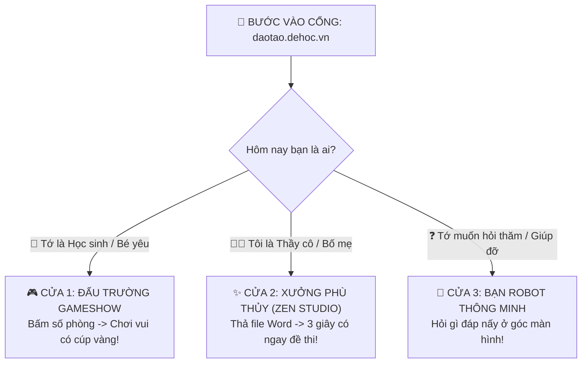
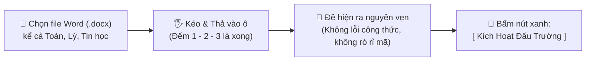

# 🌈 CẨM NANG SỬ DỤNG AEGIS GLOBAL — SIÊU DỄ HIỂU (BÉ MẪU GIÁO CŨNG LÀM ĐƯỢC!)

> **Cổng Trực Tuyến**: [**`https://daotao.dehoc.vn`**](https://daotao.dehoc.vn)  
> **Khẩu hiệu**: *"Học mà chơi — Chơi mà giỏi — Bấm là mê!"*  
> **Dành cho**: Tất cả mọi người (từ các bé mẫu giáo, học sinh tiểu học đến quý phụ huynh và thầy cô giáo).

---

## 🧸 BẢN ĐỒ VÀNG: BẠN MUỐN LÀM GÌ HÔM NAY?

Hệ thống giống như một **Công viên Đồ chơi Thông minh**, chỉ có 3 cánh cửa thần kỳ:



---

## 🎮 PHẦN 1: DÀNH CHO CÁC BẠN NHỎ & HỌC SINH (3 BƯỚC VÀO CHƠI)

Các bạn nhỏ ơi, thi đua trên Aegis vui như chơi điện tử trên tivi vậy! Hãy làm đúng 3 bước này nhé:

```
  [ BƯỚC 1: MỞ CỬA ]        [ BƯỚC 2: NHẬP MÃ ]         [ BƯỚC 3: RINH CÚP ]
        🌐                         🔢                           🏆
   Vào trang web             Nhập 6 số cô giáo đưa        Bấm màu & Rinh quà
  daotao.dehoc.vn             Ví dụ: 1 2 3 4 5 6          Đứng đầu bảng vàng!
```

### 🎈 Bước 1: Mở cổng phép thuật
- Lấy máy tính bảng, điện thoại hoặc máy tính của bố mẹ.
- Mở trình duyệt (hình quả cầu hoặc chữ C nhiều màu) và gõ: **`daotao.dehoc.vn`**.

### 🎈 Bước 2: Nhập số bí mật
- Nhìn thấy ô có chữ **"Nhập Mã Phòng Thi"** to đùng giữa màn hình.
- Nhập **6 con số** mà thầy cô hoặc bố mẹ đọc cho bạn (ví dụ: `888999`).
- Gõ tên đáng yêu của mình (ví dụ: `Bé Bắp`, `Siêu Nhân Nhí`).
- Bấm chiếc nút xanh lá cây: **[ VÀO THI NGAY ]**.

### 🎈 Bước 3: Bấm chọn và Bắn pháo hoa!
- Khi câu hỏi hiện lên:
  - 🔵 **Màu Xanh Dương (A)**: Lựa chọn 1
  - 🟢 **Màu Xanh Lá (B)**: Lựa chọn 2
  - 🟡 **Màu Vàng (C)**: Lựa chọn 3
  - 🔴 **Màu Đỏ (D)**: Lựa chọn 4
- **Bấm thật nhanh**: Ai bấm đúng và nhanh nhất sẽ được **Cúp Vàng** 🏆 bay lơ lửng và tên bay lên đầu bảng xếp hạng!

---

## ✨ PHẦN 2: DÀNH CHO THẦY CÔ & PHỤ HUYNH (SOẠN ĐỀ DỄ NHƯ PHA MÌ TÔM)

Thầy cô không cần phải copy-paste từng câu mỏi tay nữa. Hệ thống đã có **Xưởng Thần Tốc (Zen Studio)**:



### 🪄 Quy trình 3 chạm thần thánh:

| Chạm | Thao tác | Mô tả siêu đơn giản |
| :---: | :--- | :--- |
| **Chạm 1** | **Bấm vào "Zen Studio"** | Nằm ngay trên đầu trang, có biểu tượng cây đũa thần màu tím 🪄 |
| **Chạm 2** | **Kéo thả File Word HOẶC Chọn Chủ Đề Đã Lưu** | Thả tệp đề thi mới vào khung nét đứt, HOẶC bấm sang tab **`📚 Chủ Đề & Câu Hỏi Đã Lưu`** để chọn lại bài tập cũ có sẵn trong kho! |
| **Chạm 3** | **Bấm nút [ Kích Hoạt Đấu Trường ] hoặc [ Giao Bài Tập ]** | Lập tức hiện ra **Mã Phòng 6 Số** cho cả lớp cùng chơi đua điểm, hoặc link Zalo gửi bài về nhà cho học sinh! |

---

## 🎛️ BẢNG TRA CỨU CÁC NÚT BẤM KỲ DIỆU (NHÌN HÌNH ĐOÁN NÚT)

Dưới chân bảng câu hỏi có các nút màu sắc rất dễ nhớ:

```
┌─────────────────┬─────────────────┬───────────────────┬────────────────┐
│  💾 Nút Xanh    │  🚀 Nút Ngọc    │    ❌ Nút Xám     │  🎁 Nút Cam    │
│  LƯU NGÂN HÀNG  │ KÍCH HOẠT ĐẤU   │      HỦY BỎ       │   COMMUNITY    │
│                 │     TRƯỜNG      │     (Cancel)      │                │
├─────────────────┼─────────────────┼───────────────────┼────────────────┤
│ Cất đề thi vào  │ Mở phòng chơi   │ Không thích nữa,  │ Tặng đề thi    │
│ kho bí mật của  │ trực tiếp cho   │ xóa đi làm lại,   │ này cho các    │
│ thầy cô để      │ cả lớp cùng     │ an toàn 100%,     │ cô giáo khác   │
│ dùng nhiều lần  │ bấm chuông đua  │ không sợ hỏng     │ trên khắp cả   │
│                 │ điểm            │ dữ liệu           │ nước           │
└─────────────────┴─────────────────┴───────────────────┴────────────────┘
```

> [!TIP]
> **BẤM NHẦM CŨNG KHÔNG SAO!**  
> Nếu vừa tải nhầm một file Word cũ, thầy cô chỉ cần bấm chiếc nút xám có chữ **[ Hủy Bỏ ]** (nằm ngay sau nút Kích hoạt đấu trường). Màn hình sẽ quay về trạng thái sạch sẽ như mới!

---

## 💻 ĐỀ THI TIN HỌC & TOÁN HỌC KHÔNG BAO GIỜ BỊ LỖI!

Hệ thống có "Mắt thần AI" thông minh nhất quả đất:
1. **Đề Tin học có code khó (`<html>`, `<style>`, `<ol>`...)**: Hệ thống bọc lớp kính bảo vệ, **giữ nguyên từng dấu chấm, dấu phẩy**, không bị mất chữ hay vỡ khung hình.
2. **Đề Toán có căn bậc hai, phân số, hình vẽ tam giác**: Hệ thống tự dịch sang chữ in hoa chuẩn sách giáo khoa, rõ nét từng milimét.

---

## 🤖 GẶP KHÓ KHĂN? HỎI NGAY BẠN ROBOT TRỢ LÝ!

Nếu có chỗ nào chưa hiểu, bạn đừng ngại:
1. Nhìn xuống **góc dưới cùng bên phải màn hình**.
2. Thấy hình **chú Robot tròn xoe đang cười** 🤖.
3. Bấm vào chú Robot và nói hoặc gõ: *"Làm sao để tạo đề thi?"*, *"Làm sao để lấy lại mật khẩu?"*...
4. Bạn Robot sẽ trả lời ngay lập tức bằng tiếng Việt siêu ngọt ngào và chỉ dẫn từng bước!

---

## 🛡️ BẢNG XỬ LÝ NHANH TRONG 1 GIÂY KHI CÓ TRỤC TRẶC

| Hiện tượng | Nguyên nhân | Cách sửa siêu nhanh (Bé cũng làm được) |
| :--- | :--- | :--- |
| **Không nghe thấy tiếng pháo hoa/âm nhạc** | Loa máy tính đang tắt | Bấm vào biểu tượng 🎵 **Hiệu Ứng Âm Thanh: BẬT** ở góc trên màn hình. |
| **Bấm vào web quay tròn tròn** | Mạng Wifi nhà mình bị yếu | Tắt Wifi đi bật lại, hoặc bấm nút F5 (Tải lại trang). |
| **Quên mã phòng thi** | Cô giáo chưa gửi hoặc nhập nhầm | Nhìn lên màn hình lớn của cô giáo để xem lại 6 con số to đùng nhé. |
| **Muốn xem thông tin trường / pháp lý** | Cần tìm hiểu về Aegis Global | Cuộn chuột xuống tít dưới chân trang, bấm vào mục **"Về Aegis Global"** hoặc **"Điều khoản sử dụng"**. |

---

> 🎉 **CHÚC CÁC BẠN NHỎ VÀ QUÝ THẦY CÔ CÓ NHỮNG GIỜ HỌC BÙNG NỔ NIỀM VUI CÙNG AEGIS GLOBAL!**

