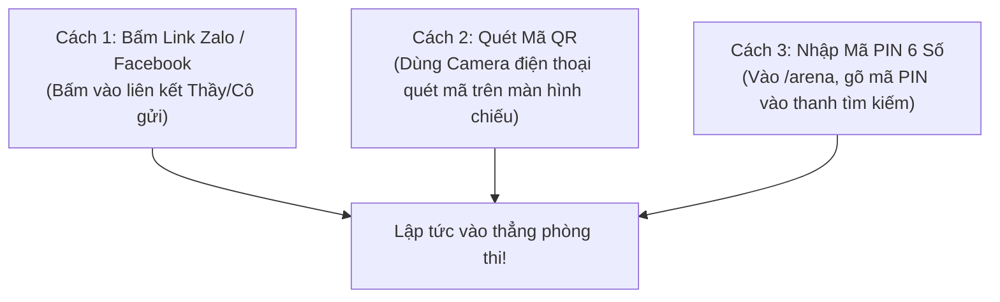

# 📱 CẨM NANG HƯỚNG DẪN DÀNH CHO HỌC SINH & NGƯỜI HỌC
## VÀO THI 1 CHẠM KHÔNG CẦN NICK • BẤM CHUÔNG LIVE ARENA • TRANH TÀI GIẢI ĐẤU DỮ LIỆU THẬT
### *(Chuẩn Trải Nghiệm Người Học Quốc Tế — Áp Dụng Cho Mọi Thiết Bị Điện Thoại, Tablet, Laptop, PC)*

> **Phiên bản**: `2026.2 (Chuẩn Trải Nghiệm Đấu Trường Thực Tế)`  
> **Địa chỉ sảnh đấu trường**: `http://localhost:3000/arena`  
> **Phương châm**: *"Học tập đỉnh cao như thể thao điện tử Esports — Tranh tài công bằng với ngân hàng câu hỏi thật 100%"*

---

### MỤC LỤC
1. [Triết Lý "Zero-Friction" — Không Cần Đăng Ký Rườm Rà](#1-triết-lý-zero-friction--không-cần-đăng-ký-rườm-rà)
2. [Tham Gia Các Giải Đấu Trực Tiếp Với Dữ Liệu Thật (Live Real Tournaments)](#2-tham-gia-các-giải-đấu-trực-tiếp-với-dữ-liệu-thật-live-real-tournaments)
3. [Cách Vào Phòng Thi Đấu Của Lớp (3 Cách Cực Dễ)](#3-cách-vào-phòng-thi-đấu-của-lớp-3-cách-cực-dễ)
4. [Bí Quyết Giành Chiến Thắng Tại 5 Thể Thức Gameshow](#4-bí-quyết-giành-chiến-thắng-tại-5-thể-thức-gameshow)
5. [Hướng Dẫn Làm Bài Thi Tự Luyện & Tự Sửa Sai (ACSE 4 Lát Cắt)](#5-hướng-dẫn-làm-bài-thi-tự-luyện--tự-sửa-sai-acse-4-lát-cắt)
6. [Giải Đáp Thắc Mắc Thường Gặp (FAQ)](#6-giải-đáp-thắc-mắc-thường-gặp-faq)

---

### 1. TRIẾT LÝ "ZERO-FRICTION" — KHÔNG CẦN ĐĂNG KÝ RƯỜM RÀ

Tại **AegisGlobal**, các bạn học sinh không phải mất thời gian tạo tài khoản phức tạp, nhớ mật khẩu hay xác thực email:
* **Vào thi trong 5 giây**: Chỉ cần có link Thầy/Cô gửi qua Zalo hoặc quét mã QR là vào làm bài ngay.
* **Bảo vệ quyền riêng tư**: Không yêu cầu số điện thoại hay thông tin cá nhân nhạy cảm.

---

### 2. THAM GIA CÁC GIẢI ĐẤU TRỰC TIẾP VỚI DỮ LIỆU THẬT (LIVE REAL TOURNAMENTS)

Ngay tại sảnh chính **Arena Hub** (`http://localhost:3000/arena`), bạn có thể tham gia thi đấu thời gian thực 24/7 tại các giải đấu được nạp **100% dữ liệu câu hỏi thật** từ ngân hàng đề thi chuẩn quốc gia:

| Giải Đấu Thực Tế | Ngân Hàng Câu Hỏi | Thể Thức Mặc Định | Đối Tượng Thử Sức |
| :--- | :---: | :---: | :--- |
| **🇬🇧 Đại Chiến Tiếng Anh Quốc Gia** | **40 Câu thật** *(Đề chuẩn Bộ GD&ĐT)* | 🏆 Olympia Supreme | Luyện thi Tốt nghiệp THPT, chứng chỉ IELTS / TOEIC |
| **🏦 Đấu Trường Tín Dụng & Ngân Hàng** | **240 Câu thật** *(Quy chế cho vay & Thẩm định)* | 🔔 Rung Chuông Vàng | Sinh viên Kinh tế, Banker, chuyên viên tín dụng |
| **🔬 Đấu Trường Hóa Học Đỉnh Cao** | **28 Câu thật** *(Este, kim loại kiềm, đồ thị)* | ⚡ Nhanh Như Chớp | Ôn thi học sinh giỏi, chinh phục điểm 9-10 khối A/B |
| **🧬 Đấu Trường Sinh Học & Di Truyền** | **28 Câu thật** *(Men-đen, phiên mã dịch mã)* | 👑 Ai Là Triệu Phú | Chinh phục điểm cao khối B, y đa khoa |
| **🌟 Siêu Trí Tuệ Toàn Năng (Omniverse)** | **816+ Câu thật** *(Đa môn bốc ngẫu nhiên)* | 🔔 Rung Chuông Vàng | Toàn bộ học sinh và kiện tướng tri thức cả nước |

> [!TIP]
> **Chế độ Tự Tạo Giải Đấu Riêng**: Bạn có thể bấm nút **"+ TẠO GIẢI ĐẤU RIÊNG (ĐỀ THẬT)"** để chọn môn học bạn thích, chọn số lượng câu (10, 15, 20, 30 câu), sau đó gửi mã PIN 6 số cho bạn bè trong lớp cùng vào tranh tài!

---

### 3. CÁCH VÀO PHÒNG THI ĐẤU CỦA LỚP (3 CÁCH CỰC DỄ)

#### Chi tiết Cách 3 (Nhập mã PIN):
1. Mở trình duyệt web trên điện thoại hoặc máy tính, truy cập: `http://localhost:3000/arena`.
2. Gõ **Mã PIN 6 số** Thầy/Cô cung cấp (Ví dụ: `175014`) vào ô nhập mã.
3. Bấm **"VÀO PHÒNG"**, nhập Tên/Biệt danh và chọn Avatar là bạn đã sẵn sàng trên sàn đấu!

---

### 4. BÍ QUYẾT GIÀNH CHIẾN THẮNG TẠI 5 THỂ THỨC GAMESHOW

1. **🔔 Rung Chuông Vàng (Golden Bell)**:
   * Giữ vững sự tập trung cao độ vì **sai 1 câu là phải rời sàn đấu**!
   * Chờ đón cơ hội Thầy Cô thực hiện minigame "Cứu Trợ" để được hồi sinh.
2. **⚡ Nhanh Như Chớp (Lightning Incline)**:
   * Leo 10 bậc đứng trong 2 phút!
   * Trả lời đúng leo 1 bậc, trả lời sai tụt ngay về vạch số 0. Tốc độ và bình tĩnh là chìa khóa.
3. **🏆 Olympia Supreme**:
   * Tận dụng tốc độ bấm chuông phản xạ cực nhanh ($<2\text{ms}$).
   * Sử dụng thông minh **Ngôi Sao Hy Vọng** tại phần thi Về Đích để nhân đôi điểm số.
4. **👑 Ai Là Triệu Phú**:
   * Tận dụng 4 quyền trợ giúp độc bản: 50:50, Hỏi Gia Sư AI Socrates, Hỏi ý kiến cả lớp qua quét QR, Đổi câu hỏi.
5. **🎓 Đấu Trường Đại Học**:
   * Bấm chuông Starter để giành quyền trả lời và mở chuỗi 3 câu hỏi Bonus với kênh thảo luận kín cùng đồng đội.

---

### 5. HƯỚNG DẪN LÀM BÀI THI TỰ LUYỆN & TỰ SỬA SAI (ACSE 4 LÁT CẮT)

Khi hoàn thành bài thi tự luyện, hãy bấm nút **"💡 Học Từ Sai Lầm"**:
* 🔍 **1. Clue (Dấu hiệu)**: Nhận biết dấu hiệu nhận diện trong đề.
* 💡 **2. Concept (Hạt nhân tri thức)**: Nhớ lại công thức cốt lõi.
* 👣 **3. Step (Chuỗi suy luận)**: Các bước giải nhanh gọn.
* 🪝 **4. Hook (Mẹo khắc cốt ghi tâm)**: Câu thần chú ngắn gọn để không bao giờ sai lại câu tương tự.
* Bấm **"+ Sổ Tay FSRS"** để thuật toán lặp ngắt quãng tự động nhắc bạn ôn tập lại câu sai sau 1 ngày, 3 ngày và 7 ngày!
