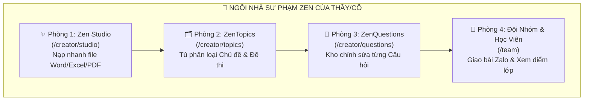
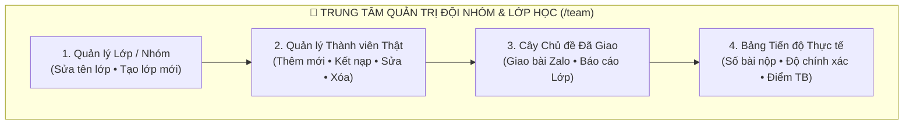

# 🎓 CẨM NANG HƯỚNG DẪN SỬ DỤNG HỆ SINH THÁI SƯ PHẠM ZEN (4-TRONG-1)
## DÀNH CHO MỌI GIÁO VIÊN — TỪ CÔ GIÁO MẦM NON ĐẾN GIẢNG VIÊN ĐẠI HỌC
### *(Hướng dẫn cầm tay chỉ việc từng bước • Ngôn ngữ bình dị • Kèm ví dụ minh họa thực tế)*

> **Hệ sinh thái**: Aegis Global Cognitive Infrastructure (AGCI)  
> **Phiên bản**: `ALDS v3.0 — Hierarchical Topic Tree, PDF Spatial Math & Real Team Management Edition` (Cập nhật: `2026-11-10`)  
> **Thanh điều hướng 4 phân hệ của Giáo viên**:  
> - ✨ **Zen Studio (Soạn Đề)**: [`/creator/studio`](file:///d:/Cuong/DuAn/mybank/AegisGlobal/Frontend/src/pages/creator/studio/CreatorZenStudioPage.tsx)  
> - 🗂️ **ZenTopics (Chủ Đề Của Tôi)**: [`/creator/topics`](file:///d:/Cuong/DuAn/mybank/AegisGlobal/Frontend/src/pages/creator/topics/ZenTopicsPage.tsx)  
> - 📝 **ZenQuestions (Câu Hỏi Của Tôi)**: [`/creator/questions`](file:///d:/Cuong/DuAn/mybank/AegisGlobal/Frontend/src/pages/creator/questions/ZenQuestionsPage.tsx)  
> - 👥 **Đội Nhóm & Học Viên (Quản Lý Lớp)**: [`/team`](file:///d:/Cuong/DuAn/mybank/AegisGlobal/Frontend/src/pages/team-leader/TeamDashboard.tsx)  
> **Lời hứa với Thầy/Cô**: *"Không cần giỏi máy tính! Chỉ cần biết bấm chuột hoặc chạm màn hình điện thoại là Thầy/Cô làm chủ được toàn bộ hệ thống trong 3 phút."*

---

## 📑 MỤC LỤC NHANH CHO THẦY/CÔ
1. [Bức Tranh Toàn Cảnh: "Ngôi Nhà Zen 4 Phòng" Của Thầy/Cô](#1-bức-tranh-toàn-cảnh-ngôi-nhà-zen-4-phòng-của-thầycô)
2. [Phòng 1 — ✨ Zen Studio: Biến Tờ Giấy/File Word Thành Trò Chơi Trong 3 Chạm](#2-phòng-1--zen-studio-biến-tờ-giấyfile-word-thành-trò-chơi-trong-3-chạm)
3. [Phòng 2 — 🗂️ ZenTopics: "Tủ Đựng Hồ Sơ Chủ Đề" Của Riêng Thầy/Cô](#3-phòng-2--zentopics-tủ-đựng-hồ-sơ-chủ-đề-của-riêng-thầycô)
4. [Phòng 3 — 📝 ZenQuestions: "Kho Câu Hỏi Cá Nhân" & Trợ Lý AI Soạn Hộ](#4-phòng-3--zenquestions-kho-câu-hỏi-cá-nhân--trợ-lý-ai-soạn-hộ)
5. [Phòng 4 — 👥 Đội Nhóm & Học Viên: Giao Bài Qua Zalo & Xem Ai Đã Làm Bài](#5-phòng-4--đội-nhóm--học-viên-giao-bài-qua-zalo--xem-ai-đã-làm-bài)
6. [3 Câu Chuyện Ví Dụ Thực Tế (Từ Cô Giáo Mầm Non Đến Thầy Giáo Trung Học)](#6-3-câu-chuyện-ví-dụ-thực-tế-từ-cô-giáo-mầm-non-đến-thầy-giáo-trung-học)
7. [5 Trò Chơi Đấu Trường Trực Tiếp Trên Lớp Học (Live Arena)](#7-5-trò-chơi-đấu-trường-trực-tiếp-trên-lớp-học-live-arena)
8. [Mẹo Gõ File Word / Excel Để Máy Đọc Chuẩn 100%](#8-mẹo-gõ-file-word--excel-để-máy-đọc-chuẩn-100)
9. [Giải Đáp Thắc Mắc Thường Gặp Của Thầy/Cô (Hỏi Nhanh - Đáp Gọn)](#9-giải-đáp-thắc-mắc-thường-gặp-của-thầycô-hỏi-nhanh---đáp-gọn)

---

## 1. BỨC TRANH TOÀN CẢNH: "NGÔI NHÀ ZEN 4 PHÒNG" CỦA THẦY/CÔ

Khi đăng nhập vào hệ thống, Thầy/Cô sẽ thấy ngay **Thanh điều hướng 4 nút màu sắc** ở trên cùng màn hình ([`CreatorWorkspaceNav.tsx`](file:///d:/Cuong/DuAn/mybank/AegisGlobal/Frontend/src/pages/creator/components/CreatorWorkspaceNav.tsx)). Hãy hình dung đây là **4 căn phòng làm việc riêng tư** của Thầy/Cô (người khác không thể tự ý xóa hay sửa bài của Thầy/Cô):



| Tên Phòng (Nút Trên Màn Hình) | Dùng Để Làm Gì? (Hiểu Trong 1 Câu) | Khi Nào Thầy/Cô Bấm Vào Đây? |
| :--- | :--- | :--- |
| **✨ Zen Studio (Soạn Đề)** | Kéo thả file Word/Excel/PDF có sẵn để máy tự tách câu hỏi trong 2 giây. | Khi Thầy/Cô có sẵn file đề thi trên máy tính và muốn cho học sinh làm ngay. |
| **🗂️ ZenTopics (Chủ Đề Của Tôi)** | Như "Tủ hồ sơ nhiều ngăn" chứa các Chủ đề & Đề thi do chính Thầy/Cô tạo. | Khi Thầy/Cô muốn tạo chủ đề mới (VD: *Chủ đề Động vật*, *Toán Lớp 1*), xem đề cũ hoặc xóa đề nháp. |
| **📝 ZenQuestions (Câu Hỏi Của Tôi)** | Chứa toàn bộ từng câu hỏi lẻ của Thầy/Cô. Có nút nhờ AI tự nghĩ câu hỏi mới! | Khi Thầy/Cô muốn gõ thêm 1-2 câu đố mới, sửa lỗi chính tả câu cũ, hoặc nhờ AI soạn hộ 5 câu hỏi. |
| **👥 Đội Nhóm & Học Viên** | Nơi lấy đường link gửi vào Zalo phụ huynh và xem bảng điểm của cả lớp. | Khi Thầy/Cô muốn giao bài về nhà hoặc kiểm tra xem bé nào đã làm bài, câu nào cả lớp hay sai. |

> [!IMPORTANT]
> **Bảo mật & Chủ quyền tuyệt đối**: Trang Quản trị hệ thống (`/admin`) chỉ dành cho Quản trị viên kỹ thuật (`SysAdmin` & `TenantAdmin`). Toàn bộ tài nguyên giảng dạy của Thầy/Cô được bảo vệ riêng biệt trong 4 phòng Zen ở trên — **chỉ chính Thầy/Cô** mới có quyền sửa/xóa chủ đề và câu hỏi của mình!

---

## 2. PHÒNG 1 — ✨ ZEN STUDIO: BIẾN TỜ GIẤY / FILE WORD / PDF / EXCEL THÀNH TRÒ CHƠI TRONG 3 CHẠM

📍 **Cách mở**: Bấm nút **`✨ Zen Studio (Soạn Đề)`** trên thanh menu (hoặc vào địa chỉ [`/creator/studio`](file:///d:/Cuong/DuAn/mybank/AegisGlobal/Frontend/src/pages/creator/studio/CreatorZenStudioPage.tsx)).

### Thao tác 3 bước cực dễ:
1. **Bước 1 (Thả file Word, Excel hoặc PDF)**:
   - Thầy/Cô bấm vào khung nét đứt giữa màn hình rồi chọn file **Word (`.docx`)**, **Excel (`.xlsx`)** hoặc **PDF (`.pdf`)** trên máy tính.
   - **Đặc quyền nâng cấp cho file PDF Toán/Lý/Hóa**: Hệ thống tự động tái tạo công thức phân số $\frac{a}{b}$, dấu vector $\overrightarrow{AB}$, hệ phương trình ngoặc nhọn $\begin{cases}$, chỉ số dưới $u_n$ và chuyển **Bảng số liệu ghép nhóm** trong PDF thành bảng biểu sắc nét, đồng thời tự động lấy chuẩn Đáp án đúng và Hướng dẫn giải như file Word! Với các trang PDF chụp ảnh mờ, hệ thống tự động kích hoạt **AI Vision Fallback** ([`PdfHybridVisionFallbackService.cs`](file:///d:/Cuong/DuAn/mybank/AegisGlobal/Backend/src/Aegis.Infrastructure/Services/Pdf/PdfHybridVisionFallbackService.cs)) để đọc không sót 1 chữ.
2. **Bước 2 (Xem lại, Chỉnh sửa & Chọn Nhánh Chủ Đề Cha)**:
   - Máy tự động đọc và hiện danh sách câu hỏi ngay trên màn hình ([`ZenExamPreview.tsx`](file:///d:/Cuong/DuAn/mybank/AegisGlobal/Frontend/src/pages/creator/studio/components/ZenExamPreview.tsx)).
   - Khi bấm **`✏️ Sửa`** ở bất kỳ câu hỏi nào:
     - Bấm nút **`Σ Toán`** để mở **Bàn Phím & Studio Công Thức Toán Học Toàn Màn Hình** ([`MathFormulaStudioModal.tsx`](file:///d:/Cuong/DuAn/mybank/AegisGlobal/Frontend/src/components/common/math-studio/MathFormulaStudioModal.tsx)) gồm 8 chuyên đề (Đại số, Giải tích, Hình học, Ma trận/Hệ PT, Lượng giác, Vật lý, Hóa học...) chèn 1 chạm ngay tại con trỏ.
     - Bấm nút **`Bảng`** để chèn bảng số liệu — mọi công thức toán `$...$` nằm bên trong ô bảng đều được hiển thị sắc nét thành công thức chuẩn.
   - **Chọn Nhánh Chủ Đề Đích (Cây Phân Cấp)**: Ngay trên thanh công cụ đề thi có ô chọn **`Nhánh chủ đề cha`** (hiển thị dạng cây `├─`, `└─`) và nút **`+ Nhánh mới`** ([`ZenQuickTopicModal.tsx`](file:///d:/Cuong/DuAn/mybank/AegisGlobal/Frontend/src/pages/creator/studio/components/ZenQuickTopicModal.tsx)) để Thầy/Cô đặt đề thi vào đúng thư mục môn học/khối lớp mong muốn.
3. **Bước 3 (Chọn 1 trong 4 nút ở thanh điều khiển nổi dưới đáy màn hình)**:
   - Nút **💾 Lưu Ngân Hàng**: Cất đề này vào đúng nhánh chủ đề đã chọn trên cây (`ZenTopics` & `ZenQuestions`) để dành hôm sau dùng.
   - Nút **📤 Giao Bài Tập**: Tạo ra **Mã QR** (hình vuông đen trắng) và **Đường link** để gửi vào Zalo cho phụ huynh/học sinh làm ở nhà.
   - Nút **⚡ Kích Hoạt Đấu Trường**: Mở ngay trò chơi **Rung Chuông Vàng** hoặc **Nhanh Như Chớp** chiếu lên Tivi/Máy chiếu cho cả lớp cùng chơi!
   - Nút **❌ Hủy Bỏ (Cancel)**: Hủy bỏ ngay lượt đọc đề hiện tại để quay về màn hình chọn file khác mà không lưu bất kỳ dữ liệu rác nào vào hệ thống.

> [!NOTE]
> **Hỗ trợ đặc biệt cho Đề thi Tin học & Lập trình**:  
> Nếu đề thi chứa các đoạn mã code HTML, CSS, XML (ví dụ: `<ol start="10">`, `<li>...</li>`, `<h1>`, `<style>...</style>`), hệ thống tự động nhận diện và giữ nguyên vẹn 100% từng dòng code để hiển thị sắc nét cho học sinh, tuyệt đối không bị mất nội dung hay vỡ giao diện!

---

## 3. PHÒNG 2 — 🗂️ ZENTOPICS: "CÂY THƯ MỤC CHỦ ĐỀ PHÂN CẤP" CỦA RIÊNG THẦY/CÔ

📍 **Cách mở**: Bấm nút **`🗂️ ZenTopics (Chủ Đề Của Tôi)`** trên thanh menu ([`/creator/topics`](file:///d:/Cuong/DuAn/mybank/AegisGlobal/Frontend/src/pages/creator/topics/ZenTopicsPage.tsx)).

Hãy tưởng tượng **ZenTopics** giống như chiếc tủ hồ sơ nhiều tầng ngăn kéo (**Cây Phân Cấp Cha $\rightarrow$ Con**). Thầy/Cô có thể tạo Thư mục lớn (VD: *Toán Lớp 12*), bên trong có các Thư mục con (VD: *Chương 1: Hàm số*, *Chương 2: Nguyên hàm - Tích phân*), và bên trong nữa là từng Đề thi cụ thể!

### Các nâng cấp nổi bật trong Cây Chủ Đề Phân Cấp ([`TopicTreeTable.tsx`](file:///d:/Cuong/DuAn/mybank/AegisGlobal/Frontend/src/pages/admin/questions/components/TopicTreeTable.tsx)):
1. **Hiển thị Dạng Cây Đa Tầng & Cộng Dồn Số Lượng Câu Hỏi (`Roll-up Question Count`)**:
   - Các chủ đề được sắp xếp theo cấu trúc phả hệ Cha $\rightarrow$ Con có mũi tên đóng/mở nhánh (`▶` / `▼`) và nhãn cấp độ (`Lv.0`, `Lv.1`, `Lv.2`...).
   - **Tự động cộng dồn câu hỏi**: Thư mục cha tự động tính tổng số câu hỏi của chính nó cộng với tất cả các nhánh con cháu bên dưới (ví dụ: Thư mục gốc `Creator Studio` hiển thị tổng `62 câu` từ các đề con bên trong, không bao giờ bị báo `0 câu` ảo).
2. **Nút `+ Tạo Chủ Đề Mới` (hoặc tạo Chủ đề nhánh con)**:
   - Khi bấm **`+ Tạo Chủ Đề Mới`** ([`TopicModal.tsx`](file:///d:/Cuong/DuAn/mybank/AegisGlobal/Frontend/src/pages/admin/questions/components/TopicModal.tsx)), Thầy/Cô có thể chọn **`Chủ đề cha (Parent Topic)`** từ danh sách cây phân cấp:
     - Để trống nếu muốn tạo **Thư mục gốc (Cấp cao nhất)**.
     - Chọn một chủ đề có sẵn nếu muốn tạo **Chủ đề nhánh con** nằm bên trong chủ đề đó.
   - Hệ thống tự động tính toán đường dẫn phân cấp `MaterializedPath` ([`TopicsController.cs`](file:///d:/Cuong/DuAn/mybank/AegisGlobal/Backend/src/Aegis.API/Controllers/TopicsController.cs)) giúp tra cứu tức thì.
3. **Nút `💬 Câu hỏi` (Xem toàn bộ câu hỏi của cả nhánh cây)**:
   - Khi bấm nút **`💬 Câu hỏi`** trên một thư mục cha ([`TopicQuestionsModal.tsx`](file:///d:/Cuong/DuAn/mybank/AegisGlobal/Frontend/src/pages/admin/topics/components/TopicQuestionsModal.tsx)), cửa sổ sẽ hiển thị **toàn bộ câu hỏi của thư mục cha đó và tất cả các thư mục con bên dưới** kèm đáp án đúng màu xanh lá cây!
4. **Nút `👁️ Xem chi tiết` & Nút `🌐 Cộng đồng`**:
   - Mở bảng thông tin chi tiết của chủ đề với các nút: **`+ Mới`**, **`✏️ Sửa`** (có thể đổi sang thư mục cha khác bất kỳ lúc nào), **`🌐 Cộng đồng`** (chia sẻ sang nhánh `COM_{mã_chủ_đề}` trên cây Cộng đồng mà vẫn giữ 100% quyền tác giả), **`💬 Câu hỏi`**, và **`🗑️ Xóa`**.

> [!TIP]
> **Cơ chế Xóa Thông Minh Bảo Vệ Công Sức Thầy/Cô**:
> - Nếu một câu hỏi đang nằm chung ở 2 chủ đề, khi Thầy/Cô xóa 1 chủ đề, **câu hỏi đó KHÔNG BỊ MẤT** mà vẫn còn nguyên vẹn trong chủ đề kia!
> - Câu hỏi chỉ thực sự bị xóa khi Thầy/Cô xóa chủ đề cuối cùng đang chứa câu hỏi đó (và hệ thống luôn hỏi xác nhận cẩn thận trước khi xóa).

---

## 4. PHÒNG 3 — 📝 ZENQUESTIONS: "KHO CÂU HỎI CÁ NHÂN", LỌC THEO NHÁNH CÂY & TRỢ LÝ AI SOẠN HỘ

📍 **Cách mở**: Bấm nút **`📝 ZenQuestions (Câu Hỏi Của Tôi)`** trên thanh menu ([`/creator/questions`](file:///d:/Cuong/DuAn/mybank/AegisGlobal/Frontend/src/pages/creator/questions/ZenQuestionsPage.tsx)).

### 3 Cách làm việc cực nhàn tại ZenQuestions:

#### Cách 1: Tự gõ 1 câu hỏi mới (`+ Soạn Câu Hỏi Mới`) kèm Studio Toán & Bảng Biểu
1. Bấm nút màu xanh lá **`+ Soạn Câu Hỏi Mới`** ở góc phải trên.
2. Chọn **Chủ đề** trên danh sách cây phân cấp (`├─`, `└─`).
3. Gõ nội dung câu hỏi, bấm **`Σ Toán`** nếu cần chèn công thức Toán/Lý/Hóa hoặc bấm **`Bảng`** để chèn bảng số liệu.
4. Gõ các phương án A, B, C, D, tích chọn đáp án đúng rồi bấm **Lưu**.

#### Cách 2: Nhờ Trí Tuệ Nhân Tạo (AI) tự nghĩ câu hỏi giúp (`🧠 Sinh Bằng AI`)
1. Bấm nút màu tím **`🧠 Sinh Bằng AI`**.
2. Chọn chủ đề trên cây phân cấp và gõ yêu cầu ngắn gọn như nói chuyện bình thường:
   > *"Hãy tạo cho tôi 5 câu đố vui thật dễ hiểu cho trẻ mẫu giáo 5 tuổi về các loại quả ngọt mùa hè"*
3. Bấm **Tạo câu hỏi** $\rightarrow$ Chỉ sau vài giây, AI sẽ tự động soạn sẵn 5 câu hỏi có đủ 4 đáp án A, B, C, D và lời giải thích dịu dàng cho bé!

#### Cách 3: Lọc câu hỏi thông minh theo Nhánh Cây Chủ Đề ([`useQuestionFilters.ts`](file:///d:/Cuong/DuAn/mybank/AegisGlobal/Frontend/src/pages/admin/questions/hooks/useQuestionFilters.ts))
- Ô lọc **Chủ đề** hiển thị đầy đủ cấu trúc cây phân cấp kèm tổng số câu hỏi cộng dồn ở mỗi nhánh.
- Khi Thầy/Cô chọn một **Thư mục cha**, bảng câu hỏi sẽ tự động hiển thị **tất cả các câu hỏi thuộc thư mục cha đó và mọi nhánh con bên dưới**!

---

## 5. PHÒNG 4 — 👥 ĐỘI NHÓM & HỌC VIÊN (`/team`): QUẢN LÝ THÀNH VIÊN LỚP HỌC, DỮ LIỆU THẬT 100% & GIAO BÀI ZALO

📍 **Cách mở**: Bấm nút **`👥 Đội Nhóm & Học Viên`** trên thanh menu ([`/team`](file:///d:/Cuong/DuAn/mybank/AegisGlobal/Frontend/src/pages/team-leader/TeamDashboard.tsx) hoặc `/creator/team`).

Đây là **"Trung tâm Quản trị Lớp học & Đội nhóm"** kết nối trực tiếp 100% với cơ sở dữ liệu thực tế PostgreSQL ([`TeamLeaderController.cs`](file:///d:/Cuong/DuAn/mybank/AegisGlobal/Backend/src/Aegis.API/Controllers/TeamLeaderController.cs)), giúp Thầy/Cô quản lý danh sách học sinh, giao bài và theo dõi tiến độ thật của từng em:



### 5.1. Quản lý Thông tin Lớp học & Tạo Lớp mới ([`TeamSettingsModal.tsx`](file:///d:/Cuong/DuAn/mybank/AegisGlobal/Frontend/src/pages/team-leader/components/TeamSettingsModal.tsx))
- **Nút `⚙️ Cài Đặt Nhóm`**: Cho phép Thầy/Cô đổi lại **Tên lớp / đội nhóm** (ví dụ: *Lớp Toán 12A1 - Thầy Cường*), **Mã nhóm** và **Mô tả lớp học**.
- **Nút `+ Tạo Nhóm Mới`**: Khởi tạo thêm một lớp học hoặc đội tuyển mới trong hệ thống chỉ với 1 chạm.

### 5.2. Quản lý Thành viên Lớp học: Thêm mới, Kết nạp, Chỉnh sửa & Xóa ([`TeamMemberManagerModal.tsx`](file:///d:/Cuong/DuAn/mybank/AegisGlobal/Frontend/src/pages/team-leader/components/TeamMemberManagerModal.tsx))
Khi bấm nút màu xanh lá **`+ Thêm Học Viên`**, hộp thoại quản lý thành viên mở ra với **2 chế độ linh hoạt**:
1. **Chế độ 1 — `✨ Tạo học viên mới` (Dành cho học sinh chưa có tài khoản)**:
   - Thầy/Cô chỉ cần nhập **Họ và tên**, **Email**, **Số điện thoại** (tùy chọn) và **Mật khẩu khởi tạo** (mặc định `Aegis@123`).
   - Hệ thống tự động tạo tài khoản thật trong cơ sở dữ liệu và đưa học sinh vào lớp của Thầy/Cô ngay lập tức!
2. **Chế độ 2 — `🔍 Chọn tài khoản có sẵn` (Dành cho học sinh đã đăng ký trên hệ thống)**:
   - Gõ tên hoặc email để tìm kiếm trong danh sách người dùng của trường/hệ thống, bấm chọn để kết nạp ngay vào lớp.
3. **Chỉnh sửa hoặc Xóa thành viên ngay trên bảng ([`TeamMembersTableSection.tsx`](file:///d:/Cuong/DuAn/mybank/AegisGlobal/Frontend/src/pages/team-leader/components/TeamMembersTableSection.tsx))**:
   - Trên mỗi dòng học viên đều có nút **`✏️ Sửa`** (cập nhật Họ tên, Email, SĐT) và nút **`🗑️ Xóa`** (gỡ học viên khỏi lớp học hiện tại).

### 5.3. Cây Chủ Đề & Đề Thi Đã Giao Cho Học Viên
- Hiển thị các Chủ đề & Đề thi của Thầy/Cô theo **cấu trúc phân cấp Cha $\rightarrow$ Con** kèm tổng số câu hỏi cộng dồn.
- Trên mỗi thẻ đề thi có **3 nút lệnh 1 chạm**:
  - **🔗 `Giao bài`**: Tự động chép sẵn đường link bài tập để Thầy/Cô dán (`Paste`) gửi vào nhóm Zalo lớp.
  - **📊 `Báo cáo Lớp`** ([`TeacherCohortDashboardModal.tsx`](file:///d:/Cuong/DuAn/mybank/AegisGlobal/Frontend/src/pages/creator/studio/components/TeacherCohortDashboardModal.tsx)): Mở bảng tổng kết điểm trung bình, phát hiện **Câu hỏi nhiều học sinh làm sai nhất** (báo đỏ) và tự động phân 3 nhóm học lực (*Đột Phá*, *Vững Vàng*, *Cần Cứu Trợ*).
  - **📝 `Câu hỏi`**: Nhảy thẳng sang trang `ZenQuestions` của đúng chủ đề đó để xem hoặc sửa câu hỏi.

### 5.4. Bảng Tiến Độ Học Tập Thực Tế Của Từng Học Viên (100% Dữ Liệu Thật)
- Tự động tổng hợp trực tiếp từ bảng lịch sử làm bài `QuestionAttempts` và bài nộp về nhà `HomeworkSubmissions` trong PostgreSQL:
  - Hiển thị **Số bài tập về nhà đã nộp**, **Tổng số lượt làm câu hỏi**, **Tỷ lệ trả lời chính xác (%)**, **Điểm trung bình thực tế**, và **Thời điểm hoạt động gần nhất**.
  - Có ô **Tìm kiếm nhanh** theo tên, email hoặc số điện thoại của học sinh.

---

## 6. 3 CÂU CHUYỆN VÍ DỤ THỰC TẾ (TỪ CÔ GIÁO MẦM NON ĐẾN THẦY GIÁO TRUNG HỌC)

### 🐣 Ví dụ 1: Cô Lan (Giáo viên Mẫu giáo Lớn 5-6 tuổi) tổ chức trò chơi "Bé Yêu Thiên Nhiên"
- **Mong muốn của Cô Lan**: Chiều thứ Sáu muốn cho 25 bé trong lớp vừa xem Tivi vừa chơi đố vui về các con vật, rồi gửi bài về Zalo cho bố mẹ cuối tuần mở điện thoại chơi cùng con.
- **Cách Cô Lan làm (chỉ mất 3 phút)**:
  1. Cô Lan bấm vào **`🗂️ ZenTopics`** $\rightarrow$ bấm **`+ Tạo Chủ Đề Mới`** $\rightarrow$ đặt mã là `BE_YEU_THIEN_NHIEN`, tên là *"Đố vui Bé yêu thiên nhiên lớp Lá 1"*.
  2. Cô Lan bấm sang **`📝 ZenQuestions`** $\rightarrow$ bấm **`🧠 Sinh Bằng AI`** (hoặc **`+ Soạn Câu Hỏi Mới`**) tạo 10 câu đố vui về tiếng kêu con mèo, con gà trống, màu sắc quả táo, bông hoa hướng dương.
  3. Để gửi cho bố mẹ các bé: Cô Lan bấm sang **`👥 Đội Nhóm & Học Viên`**, tìm thẻ *"Đố vui Bé yêu thiên nhiên lớp Lá 1"* $\rightarrow$ bấm nút **`🔗 Giao bài`** $\rightarrow$ dán vào nhóm Zalo *"Lớp Lá 1 Yêu Thương"*.
  4. Ở nhà, bố mẹ chỉ cần bấm vào link trên Zalo (chế độ **🎈 Kids Mode** chữ to, màu sắc hoạt hình rực rỡ), đọc câu hỏi cho bé chọn và nhận pháo hoa khen thưởng ngay trên điện thoại!

---

### 📐 Ví dụ 2: Thầy Minh (Giáo viên Toán) nạp đề Word có công thức phân số & hình học
- **Mong muốn của Thầy Minh**: Có sẵn file Word `De-On-Tap-Chuong-1.docx` gồm 20 câu trắc nghiệm có nhiều công thức căn bậc hai và phân số, muốn nạp vào máy mà không phải gõ lại công thức.
- **Cách Thầy Minh làm (chỉ mất 10 giây)**:
  1. Thầy Minh mở **`✨ Zen Studio`** (`/creator/studio`).
  2. Kéo file `De-On-Tap-Chuong-1.docx` thả vào giữa màn hình.
  3. Máy tự động bóc tách đủ 20 câu và hiển thị công thức Toán đẹp mắt.
  4. Thầy bấm **`📤 Giao Bài Tập`** ở dưới đáy $\rightarrow$ chọn chế độ **📝 Paper Mode** (giống hệt tờ đề giấy) $\rightarrow$ bấm **`Tải Mã QR`** gửi vào nhóm lớp.
  5. Sáng hôm sau, Thầy Minh vào **`👥 Đội Nhóm & Học Viên`** $\rightarrow$ bấm **`📊 Báo cáo Lớp`** $\rightarrow$ phát hiện Câu số 14 có tới 65% học sinh chọn nhầm đáp án B $\rightarrow$ lên lớp Thầy chỉ cần chữa đúng Câu 14, tiết kiệm được 30 phút trên lớp!

---

### 🧹 Ví dụ 3: Cô Mai muốn dọn dẹp lại các Chủ đề và Câu hỏi của mình
- **Mong muốn của Cô Mai**: Cô tạo nhầm một chủ đề tên là *"Đề nháp thử nghiệm"* và muốn xóa đi, nhưng sợ làm mất các câu hỏi hay đã dùng chung với *"Đề ôn thi học kỳ"*.
- **Cách Cô Mai làm**:
  1. Cô Mai vào **`🗂️ ZenTopics`** (`/creator/topics`).
  2. Trên dòng *"Đề nháp thử nghiệm"*, cô bấm nút **`💬 Câu hỏi`** để kiểm tra xem có những câu nào bên trong.
  3. Sau đó cô bấm nút **`👁️ Xem chi tiết`** $\rightarrow$ bấm nút **`🗑️ Xóa`** ở góc dưới bên phải.
  4. Hệ thống tự động giữ nguyên toàn bộ các câu hỏi đang dùng chung ở *"Đề ôn thi học kỳ"*, chỉ xóa sạch những câu nháp không dùng ở đâu khác!

---

## 7. 5 TRÒ CHƠI ĐẤU TRƯỜNG TRỰC TIẾP TRÊN LỚP HỌC (LIVE ARENA)

Khi ở trong **`✨ Zen Studio`**, sau khi nạp đề xong, nếu Thầy/Cô bấm nút **`⚡ Kích Hoạt Đấu Trường`**, Thầy/Cô có thể chọn 1 trong 5 trò chơi truyền hình cực kỳ sôi động:

| Tên Trò Chơi | Phù Hợp Nhất Cho | Cách Chơi Cực Vui Trên Lớp |
| :--- | :--- | :--- |
| **🔔 1. Rung Chuông Vàng** | **Mầm non, Tiểu học, Cả lớp cùng chơi** | Tất cả học sinh cùng ngồi trên thảm đấu ảo. Trả lời sai sẽ bị loại tạm thời, và Cô giáo có nút **"Máy Bay Cứu Trợ"** để cứu cả lớp quay lại chơi tiếp! |
| **⚡ 2. Nhanh Như Chớp** | **Chia 2 tổ thi đua đầu giờ (5-10 phút)** | Học sinh trả lời đúng liên tiếp để leo lên đỉnh dốc 10 bậc. Trả lời sai 1 câu sẽ trượt cầu tuột về vạch xuất phát — cả lớp reo hò cực kỳ hào hứng! |
| **👑 3. Ai Là Triệu Phú** | **Gọi 1 học sinh lên bảng kiểm tra bài cũ** | Có 4 quyền trợ giúp: *50:50 (bỏ 2 đáp án sai)*, *Hỏi ý kiến các bạn dưới lớp*, *Đổi câu hỏi*, và *Hỏi Gia sư Thông thái*. |
| **🏆 4. Đường Lên Đỉnh Olympia** | **Thi chung kết 4 bạn giỏi nhất lớp/trường** | Đầy đủ 4 phần thi: Khởi động, Vượt chướng ngại vật (lật mảnh ghép đoán hình), Tăng tốc và Về đích chọn Ngôi sao hy vọng. |
| **🎓 5. Đấu Trường Đội Tuyển** | **Chia 2 đội (Đội Đỏ vs Đội Xanh) thi đấu** | Hai đội bấm chuông giành quyền trả lời trước và thảo luận nhóm để ghi điểm đồng đội. |

---

## 7C. SỬ DỤNG CÂY CHỦ ĐỀ PHÂN CẤP & KHO CÂU HỎI ĐÃ LƯU NGAY TRONG ZEN STUDIO (GIAO BÀI & ĐẤU TRƯỜNG 1 CHẠM)

Ngoài tính năng nạp đề thi mới từ file Word/Excel/PDF, **`✨ Zen Studio`** ([`/creator/studio`](file:///d:/Cuong/DuAn/mybank/AegisGlobal/Frontend/src/pages/creator/studio/CreatorZenStudioPage.tsx)) được trang bị **Bộ Chuyển Đổi Không Gian Làm Việc Song Hành**:

```
 ┌──────────────────────────────────────┬──────────────────────────────────────┐
 │  📄 Soạn Đề Mới (Word/Excel/PDF)     │  📚 Chủ Đề & Câu Hỏi Đã Lưu          │
 └──────────────────────────────────────┴──────────────────────────────────────┘
```

Khi Thầy/Cô bấm chuyển sang tab **`📚 Chủ Đề & Câu Hỏi Đã Lưu`** ([`ZenSavedBankSelector.tsx`](file:///d:/Cuong/DuAn/mybank/AegisGlobal/Frontend/src/pages/creator/studio/components/ZenSavedBankSelector.tsx)):
1. **Cột Trái — Cây Chủ Đề Phân Cấp Tương Tác ([`ZenTopicTreePanel.tsx`](file:///d:/Cuong/DuAn/mybank/AegisGlobal/Frontend/src/pages/creator/studio/components/ZenTopicTreePanel.tsx))**:
   - Hiển thị toàn bộ các chủ đề và đề thi của Thầy/Cô theo **cấu trúc cây phân cấp Cha $\rightarrow$ Con** (ví dụ: `STUDIO` $\rightarrow$ `Studio 2026-11-05` $\rightarrow$ `Creator [...]` $\rightarrow$ `Đề thi...`; hoặc `COMMUNITY` $\rightarrow$ `COM_...`).
   - Có nút **`▶` / `▼`** để thu gọn hoặc mở rộng từng nhánh, nút **`Mở rộng hết / Thu gọn`** và nút **`+ Tạo gốc`** để thêm thư mục lớn mới.
   - **Tổng số câu hỏi cộng dồn (`totalQuestionCount`)**: Mỗi thư mục cha tự động hiển thị tổng số câu hỏi của toàn bộ các nhánh con bên dưới ([`topicTreeHelper.ts`](file:///d:/Cuong/DuAn/mybank/AegisGlobal/Frontend/src/shared/lib/quiz/topicTreeHelper.ts)).
   - **Thao tác nhanh ngay trên từng nhánh cây**: Khi di chuột vào một chủ đề bất kỳ trên cây, 3 nút tiện ích hiện ra ngay:
     - **`+`** (*Tạo nhánh con*): Mở hộp thoại [`ZenQuickTopicModal.tsx`](file:///d:/Cuong/DuAn/mybank/AegisGlobal/Frontend/src/pages/creator/studio/components/ZenQuickTopicModal.tsx) để tạo ngay một chủ đề con nằm dưới nhánh đó.
     - **`✏️`** (*Sửa nhánh*): Đổi tên chủ đề hoặc chuyển nhánh sang thư mục cha khác.
     - **`🗑️`** (*Xóa nhánh*): Xóa chủ đề nháp không còn sử dụng.
2. **Cột Phải — Kho Câu Hỏi Theo Nhánh Cây**:
   - Khi bấm chọn bất kỳ thư mục cha nào ở cột trái, cột phải lập tức hiển thị **tất cả các câu hỏi thuộc thư mục cha đó và toàn bộ các nhánh con bên dưới**, kèm checkbox tích chọn linh hoạt (**Chọn tất cả** / **Bỏ chọn**).
3. **Thanh Hành Động Nổi Diệu Kỳ (Xuất hiện ngay khi chọn Chủ đề hoặc Câu hỏi)**:
   - ✈️ **`Giao Bài Tập`**: Mở ngay hộp thoại cấu hình giao bài (Luyện tập / Thi thử / Kid Mode / Đảo đề) và sinh mã QR, link làm bài ngay tức thì mà không cần nạp lại file!
   - 🚀 **`Kích Hoạt Đấu Trường`**: Mở ngay hộp thoại chọn thể thức Gameshow (Chuông Vàng, Triệu Phú, Olympia...) để cả lớp cùng thi đấu trực tiếp với các câu hỏi đã chọn!
   - ✏️ **`Mở Trong Studio`**: Nạp trọn vẹn danh sách câu hỏi đã chọn vào trình soạn thảo Zen Studio để chỉnh sửa, cập nhật đáp án hoặc bổ sung lời giải chi tiết.

---

## 8. MẸO GÕ FILE WORD / EXCEL ĐỂ MÁY ĐỌC CHUẨN 100%

Nếu Thầy/Cô thích soạn câu hỏi trên Word (`.docx`) trước khi thả vào **`✨ Zen Studio`**, chỉ cần nhớ **3 quy tắc nhỏ xíu** sau:

1. **Đầu mỗi câu hỏi**: Gõ chữ **`Câu 1:`**, **`Câu 2:`**, **`Câu 3:`**...
2. **Đầu 4 đáp án**: Gõ chữ **`A.`**, **`B.`**, **`C.`**, **`D.`**
3. **Đánh dấu đáp án đúng**: Chỉ cần **gạch chân** (ví dụ: <u>**A.**</u> Con Mèo) hoặc **tô màu đỏ** chữ cái đáp án đúng (hoặc để bảng đáp án `1A 2B 3C` ở cuối trang Word).

**Ví dụ mẫu 1 câu trong file Word chuẩn 100%:**
```text
Câu 1: Đèn giao thông bật màu gì thì bé và bố mẹ phải dừng xe lại?
A. Màu Đỏ
B. Màu Xanh lá
C. Màu Vàng
D. Màu Tím
Lời giải: Khi đèn giao thông màu Đỏ bật sáng, mọi phương tiện phải dừng lại trước vạch kẻ đường để đảm bảo an toàn.
```
*(Trong đó chữ **A.** được gạch chân hoặc tô đỏ).*

---

## 8B. TUYỆT CHIÊU DÁN HÌNH ẢNH, THU ÂM GIỌNG CÔ, VIDEO HOẠT HÌNH & COPY BẢNG/CÔNG THỨC TỪ WORD (DÀNH CHO MẦM NON, TIỂU HỌC & TOÁN/KHOA HỌC)

Khi mở cửa sổ **Tạo/Sửa Câu Hỏi** trong **`ZenQuestions` (`/creator/questions`)** hoặc bấm **Sửa** trong **`Zen Studio` (`/creator/studio`)**, ngay phía trên mỗi ô nhập liệu (Bài đọc hiểu, Nội dung câu hỏi, Phương án A-B-C-D, Lời giải) đều có **Thanh Công Cụ Đa Phương Tiện 1 Chạm** và bộ nhận diện **`Ctrl + V` Thông Minh**:

1. **🖼️ Dán Hình Ảnh Trực Tiếp (`Ctrl + V`) hoặc Chọn Ảnh**:
   - Thầy/Cô chụp màn hình máy tính (`Win + Shift + S`), hoặc chuột phải **Copy ảnh** từ Word / Zalo / Google, rồi đặt chuột vào ô Câu hỏi (hoặc ô Phương án A, B, C, D) và bấm **`Ctrl + V`**.
   - Hệ thống **tự động nén ảnh sắc nét** và lưu thẳng vào câu hỏi (``) kèm khung xem trước ngay lập tức!
2. **🎙️ Thu Âm Giọng Đọc Của Cô Ngay Trên Trình Duyệt (Cực kỳ thu hút các bé Mầm non & Tiểu học)**:
   - Với các bé chưa biết đọc chữ hoặc học Tiếng Anh, cô chỉ cần bấm nút **`🎙️ Thu âm giọng cô`**, đọc to câu hỏi (*"Đố các con, con vật nào trong hình dưới đây kêu Meo meo?"*), rồi bấm **`Dừng thu`**.
   - Giọng đọc ấm áp của cô sẽ biến thành **Thanh phát nhạc `🎧 Bài nghe Audio`** gắn ngay trong câu hỏi hoặc từng phương án A, B, C, D để các con bấm nghe!
3. **🎬 Nhúng Video Hoạt Hình YouTube hoặc File Video `.mp4`**:
   - Bấm nút **`🎬 Video / YouTube`** (hoặc dán thẳng đường link YouTube vào ô câu hỏi bằng `Ctrl + V`).
   - Hệ thống tự động biến đường link thành **Màn hình phát Video trực quan** ngay trong bài tập của học sinh!
4. **📊 Copy Bảng Biểu & Công Thức Toán Học Từ Word / Excel Dán Thẳng Vào Ô (`Ctrl + V`)**:
   - Nếu câu hỏi có **Bảng số liệu phức tạp**, **Chỉ số trên/dưới (`x²`, `H₂O`)**, **Gạch chân ngữ âm Tiếng Anh (`<u>...</u>`)** hoặc **Công thức Toán học (`√`, phân số, hệ phương trình)**: Thầy/Cô chỉ cần bôi đen trong file Word/Excel, bấm **`Ctrl + C`** rồi qua ô câu hỏi bấm **`Ctrl + V`**.
   - Hệ thống tự động chuyển đổi cấu trúc HTML của Word sang **Bảng Markdown chuẩn (`| A | B |`)**, **Công thức Vector LaTeX (`$...$`)** và **Ảnh Base64** mà không bị vỡ dòng!
5. **💻 Đề Thi Tin Học & Mã Code Lập Trình (HTML, CSS, XML, Python, C++, Pascal)**:
   - Nếu đề thi có chứa các đoạn mã lệnh HTML/CSS như `<ol start="10">`, `<li>Khoa học tự nhiên</li>`, `<h1>Tiêu đề trang</h1>`, `<style>p {font-size: 2em;}</style>`, Thầy/Cô cứ để nguyên trong file Word.
   - Hệ thống được trang bị **Bộ lọc bảo vệ cấu trúc mã nguồn thông minh**, tự động nhận diện và hiển thị từng dòng code nguyên vẹn, sắc nét cho học sinh mà không bị trình duyệt phân tích nhầm thành thẻ trang web!

---

## 9. GIẢI ĐÁP THẮC MẮC THƯỜNG GẶP CỦA THẦY/CÔ (HỎI NHANH - ĐÁP GỌN)

**❓ Câu hỏi 1: Giáo viên khác cùng trường có tự ý vào xóa mất Chủ đề hay Câu hỏi của tôi được không?**
> **Trả lời**: **Tuyệt đối KHÔNG!** Trong `ZenTopics` và `ZenQuestions`, mỗi Thầy/Cô chỉ nhìn thấy và quản lý các chủ đề, câu hỏi do chính mình tạo ra. Không một giáo viên nào khác có quyền sửa hay xóa bài của Thầy/Cô.

**❓ Câu hỏi 2: Học sinh mẫu giáo hoặc lớp 1 chưa có tài khoản email thì làm sao làm bài cô giao?**
> **Trả lời**: Học sinh và phụ huynh **KHÔNG CẦN tạo tài khoản hay mật khẩu**! Khi Thầy/Cô gửi link hoặc mã QR vào nhóm Zalo, bố mẹ và bé chỉ cần bấm vào link, gõ tên bé (ví dụ: *"Bé Bông - Lớp Lá 1"*) là vào chơi và nộp điểm cho cô được ngay!

**❓ Câu hỏi 3: Tôi muốn đổi ngôn ngữ sang Tiếng Việt hoặc Tiếng Anh thì bấm ở đâu?**
> **Trả lời**: Ngay góc phải trên cùng của thanh menu có nút chọn cờ ngôn ngữ (**`🇻🇳 VI`** / **`🇬🇧 EN`** và 11 ngôn ngữ quốc tế). Thầy/Cô bấm vào là toàn bộ màn hình chuyển ngôn ngữ ngay lập tức mà không bị mất dữ liệu đang làm.

**❓ Câu hỏi 4: Khi tôi dùng hết lượt tải đề miễn phí trong ngày hoặc muốn mở khóa toàn bộ tính năng VIP trong đợt thi thì làm thế nào?**
> **Trả lời**: Thầy/Cô chỉ cần bấm nút màu cam **`☕ Mời 1 Ly Cafe (25.000đ)`** ở góc trên màn hình và quét mã VietQR bằng bất kỳ ứng dụng ngân hàng nào. Hệ thống tự động mở khóa toàn bộ đặc quyền Pro không giới hạn cho Thầy/Cô ngay tức thì mà không ràng buộc đóng phí hàng tháng!
