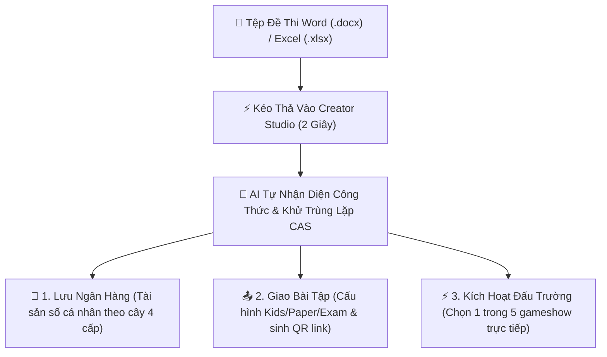

# 🎓 CẨM NANG SƯ PHẠM DÀNH CHO GIÁO VIÊN & GIẢNG VIÊN
## BỘ BA QUYỀN NĂNG SƯ PHẠM • ĐẤU TRƯỜNG ARENA 5 THỂ THỨC • PHÂN CẤP CHỦ ĐỀ SỞ HỮU TRÍ TUỆ
### *(Tài liệu chuẩn mực quốc tế — Thiết kế trực quan, dễ ứng dụng từ bậc Tiểu học đến Đại học)*

> **Hệ sinh thái**: Aegis Global Cognitive Infrastructure (AGCI)  
> **Phiên bản chuẩn hóa**: `ALDS v2.0 (Academic & Classroom Sovereign Edition)`  
> **Địa chỉ thao tác giáo viên**: `http://localhost:3000/creator/studio`  
> **Phương châm sư phạm**: *"Giảm 90% áp lực soạn đề & chấm bài — Chuyển hóa từng vấp ngã của học sinh thành bước nhảy nhận thức"*

---

## 📑 MỤC LỤC
1. [Giới thiệu Không gian Sư phạm Creator Zen Studio](#1-giới-thiệu-không-gian-sư-phạm-creator-zen-studio)
2. [Quy trình 3 Chạm / 10 Giây Tải & Tạo Đề Thi Tự Động](#2-quy-trình-3-chạm--10-giây-tải--tạo-đề-thi-tự-động)
3. [Bộ Ba Quyền Năng Sư Phạm Tại Thanh Điều Hướng Đáy](#3-bộ-ba-quyền-năng-sư-phạm-tại-thanh-điều-hướng-đáy)
4. [Đấu Trường Trực Tiếp 5 Thể Thức Động (Live Arena Gameshow Modes)](#4-đấu-trường-trực-tiếp-5-thể-thức-động-live-arena-gameshow-modes)
5. [Cấu Trúc Cây Phả Hệ Chủ Đề 4 Cấp & Bảo Vệ Bản Quyền Sáng Tạo](#5-cấu-trúc-cây-phả-hệ-chủ-đề-4-cấp--bảo-vệ-bản-quyền-sáng-tạo)
6. [Ma Trận Phân Cấp Người Dùng 4 Tầng & Hạn Mức Tương Xứng](#6-ma-trận-phân-cấp-người-dùng-4-tầng--hạn-mức-tương-xứng)
7. [Giao Bài Tự Luyện & Giám Sát Nhận Thức Lớp Học (Cohort Diagnostic Heatmap)](#7-giao-bài-tự-luyện--giám-sát-nhận-thức-lớp-học-cohort-diagnostic-heatmap)
8. [Khoa Học Nhận Thức: Giúp Học Sinh Học Từ Sai Lầm (ACSE 4 Lát Cắt & FSRS v5)](#8-khoa-học-nhận-thức-giúp-học-sinh-học-từ-sai-lầm-acse-4-lát-cắt--fsrs-v5)
9. [Bảng Hướng Dẫn Thực Hành Nhanh Cho Từng Cấp Học (Tiểu Học $\rightarrow$ Đại Học)](#9-bảng-hướng-dẫn-thực-hành-nhanh-cho-từng-cấp-học-tiểu-học--đại-học)
10. [Các Mẹo Soạn Đề Thi Word & Excel Chuẩn Xác 100%](#10-các-mẹo-soạn-đề-thi-word--excel-chuẩn-xác-100)
11. [Quản Trị Chiến Dịch Marketing Tập Trung (NoHC), Triết Lý 1 Ly Cafe (7 Ngày Pro) & Hệ Thống Đa Ngôn Ngữ Toàn Cầu (OCP, CLRACT, MultiLang)](#11-quản-trị-chiến-dịch-marketing-tập-trung-nohc-triết-lý-1-ly-cafe-7-ngày-pro--hệ-thống-đa-ngôn-ngữ-toàn-cầu-ocp-clract-multilang)

---

## 1. GIỚI THIỆU KHÔNG GIAN SƯ PHẠM CREATOR ZEN STUDIO

**Creator Zen Studio** được thiết kế dựa trên nguyên lý **Zero-Friction (Không rào cản kỹ thuật)** và **Tập trung thị giác tối thượng (Cognitive Focus)**:
* ❌ **Không phân tâm**: Khi Thầy/Cô đã nạp đề, toàn bộ banner giới thiệu, khuyến mãi được thu gọn tự động, nhường trọn vẹn **90% diện tích màn hình** để Thầy/Cô duyệt và chỉnh sửa câu hỏi.
* ❌ **Không nhập liệu thủ công**: Không cần cắt dán công thức toán hay tải từng tấm ảnh.
* 💎 **Đa dạng tệp đầu vào**: Hỗ trợ toàn diện tệp Word (`.docx`), Excel (`.xlsx`, `.xls`) và tài liệu số. Hệ thống tự động bóc tách, khử trùng lặp CAS ($0\% \text{ lãng phí}$) và sẵn sàng chỉ trong **vài giây**.



---

## 2. QUY TRÌNH 3 CHẠM / 10 GIÂY TẢI & TẠO ĐỀ THI TỰ ĐỘNG

* **Chạm 1 — Kéo Thả File**: Mở `http://localhost:3000/creator/studio`, thả tệp Word hoặc Excel vào khung giữa màn hình.
* **Chạm 2 — Hệ thống Tự Động Giải Mã (< 2 giây)**:
  - Tự động nhận diện dạng câu hỏi: Trắc nghiệm 4 lựa chọn (A-B-C-D), Đúng/Sai đa ý (GDPT 2025), Điền số ngắn, Ghép nối.
  - Tự động dịch ngược và hiển thị sắc nét công thức Toán, Lý, Hóa, Bảng biểu và Hình minh họa qua KaTeX.
  - Khử trùng lặp qua hàm băm nội dung SHA-256 (CAS), tiết kiệm kho lưu trữ.
* **Chạm 3 — Chọn 1 Trong 3 Quyền Năng Sư Phạm Tại Thanh Điều Hướng Đáy**.

---

## 3. BỘ BA QUYỀN NĂNG SƯ PHẠM TẠI THANH ĐIỀU HƯỚNG ĐÁY

Thanh điều khiển nổi (sticky) tại đáy màn hình được phân tách khoa học thành 3 nút lệnh độc lập, đại diện cho 3 nhu cầu sư phạm khác nhau của Thầy/Cô:

### 💾 1. Lưu Ngân Hàng (Pure Asset Storage)
* **Ý nghĩa**: Đề thi được cất giữ vĩnh viễn vào Ngân hàng Câu hỏi cá nhân của Thầy/Cô.
* **Đặc điểm**: Hoàn toàn **không sinh bài tập giao cho học sinh**, bảo toàn bí mật đề thi, phục vụ lưu trữ tài sản tri thức lâu dài hoặc dùng để trộn đề thi học kỳ sau này.
* **Phản hồi**: Hệ thống hiển thị hộp thoại xác nhận lưu thành công, hiển thị đầy đủ Mã Đề (`TP...`), Đường dẫn phả hệ (`/STUDIO/YYYYMMDD/CRT.../TP.../`) và nút liên kết nhanh đến Kho câu hỏi Quản trị.

### 📤 2. Giao Bài Tập (Homework Assignment & Student Tracking)
* **Ý nghĩa**: Biến đề thi thành bài tự luyện/kiểm tra về nhà cho học sinh với đầy đủ công cụ theo dõi nhận thức.
* **Thiết lập sư phạm linh hoạt**:
  - **Thời gian làm bài**: Tùy chỉnh số phút hoặc không giới hạn.
  - **Giao diện làm bài chuyên biệt**: 
    + 🎈 *Kids Mode*: Giao diện hoạt hình, rực rỡ, chữ lớn cho học sinh Tiểu học.
    + 📝 *Paper Mode*: Trải nghiệm lật đề giấy như thi thật.
    + ⚡ *Exam Mode*: Đồng hồ đếm ngược, chống gian lận.
    + 📖 *Study Mode*: Cho phép xem giải thích và gợi ý ngay sau mỗi câu.
  - **Quy tắc thi cử**: Bật/tắt đảo phương án, thiết lập thời gian cho từng câu, ngày giờ hết hạn nộp bài.
* **Phản hồi**: Sinh **Mã QR trực quan** và **Đường link ngắn** kèm nút gửi thẳng vào nhóm Zalo/Facebook phụ huynh và học sinh.

### ⚡ 3. Kích Hoạt Đấu Trường (Live Classroom Arena)
* **Ý nghĩa**: Biến buổi học trên lớp thành một sàn đấu số trực tiếp hấp dẫn như Gameshow truyền hình.
* **Đặc điểm**: Mở bảng chọn thể thức game để Thầy/Cô chọn trò chơi phù hợp với số lượng học sinh trong lớp.

---

## 4. ĐẤU TRƯỜNG TRỰC TIẾP 5 THỂ THỨC ĐỘNG (LIVE ARENA GAMESHOW MODES)

Hệ thống cung cấp **5 thể thức Gameshow đỉnh cao**, giải quyết triệt để vấn đề "chỉ hỗ trợ 4 người chơi của Olympia" trước đây:

| Thể Thức Gameshow | Biểu Tượng | Quy Mô Người Chơi | Kịch Bản Sư Phạm Khuyên Dùng |
| :--- | :---: | :---: | :--- |
| **🔔 Rung Chuông Vàng**<br/>*(Golden Bell Battle Royale)* | 🟡 | **30 - 10,000 học sinh** *(Toàn bộ lớp/trường)* | Cả lớp cùng tham gia trên sàn đấu Canvas 60fps. Sai 1 câu là rời sàn! Thầy/Cô có minigame **"Cứu Trợ Thầy Cô"** (ném máy bay giấy/bốc thăm) để hồi sinh toàn bộ học sinh. Cực kỳ sôi động cho ôn tập cuối kỳ. |
| **⚡ Nhanh Như Chớp**<br/>*(Lightning Incline)* | 🔵 | **1 - 8 học sinh** *(Thi theo tổ/nhóm)* | Cỗ máy leo dốc 10 bậc đứng! Đúng 1 câu leo 1 bậc, sai 1 câu tụt ngay về vạch số 0. Rèn luyện tốc độ và bản lĩnh phản xạ dưới áp lực đồng hồ đếm ngược 2 phút. Phù hợp kiểm tra 15 phút đầu giờ. |
| **🏆 Olympia Supreme**<br/>*(Đường Lên Đỉnh Tri Thức)* | 🟣 | **1 - 4 thí sinh/đội** *(Chung kết)* | Format 4 vòng thi truyền hình chuẩn mực: Khởi Động 60s, Vượt Chướng Ngại Vật ma trận hình ảnh, Tăng Tốc bấm chuông $<2\text{ms}$, Về Đích & Ngôi Sao Hy Vọng. Dành cho trận chung kết các đội xuất sắc nhất. |
| **👑 Ai Là Triệu Phú**<br/>*(Millionaire Socrates)* | 🔷 | **1 học sinh + Cả lớp khán giả** | 15 câu hỏi leo thang với 3 mốc an toàn. 4 quyền trợ giúp độc bản: 50:50, Hỏi Gia Sư AI Socrates, Hỏi ý kiến cả lớp qua quét mã QR, Đổi câu hỏi. Rất thích hợp cho kiểm tra bài cũ trực tiếp trên bảng. |
| **🎓 Đấu Trường Đại Học**<br/>*(Team vs Team Challenge)* | 🔴 | **2 đội tuyển** *(4 vs 4)* | Đối kháng học thuật giữa 2 tổ hoặc 2 trường. Bấm chuông Starter giành quyền trả lời và mở chuỗi câu hỏi Bonus có kênh thảo luận kín cho đồng đội. |

---

## 5. CẤU TRÚC CÂY PHẢ HỆ CHỦ ĐỀ 4 CẤP & BẢO VỆ BẢN QUYỀN SÁNG TẠO

Toàn bộ đề thi tạo từ Creator Studio được định vị tự động theo chuẩn **Materialized Path $O(1)$** với 4 tầng phân cấp bất biến:

```
/STUDIO/ (Cấp 1: Thư mục gốc Studio)
  └── /20261102/ (Cấp 2: Thư mục Ngày nạp đề)
        └── /CRT7571EC/ (Cấp 3: Không gian định danh của Thầy/Cô)
              └── /TP9967D005/ (Cấp 4: Đề thi cụ thể, mã Hex không dấu gạch nối)
```

* **Cấp 1 — Root Topic (`STUDIO`)**: Không gian gốc của toàn bộ sản phẩm từ Creator Zen Studio.
* **Cấp 2 — Ngày (`YYYYMMDD`)**: Phân nhóm đề thi theo từng mốc thời gian sư phạm rõ ràng.
* **Cấp 3 — Mã Creator (`CRT...`)**: Tiền tố `CRT` chuẩn hóa quốc tế gắn liền với mã tài khoản giáo viên (Ví dụ: `CRT7571EC`), độc lập và an toàn tuyệt đối.
* **Cấp 4 — Mã Đề (`TP...`)**: Tiền tố `TP` (Topic) kết hợp 8 ký tự Hex ngẫu nhiên (Ví dụ: `TP9967D005`), **tuyệt đối không dùng dấu gạch nối `-`** để bảo đảm thuật toán phân tích ngược URL và đối soát cơ sở dữ liệu không bao giờ bị xung đột.

---

## 6. MA TRẬN PHÂN CẤP NGƯỜI DÙNG 4 TẦNG & HẠN MỨC TƯƠNG XỨNG

Hệ thống phân cấp đặc quyền rõ ràng nhằm bảo đảm quyền lợi sư phạm và tài nguyên điện toán đám mây:

| Cấp Bậc Người Dùng | Hạn Mức Tải Đề | Thể Thức Arena | Cấu Hình Giao Bài Tập | Bản Quyền & AI |
| :--- | :---: | :---: | :---: | :--- |
| **1. Khách Vãng Lai (Guest)** | 3 đề/ngày | Golden Bell, Lightning | Mặc định (Exam Mode) | Ký số ẩn Zero-Width |
| **2. Giáo Viên Tiên Phong (Teacher Pro)** | **20 đề/ngày** *(Dùng thử 90 ngày miễn phí)* | **Cả 5 thể thức Gameshow** | Đầy đủ 4 Mode (Kids, Paper, Exam, Study) + Đảo đề | Phân tích IRT 3-PL, Gia sư AI Socrates, Thẻ vinh danh 3D |
| **3. Trưởng Bộ Môn (Dept Lead)** | 50 đề/ngày | Cả 5 thể thức + Chế độ Multi-room | Quản lý theo lớp, xuất báo cáo PDF | Ma trận nhận thức Bloom 6 cấp, lan tỏa chủ đề $\ge 40\%$ |
| **4. Hiệu Trưởng / Doanh Nghiệp (Dean)** | **Không giới hạn (∞)** | Đấu trường trường học (10,000 thí sinh) | Đồng bộ LMS, tích hợp SSO trường | Tên miền riêng (White-label), Kho đề cô lập RLS |

---

## 7. GIAO BÀI TỰ LUYỆN & GIÁM SÁT NHẬN THỨC LỚP HỌC (COHORT DIAGNOSTIC HEATMAP)

### Bước 1: Gửi Đề Cho Học Sinh Trong 1 Giây
Sau khi cấu hình tại modal **Giao Bài Tập**, Thầy/Cô bấm **"Gửi Vào Nhóm Zalo"** (hoặc sao chép link/QR). Hệ thống tự động soạn sẵn thông điệp:
> *"📢 BÀI TẬP VỀ NHÀ: Đề ôn tập Chương 2 môn Toán. Các em quét mã QR hoặc bấm link sau để làm bài trước 21h00 tối nay nhé: https://aegisglobal.io/practice/STUDIO_20261102_CRT7571EC/TP9967D005?mode=EXAM&time=45"*

### Bước 2: Theo Dõi Biểu Đồ Nhiệt Nhận Thức Cả Lớp
Thầy/Cô theo dõi bảng nhiệt sư phạm trực quan:
* Cột Đỏ Cảnh Báo ($>40\%$ học sinh làm sai): Điểm nghẽn nhận thức chung của cả lớp.
* Phân nhóm tự động 3 dải năng lực: Nhóm Cần Cứu Trợ (củng cố nền tảng), Nhóm Vững Vàng, và Nhóm Đột Phá Điểm 10.

---

## 8. KHOA HỌC NHẬN THỨC: GIÚP HỌC SINH HỌC TỪ SAI LẦM (ACSE 4 LÁT CẮT & FSRS v5)

* **Bóc tách bẫy sai (Distractor Misconception)**: Giải thích lý do tâm lý khiến học sinh chọn nhầm phương án nhiễu.
* **4 Lát cắt ACSE (Sweller Cognitive Load)**: `Clue (Dấu hiệu)` $\rightarrow$ `Concept (Hạt nhân tri thức)` $\rightarrow$ `Step (Chuỗi suy luận)` $\rightarrow$ `Hook (Mẹo khắc cốt ghi tâm)`.
* **Gia sư Socrates AI**: Không cho đáp án sẵn mà đặt câu hỏi gợi mở để học sinh tự tìm ra bản chất vấn đề.
* **Sổ tay FSRS v5**: Thuật toán lặp ngắt quãng tự động nhắc học sinh làm lại câu sai sau 1 ngày, 3 ngày, 7 ngày đến khi thuần thục.

---

## 9. BẢNG HƯỚNG DẪN THỰC HÀNH NHANH CHO TỪNG CẤP HỌC

| Cấp Học | Thể Thức Arena Khuyên Dùng | Chế Độ Làm Bài Phù Hợp | Trọng Tâm Sư Phạm |
| :--- | :--- | :--- | :--- |
| **🎒 Tiểu Học** *(Lớp 1-5)* | Rung Chuông Vàng, Ai Là Triệu Phú | **Kids Mode** *(Hình ảnh ngộ nghĩnh, chữ to)* | Tạo niềm yêu thích môn học, khen thưởng tức thì. |
| **🏫 THCS** *(Lớp 6-9)* | Nhanh Như Chớp, Đấu Trường Đội | **Study Mode** *(Xem gợi ý ngay khi làm)* | Rèn luyện tư duy logic, thói quen tự sửa sai. |
| **🎓 THPT** *(Lớp 10-12)* | Olympia Supreme, Rung Chuông Vàng | **Exam Mode / Paper Mode** *(Áp lực thời gian)* | Luyện thi tốt nghiệp, làm quen cấu trúc GDPT 2025. |
| **🏛️ Đại Học** *(ĐH/CĐ)* | Đấu Trường Đại Học, Nhanh Như Chớp | **Exam Mode** *(Chống gian lận, đảo đề)* | Đánh giá năng lực chuyên ngành, câu hỏi tình huống phức hợp. |

---

## 10. CÁC MẸO SOẠN ĐỀ THI WORD & EXCEL CHUẨN XÁC 100%

1. **Đề thi Word (`.docx`)**:
   - Câu hỏi: Bắt đầu bằng `Câu 1:`, `Câu 2.` hoặc `Bài 1:`.
   - Phương án: Gõ `A.`, `B.`, `C.`, `D.` ở đầu phương án.
   - Đáp án đúng: Bôi đỏ, gạch chân hoặc để bảng đáp án ở cuối đề (`1.A  2.B  3.C...`).
   - Công thức & Hình ảnh: Gõ MathType/Equation hoặc chèn ảnh thoải mái, hệ thống tự động bóc tách sang KaTeX.
2. **Đề thi Excel (`.xlsx`, `.xls`)**:
   - Cột A: Nội dung câu hỏi (`QuestionContent`).
   - Cột B, C, D, E: Bốn phương án lựa chọn (A, B, C, D).
   - Cột F: Đáp án đúng (`CorrectAnswer`, ví dụ `A` hoặc `1`).
   - Cột G: Lời giải chi tiết (`Explanation`).

---

## 11. QUẢN TRỊ CHIẾN DỊCH MARKETING TẬP TRUNG (NOHC), TRIẾT LÝ 1 LY CAFE (7 NGÀY PRO) & HỆ THỐNG ĐA NGÔN NGỮ TOÀN CẦU (OCP, CLRACT, MULTILANG)

Nhằm phục vụ đối tác sư phạm toàn cầu với chuẩn mực kỹ thuật và văn hóa ứng xử cao nhất, hệ thống **Creator Zen Studio** được chuẩn hóa theo 4 trụ cột kiến trúc cốt lõi:

### 11.1. Quản Trị Chiến Dịch Tiếp Thị Tập Trung & Không Hard-code (NoHC & Dynamic Policy)
- **Kiến trúc CLEAR / Clean Architecture**: Mọi thông số về quyền lợi giáo viên không bao giờ được viết cứng trong mã nguồn C# hay React. Toàn bộ chính sách được quản lý tập trung trong bảng CSDL [`creator_marketing_policies`](file:///d:/Cuong/DuAn/mybank/AegisQuiz/Backend/src/AegisQuiz.Domain/Entities/CreatorMarketingPolicy.cs) và cung cấp qua API [`/api/creator/studio/marketing-policy`](file:///d:/Cuong/DuAn/mybank/AegisQuiz/Backend/src/AegisQuiz.API/Controllers/CreatorStudioController.cs#L800-L835):
  - **Thời gian dùng thử (TrialDays)**: Linh động theo từng chiến dịch tiếp thị (ví dụ: 90 ngày, 60 ngày hoặc theo mùa tựu trường).
  - **Thời gian mở khóa Pro mời cafe (CoffeeProDays)**: Cấu hình biến động theo chiến dịch marketing (mặc định 7 ngày, có thể nâng lên 10, 14, 30 ngày trong các dịp lễ tri ân như Ngày Nhà giáo Việt Nam 20/11 hoặc Tết).
  - **Tỷ lệ chia sẻ doanh thu (RevenueShareRate)**: Cấu hình tập trung (mặc định 80/20).
  - **Điểm thưởng cống hiến Karma (KarmaBonusPoints)**: Tự động ghi nhận khi giáo viên gia nhập.
  - **Đơn giá ủng hộ & Tọa độ thanh toán SSoT**: Giá 1 ly cafe (`CoffeePriceVnd`), kết nối SSoT thời gian thực với cấu hình thanh toán tập trung (`VietQrBankBin = 970405`, `VietQrAccountNumber = 8888912600688`, `VietQrAccountName = NGUYEN VIET CUONG`) từ `IPaymentOrchestratorService`.

### 11.2. Triết Lý Kinh Tế Học & Nhân Văn Của "Chính Sách 1 Ly Cafe (Biến Động Linh Hoạt & Chuẩn Mực 7 Ngày Pro)"
Chính sách mở khóa qua 1 ly cafe được thiết kế dựa trên sự thấu cảm sâu sắc về mặt **Tâm lý học hành vi (Behavioral Economics)** và **Đạo đức sư phạm (Pedagogical Empathy)**:
1. **Thời Hạn Mở Khóa Pro Biến Động Linh Hoạt (Mặc Định Chuẩn Mực 7 Ngày)**:
   - 1 ly cafe (25.000 VNĐ ~ \$1 USD) tương đương một buổi cà phê sáng thân tình của đồng nghiệp. Mức chi phí nhỏ ("tiền lẻ") loại bỏ hoàn toàn rào cản đắn đo tâm lý (Frictionless Micro-patronage).
   - Thời hạn **mặc định 7 ngày** (1 tuần) tương ứng trọn vẹn với một **chu kỳ cao điểm soạn đề thi** của giáo viên (đợt thi giữa kỳ, cuối kỳ, hoặc khảo sát chất lượng).
   - SysAdmin có toàn quyền tùy chỉnh **thời hạn mở khóa Pro** (`CoffeeProDays`) biến động thành 10 ngày, 14 ngày hoặc 30 ngày ngay tại tab **Chính Sách Creator** thuộc phân hệ Quản trị Doanh thu `/admin/payments` để phục vụ các đợt bùng nổ chiến dịch tiếp thị mà không cần can thiệp mã nguồn.
2. **Loại bỏ Hoàn toàn Áp lực Đăng ký Định kỳ (No Recurring SaaS Lock-in)**:
   - Không tự động trừ tiền thẻ tín dụng hàng tháng.
   - Không ép buộc giáo viên phải mua gói năm hay gói tháng phức tạp khi chỉ có nhu cầu soạn đề cấp bách.
3. **Chính Sách Nhân Văn Sư Phạm — Aegis Heart (0đ Vĩnh Viễn)**:
   - Thầy/Cô công tác tại vùng sâu, vùng xa, biên giới, hải đảo hoặc hoàn cảnh khó khăn được kích hoạt gói **Aegis Heart (0đ)** tài trợ 100% tài nguyên tính toán và AI vĩnh viễn, thể hiện trách nhiệm xã hội cao quý của Aegis Global.

### 11.3. Hệ Thống Đa Ngôn Ngữ Toàn Cầu (Global MultiLang & Zero-Monolith UI)
- **Language Switcher Tức Thì**: Bộ chuyển đổi ngôn ngữ [`LanguageSwitcher.tsx`](file:///d:/Cuong/DuAn/mybank/AegisQuiz/Frontend/src/widgets/app-header/LanguageSwitcher.tsx) được tích hợp ngay trên thanh điều khiển Studio, hỗ trợ chuyển đổi 0ms giữa Tiếng Việt, Tiếng Anh và các ngôn ngữ quốc tế.
- **Type-Safe i18n Dictionary**: 100% chuỗi ký tự hiển thị được quản lý tập trung trong [`public/locales/vi/creator.json`](file:///d:/Cuong/DuAn/mybank/AegisQuiz/Frontend/public/locales/vi/creator.json) và [`public/locales/en/creator.json`](file:///d:/Cuong/DuAn/mybank/AegisQuiz/Frontend/public/locales/en/creator.json):
  - **Tiêu đề phân hệ**: Khi ở giao diện Tiếng Việt hiển thị chuẩn mực sư phạm **"Xưởng Sáng Tạo Sư Phạm Zen"**, khi ở Tiếng Anh hiển thị chuẩn quốc tế **"Creator Zen Studio"**.
  - **Nhãn nhận thức & bản quyền**: Khi ở Tiếng Việt hiển thị **"Hệ Sinh Thái Sáng Tạo Aegis • Bảo Vệ Bản Quyền Nhận Thức"**, khi ở Tiếng Anh hiển thị **"Aegis Creator Ecosystem • Anti-Scraping Protected"**.
  - **Nhãn số ngày Pro biến động**: Đồng bộ động `{coffeeDays} Ngày Pro` (VI) và `{coffeeDays} Days Pro` (EN).
- **Tuân thủ Chuẩn Zero-Monolith UI**: Toàn bộ các component giao diện [`CreatorZenStudioPage.tsx`](file:///d:/Cuong/DuAn/mybank/AegisQuiz/Frontend/src/pages/creator/studio/CreatorZenStudioPage.tsx) và [`TeacherCoffeeModal.tsx`](file:///d:/Cuong/DuAn/mybank/AegisQuiz/Frontend/src/pages/creator/studio/components/TeacherCoffeeModal.tsx) duy trì độ dài nghiêm ngặt $\le 210$ dòng code, bảo đảm hiệu năng tải tức thì và độ ổn định cao nhất.
