# 🎬 KỊCH BẢN ĐẠO DIỄN & BIÊN NIÊN PHIM GIỚI THIỆU TOÀN CẢNH HỆ SINH THÁI AEGIS GLOBAL
## The Cognitive Intelligence & Verification Standard — Official 4K Cinema Showcase

> **Chủ nhiệm Sản xuất & Tổng Đạo diễn:** No.1 — World-Class Polymath Chief Architect & Creative Director  
> **Thời lượng chuẩn:** 2 phút 45 giây (10 Phân cảnh Đột phá)  
> **Định dạng video:** 4K UHD 60fps (3840x2160) / 1080p 60fps • Tỷ lệ 16:9 • Không gian màu DCI-P3  
> **Ứng dụng Trình chiếu & Xuất Video Tương tác:** [`aegis_global_showcase_video.html`](file:///C:/Users/cuongnguyenviet8.CORP/.gemini/antigravity/brain/db8da83b-e9ca-4640-bf16-4c471d230bac/aegis_global_showcase_video.html)

---

## I. TỔNG QUAN Ý TƯỞNG NGHỆ THUẬT & TÔNG GIỌNG (CREATIVE CONCEPT & TONE)

* **Phong cách Điện ảnh:** *Cyber-Precision & Human-Centric Zen* — Kết hợp giữa sự chuẩn xác tuyệt đối của công nghệ điện toán phân tán (Distributed Systems, AI Epistemic Triad, Mật mã học) và sự tinh tế, ấm áp của Sư phạm Nhân văn (Zen Creator Studio, Giáo dục thích ứng).
* **Âm nhạc & Sound Design:** Khởi đầu với Ambient Pad trầm lắng (55Hz), bùng nổ nhịp điệu Hybrid Cinematic Orchestra phong cách Hans Zimmer / Ludwig Göransson, kết hợp hiệu ứng âm thanh công nghệ số (Sub-bass Drop, Digital Whoosh, Crystal Chime).
* **Lời bình (Voiceover):** Trầm ấm, truyền cảm hứng, đĩnh đạc và mang tầm vóc của một tiêu chuẩn quốc tế.

---

## II. CHI TIẾT 10 PHÂN CẢNH ĐỘT PHÁ (STORYBOARD & TIMELINE SCRIPT)

```mermaid
flowchart LR
    S1["Cảnh 1: Khởi Nguyên Nhận Thức<br/>(0:00 - 0:15)"] --> S2["Cảnh 2: Tam Giác Vàng 0ms<br/>(0:15 - 0:33)"]
    S2 --> S3["Cảnh 3: MathType & Zero-DOM<br/>(0:33 - 0:50)"]
    S3 --> S4["Cảnh 4: Creator Zen Studio<br/>(0:50 - 1:06)"]
    S4 --> S5["Cảnh 5: Arena 6 Gameshow<br/>(1:06 - 1:24)"]
    S5 --> S6["Cảnh 6: CAT & IRT 3-PL<br/>(1:24 - 1:41)"]
    S6 --> S7["Cảnh 7: Hội Đồng AI 6 Pha<br/>(1:41 - 1:59)"]
    S7 --> S8["Cảnh 8: Dual-Space & Cộng Đồng<br/>(1:59 - 2:15)"]
    S8 --> S9["Cảnh 9: FinOps & Quỹ Mời Cafe<br/>(2:15 - 2:30)"]
    S9 --> S10["Cảnh 10: Vị Thế Toàn Cầu<br/>(2:30 - 2:45)"]
```

---

### PHÂN CẢNH 1: KHỞI NGUYÊN NHẬN THỨC (0:00 – 0:15)
* **Hình ảnh (Visuals):** Logo Hologram biểu tượng Khiên Trí Tuệ Aegis Global xoay chậm giữa dải ngân hà hạt dữ liệu phát sáng neon xanh Cyan. Camera phóng cận cảnh đường nét sắc sảo của biểu tượng.
* **Chữ trên màn hình (On-Screen Text):**  
  `AEGIS GLOBAL`  
  *THE COGNITIVE INTELLIGENCE & VERIFICATION STANDARD*  
  *Hạ Tầng Khảo Thí & Đo Lường Năng Lực Thích Ứng Thế Hệ Mới*
* **Lời bình Tiếng Việt (Voiceover):**  
  *"Aegis Global không chỉ là một nền tảng tạo câu hỏi thông thường. Đây là Hạ tầng Trí tuệ Nhận thức Tiên phong, định hình lại chuẩn mực khảo thí và đo lường năng lực thực chất cho hàng triệu người học trên toàn thế giới."*
* **Voiceover English:**  
  *"Aegis Global is not just an ordinary assessment tool. It is the Sovereign Cognitive Infrastructure, pioneering a new benchmark for adaptive intelligence and real capability verification worldwide."*
* **Hiệu ứng âm thanh:** Tiếng Drone Synth ngân vang sâu thẳm, tiếng nhịp tim kỹ thuật số dồn dập.

---

### PHÂN CẢNH 2: TAM GIÁC VÀNG BÓC TÁCH ĐỀ THI 0MS (0:15 – 0:33)
* **Hình ảnh (Visuals):** Đồ họa 3 đỉnh của Tam Giác Vàng phát sáng rực rỡ:
  1. [`DocxStateMachineClassifier.cs`](file:///d:/Cuong/DuAn/mybank/AegisGlobal/Backend/src/Aegis.Infrastructure/Services/Docx/DocxStateMachineClassifier.cs) (Skinny State Orchestrator $\le 1,200$ LOC).
  2. [`DynamicQuestionIngestionEngine.cs`](file:///d:/Cuong/DuAn/mybank/AegisGlobal/Backend/src/Aegis.Infrastructure/Services/DynamicQuestionIngestionEngine.cs) (CIG 4-Specs SSoT).
  3. [`UniversalCoordinateTaxonomyEngine.cs`](file:///d:/Cuong/DuAn/mybank/AegisGlobal/Backend/src/Aegis.Infrastructure/Services/UniversalCoordinateTaxonomyEngine.cs) (5 Trục tọa độ trực giao & 3 Lăng kính xoay Pivot $O(1)$).
* **Chữ trên màn hình:**  
  `TAM GIÁC VÀNG BÓC TÁCH 0MS`  
  *Skinny Orchestrator • CIG Grammar • 5 Trục Tọa Độ UCTE*
* **Lời bình:**  
  *"Đột phá kiến trúc với Tam Giác Vàng bóc tách: Skinny State Orchestrator tinh gọn dưới 1.200 dòng mã kết hợp CIG Grammar tự phục hồi và 5 trục tọa độ UCTE, nuốt trọn mọi đề thi Word phức tạp nhất chỉ trong chưa đầy hai giây."*
* **Hiệu ứng âm thanh:** Tech Whoosh tốc độ cao, tiếng dữ liệu số được phân tích với tần số cao.

---

### PHÂN CẢNH 3: GIẢI MÃ MATHTYPE WMF & KHÁNG RÒ RỈ DOM (0:33 – 0:50)
* **Hình ảnh (Visuals):** Màn hình chia đôi:
  - Nửa trái: Công thức tích phân, vectơ, hệ phương trình MathType nhị phân WMF được chuyển hóa thành Vector SVG và KaTeX $\displaystyle$ sắc nét.
  - Nửa phải: Đề thi Tin học chứa mã code HTML/CSS (`<ol start="10">`, `<li>...</li>`, ``) được hiển thị nguyên bản dạng khối code bóng bẩy, không hề bị rò rỉ hay phá vỡ DOM.
* **Chữ trên màn hình:**  
  `MATHTYPE WMF VECTOR & ZERO-DOM-LEAK CODE`  
  *KaTeX \displaystyle • Kháng Rò Rỉ DOM Tin Học Tuyệt Đối*
* **Lời bình:**  
  *"Giải mã nhị phân MathType WMF sắc nét sang KaTeX Vector SVG. Bảo vệ toàn vẹn tuyệt đối mã nguồn Tin học HTML, CSS, XML mà không làm rò rỉ bất kỳ thẻ DOM nào ra giao diện người dùng."*
* **Hiệu ứng âm thanh:** Tiếng gõ bàn phím cơ êm ái, tiếng quét laser quang học.

---

### PHÂN CẢNH 4: CREATOR ZEN STUDIO — 3 CHẠM TRONG 10 GIÂY (0:50 – 1:06)
* **Hình ảnh (Visuals):** Mô phỏng bàn tay chạm màn hình:
  - Chạm 1: Thả file đề Word vào ô tròn ánh sáng.
  - Chạm 2: Danh sách câu hỏi dựng thẻ đẹp như sách giáo khoa hiện ra tức thì.
  - Chạm 3: Bấm nút trên Thanh điều khiển nổi với 4 lựa chọn: Lưu Ngân Hàng, Giao Bài Tập, Kích Hoạt Đấu Trường, và nút Hủy Bỏ tinh tế.
* **Chữ trên màn hình:**  
  `CREATOR ZEN STUDIO — 3 CHẠM TRONG 10 GIÂY`  
  *Thả File Đề ➔ Xem Lướt Thẻ ➔ Phát Hành Ngay*
* **Lời bình:**  
  *"Creator Zen Studio: Triết lý thiết kế 3 chạm trong 10 giây. Thả file đề, xem lướt thẻ câu hỏi sắc sảo, và phát hành ngay phòng thi với thanh điều khiển nổi tích hợp nút Hủy Bỏ siêu mượt mà."*
* **Hiệu ứng âm thanh:** Tiếng chuông thanh thoát Zen Chime, tiếng Click nút bấm nảy chắc chắn.

---

### PHÂN CẢNH 5: AEGIS ARENA — ĐẤU TRƯỜNG 6 GAMESHOW ĐỈNH CAO (1:06 – 1:24)
* **Hình ảnh (Visuals):** Màn hình bùng nổ ánh sáng sân khấu Gameshow với 6 biểu tượng:
  - Rung Chuông Vàng, Nhanh Như Chớp, Đường Lên Đỉnh Olympia, Ai Là Triệu Phú, Đấu Trí Chiến Thuật, Khảo Thí Tốc Độ.
  - Đồng hồ đếm ngược 15 giây, hiệu ứng hạt pháo hoa bùng nổ khi thí sinh trả lời đúng.
* **Chữ trên màn hình:**  
  `AEGIS ARENA — 6 GAMESHOW ĐỈNH CAO`  
  *Độ Trễ Bấm Chuông RAM < 2ms • Web Audio 0ms • 60 FPS*
* **Lời bình:**  
  *"Aegis Arena bùng nổ năng lượng với 6 thể thức Gameshow đỉnh cao: Rung Chuông Vàng, Nhanh Như Chớp, Olympia, Triệu Phú. Độ trễ bấm chuông RAM dưới 2 mili-giây, âm thanh vòm sống động 0ms."*
* **Hiệu ứng âm thanh:** Tiếng chuông vàng vang rền, tiếng vỗ tay cuồng nhiệt của khán đài.

---

### PHÂN CẢNH 6: KHẢO THÍ THÍCH ỨNG CAT & IRT 3-PL (1:24 – 1:41)
* **Hình ảnh (Visuals):** Biểu đồ đường cong đặc trưng Item Characteristic Curve (ICC) vẽ nét uốn lượn Sigmoid. Điểm năng lực $\theta$ hội tụ dần về mức chuẩn xác kèm sai số đo lường $SE \le 0.3$.
* **Chữ trên màn hình:**  
  `KHẢO THÍ THÍCH ỨNG CAT & TÂM TRẮC HỌC IRT 3-PL`  
  *Mô Hình Xác Suất P(θ) • Deep Knowledge Tracing • FSRS v5*
* **Lời bình:**  
  *"Não bộ tâm trắc học tiên tiến với mô hình xác suất IRT 3 tham số a, b, c, khảo thí thích ứng CAT phân loại trình độ chỉ trong 10 câu, kết hợp Deep Knowledge Tracing và thuật toán lặp ngắt quãng FSRS v5."*
* **Hiệu ứng âm thanh:** Nhịp điệu toán học nhấp nháy, âm thanh tổng hợp tần số quét.

---

### PHÂN CẢNH 7: HỘI ĐỒNG AI BIỆN CHỨNG 6 PHA (1:41 – 1:59)
* **Hình ảnh (Visuals):** Ba luồng năng lượng đại diện cho Hệ Ba Ngôi Nhận Thức:
  - Universal AI Router (UAR) $\rightarrow$ Wolf Pack Swarm Engine (WPSE) $\rightarrow$ Universal Symposium Engine (Hội Đồng 6 Pha với các tác tử Popperian Bác bỏ, Bayesian Tu chỉnh niềm tin và Peircean Khởi tạo giả thuyết).
* **Chữ trên màn hình:**  
  `HỆ BA NGÔI NHẬN THỨC & ĐẠI HỘI THẢO AI 6 PHA`  
  *FinOps Pareto UAR • Bầy Sói WPSE • Hạt Nhân L0 Meta-Nucleus*
* **Lời bình:**  
  *"Hệ Ba Ngôi Nhận Thức: Universal AI Router FinOps, Bầy sói WPSE đồng thuận chuỗi tư duy, và Đại Hội Thảo Hàn Lâm 6 pha với hạt nhân L0 Meta-Nucleus, triệt tiêu 100% ảo giác AI."*
* **Hiệu ứng âm thanh:** Âm thanh hợp xướng số viễn tưởng, tiếng nổ năng lượng trí tuệ nhân tạo.

---

### PHÂN CẢNH 8: KHÔNG GIAN KÉP & KHO TRI THỨC CỘNG ĐỒNG (1:59 – 2:15)
* **Hình ảnh (Visuals):** Mô hình Không gian Kép CDSA:
  - Cột trái: Tủ hồ sơ cá nhân bảo mật tuyệt đối.
  - Mũi tên đóng góp 1 chạm: Nút `🌐 Cộng đồng` phát sáng.
  - Cột phải: Cây tri thức Cộng đồng mở bung ra hàng vạn nhánh đề cho học sinh cả nước.
* **Chữ trên màn hình:**  
  `KHÔNG GIAN KÉP CDSA & KHO TRI THỨC CỘNG ĐỒNG`  
  *Chủ Quyền Cá Nhân Song Hành Pháo Đài Doanh Nghiệp • CAS SHA-256 (Tiết Kiệm 85% DB)*
* **Lời bình:**  
  *"Kiến trúc Không gian Kép CDSA: Tủ hồ sơ cá nhân độc lập song hành cùng Cây Tri thức Cộng đồng. Cơ chế Copy-On-Write và băm SHA-256 tiết kiệm 85% dung lượng lưu trữ toàn cầu."*
* **Hiệu ứng âm thanh:** Tiếng mở két sắt điện tử an ninh, tiếng dòng chảy dữ liệu kết nối.

---

### PHÂN CẢNH 9: KHO BẠC TOÀN CẦU & KINH TẾ HỌC TRI THỨC (2:15 – 2:30)
* **Hình ảnh (Visuals):** Các phương thức thanh toán xuất hiện mượt mà:
  - VietQR Napas 24/7 EMVCo Offline Fallback, Stripe, Apple Pay, Web3 Polygon.
  - Hộp quà "Mời 1 Ly Cafe (25.000đ)" và ví xu AegisCoin lấp lánh tri ân các thầy cô.
* **Chữ trên màn hình:**  
  `KHO BẠC TOÀN CẦU & FINOPS DOANH NGHIỆP`  
  *VietQR Napas 24/7 EMVCo • Stripe • Web3 • Quỹ Tri Ân Mời Cafe*
* **Lời bình:**  
  *"Kho bạc Toàn cầu Aegis Treasury: Điều phối đa cổng thanh toán PayOS, VietQR EMVCo Fallback ngoại tuyến, Stripe quốc tế và Web3 Polygon. Quỹ Mời Cafe tri ân người đóng góp tri thức."*
* **Hiệu ứng âm thanh:** Tiếng chạm ly cafe ấm cúng, âm thanh giao dịch thành công tinh tế.

---

### PHÂN CẢNH 10: KHẲNG ĐỊNH VỊ THẾ TOÀN CẦU (2:30 – 2:45)
* **Hình ảnh (Visuals):** Toàn cảnh giao diện Aegis Global trên màn hình máy tính, máy tính bảng và điện thoại di động PWA. Dòng chữ định vị thương hiệu hiện lên kiêu hãnh với các con dấu chuẩn mực quốc tế: ISO/IEC 27001, NIST SP 800-63B, QTI 3.0.
* **Chữ trên màn hình:**  
  `AEGIS GLOBAL`  
  *Đo Lường Năng Lực Thực Chất — Bùng Nổ Cảm Hứng Học Tập Đỉnh Cao*  
  *https://daotao.dehoc.vn*
* **Lời bình:**  
  *"Aegis Global — Đo lường năng lực thực chất, bùng nổ cảm hứng học tập đỉnh cao. Sẵn sàng đồng hành cùng mọi nhà giáo, học sinh và tổ chức trên toàn thế giới."*
* **Hiệu ứng âm thanh:** Điệp khúc dàn nhạc giao hưởng vút lên đỉnh điểm cao trào rồi kết thúc bằng tiếng vang ngân dài lắng đọng.

---

## III. HƯỚNG DẪN TRẢI NGHIỆM VÀ XUẤT VIDEO TRỰC TIẾP TỪ TRÌNH DUYỆT

1. Mở tệp Artifact: [`aegis_global_showcase_video.html`](file:///C:/Users/cuongnguyenviet8.CORP/.gemini/antigravity/brain/db8da83b-e9ca-4640-bf16-4c471d230bac/aegis_global_showcase_video.html) trên trình duyệt Chrome / Edge.
2. Bấm nút **`▶ Play`** để thưởng thức toàn cảnh 10 phân cảnh đồ họa Canvas 60fps kèm nhạc nền Synthesizer và giọng đọc thuyết minh tiếng Việt tự động.
3. Bấm nút **`Xuất Video (WebM/MP4)`** để hệ thống tự động chạy toàn bộ thước phim và tải về máy tệp video thành phẩm độ phân giải cao sẵn sàng đăng tải lên YouTube, TikTok, Facebook hoặc gửi đối tác!

