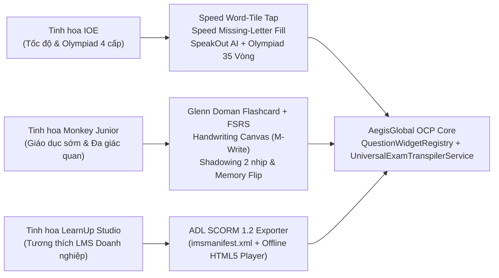

# 🚀 HỒ SƠ KIẾN TRÚC NÂNG CẤP: OLYMPIAD, SƯ PHẠM ĐA GIÁC QUAN & CHUẨN LMS SCORM 1.2

> **Mã hồ sơ**: `ALDS-OPSU-2026`  
> **Tiêu chuẩn áp dụng**: [AEGIS LIVING DOCUMENTATION STANDARD (ALDS v1.0)](file:///d:/Cuong/DuAn/mybank/AegisGlobal/docs/standards/AEGIS_LIVING_DOCUMENTATION_STANDARD.md)  
> **Commits tham chiếu**: `2c5e593` (IOE Olympiad & SpeakOut), `2cc2a57` (Monkey Junior Pedagogy), `9caaf12` (LearnUp SCORM 1.2 Exporter)  
> **Nguyên lý kiến trúc**: Zero-Monolith ($\le 250$ LOC/file) · Open/Closed Principle (OCP) via `QuestionWidgetRegistry` & `ITranspilerExportStrategy` · Multi-Subject & Multi-Language

---

## I. TỔNG QUAN CHIẾN LƯỢC HỘI TỤ TINH HOA

Bộ nâng cấp này tổng hợp tinh hoa từ 3 mô hình EdTech hàng đầu (**IOE**, **Monkey Junior**, **LearnUp Studio**) và chuyển hóa thành **năng lực lõi đa môn, đa ngành, đa ngôn ngữ** cho **AegisGlobal**:

---

## II. CHI TIẾT CÁC PHÂN HỆ ĐÃ TRIỂN KHAI & LIÊN KẾT MÃ NGUỒN SỐNG

### 1. Tinh hoa Olympiad Tốc Độ Cao & Lộ trình 35 Vòng (IOE-Grade)
| Tính năng | Mô tả kỹ thuật | Mã nguồn sống |
|---|---|---|
| **Chạm từ ghép câu siêu tốc (Word-Tile Tap)** | Tự động bật chế độ chạm thẻ từ ghép câu khi các mảnh ghép $\le 28$ ký tự; hỗ trợ chuyển đổi 1 chạm với chế độ kéo-thả | [`OrderingWidget.tsx`](file:///d:/Cuong/DuAn/mybank/AegisGlobal/Frontend/src/components/quiz/widgets/OrderingWidget.tsx) |
| **Điền từ & Chữ cái khuyết tốc độ cao** | Tự động nhận diện `FILL_BLANK` hoặc mẫu khuyết chữ cái (`b _ _ k`, `____`) để render ô nhập nhanh `autoFocus` kèm badge gợi ý | [`ShortAnswerWidget.tsx`](file:///d:/Cuong/DuAn/mybank/AegisGlobal/Frontend/src/components/quiz/widgets/ShortAnswerWidget.tsx) |
| **Luyện phát âm AI (`SPEAK_OUT`)** | Nghe mẫu (`speechSynthesis`), thu âm Micro (`SpeechRecognition`), chấm điểm khớp từng từ và tô màu xanh/đỏ trực quan | [`SpeakOutWidget.tsx`](file:///d:/Cuong/DuAn/mybank/AegisGlobal/Frontend/src/components/quiz/widgets/SpeakOutWidget.tsx) · [`SpeakOutQuestion`](file:///d:/Cuong/DuAn/mybank/AegisGlobal/Backend/src/Aegis.Domain/Entities/QuestionBase.cs#L464-L497) |
| **Động cơ 35 Vòng & Xếp hạng Olympiad** | Mở khóa tuần tự 35 vòng tự luyện $\rightarrow$ mở cổng 4 cấp (`School` 15, `District` 20, `Province` 25, `National` 30); tính điểm `Score * 10,000 - DurationSeconds` | [`OlympiadProgressionEvaluator.cs`](file:///d:/Cuong/DuAn/mybank/AegisGlobal/Backend/src/Aegis.Application/Services/OlympiadProgressionEvaluator.cs) |

### 2. Tinh hoa Sư phạm Đa Giác Quan & Giáo dục Sớm (Monkey Junior-Grade)
| Tính năng | Mô tả kỹ thuật | Mã nguồn sống |
|---|---|---|
| **Glenn Doman Rapid Flashcard (`FLASHCARD_RAPID`)** | Tráo thẻ nhanh `1.0s / 1.5s / 2.2s`, đọc âm thanh bản xứ tự động, hỗ trợ KaTeX và phân loại FSRS (`MASTERED` / `REVIEW_AGAIN`) | [`GlennDomanFlashcardWidget.tsx`](file:///d:/Cuong/DuAn/mybank/AegisGlobal/Frontend/src/components/quiz/widgets/GlennDomanFlashcardWidget.tsx) |
| **Tập viết & Vẽ nét thông minh (`HANDWRITING`)** | Bảng vẽ HTML5 Canvas hỗ trợ nét mẫu mờ (`targetGlyph`), đổi màu bút, đếm số nét (`strokes`) và mật độ mực (`coveragePct`) cho chữ cái, Kanji/Hanzi và ký hiệu Toán | [`HandwritingWidget.tsx`](file:///d:/Cuong/DuAn/mybank/AegisGlobal/Frontend/src/components/quiz/widgets/HandwritingWidget.tsx) · [`HandwritingQuestion`](file:///d:/Cuong/DuAn/mybank/AegisGlobal/Backend/src/Aegis.Domain/Entities/QuestionBase.cs#L499-L526) |
| **Shadowing Đa Ngôn Ngữ 2 Nhịp** | Hỗ trợ 6 ngôn ngữ (`EN-US`, `VI`, `JA`, `ZH`, `KO`, `FR`); phát câu mẫu $\rightarrow$ đếm nhịp `2..1` $\rightarrow$ tự động bật micro thu âm bắt chước tức thời | [`SpeakOutWidget.tsx`](file:///d:/Cuong/DuAn/mybank/AegisGlobal/Frontend/src/components/quiz/widgets/SpeakOutWidget.tsx) |
| **Lật thẻ trí nhớ (`MemoryFlipBoard`)** | Tích hợp trực tiếp vào chế độ Ghép cặp (`MATCHING`), cho phép người học chuyển sang trò chơi lật thẻ tìm cặp tương ứng | [`MemoryFlipBoard.tsx`](file:///d:/Cuong/DuAn/mybank/AegisGlobal/Frontend/src/components/quiz/widgets/MemoryFlipBoard.tsx) · [`MatchingWidget.tsx`](file:///d:/Cuong/DuAn/mybank/AegisGlobal/Frontend/src/components/quiz/widgets/MatchingWidget.tsx) |
| **Đăng ký OCP Dynamic Widget Registry** | Toàn bộ widget mới được lazy-load qua Registry mà không sửa vòng lặp render lõi | [`QuestionWidgetRegistry.ts`](file:///d:/Cuong/DuAn/mybank/AegisGlobal/Frontend/src/components/quiz/widgets/QuestionWidgetRegistry.ts) |

### 3. Tinh hoa Đóng Gói LMS Doanh nghiệp Chuẩn SCORM 1.2 (LearnUp-Grade)
| Thành phần | Mô tả kỹ thuật | Mã nguồn sống |
|---|---|---|
| **Chiến lược xuất gói SCORM 1.2** | Tạo tệp `.scorm12.zip` (`FormatCode = "SCORM_12"`) gồm `imsmanifest.xml` (`ADL SCORM 1.2`), hình ảnh nhúng (`resources/img_*`) và trình phát HTML5 tự chấm điểm kết nối `LMSInitialize` / `cmi.core.score.raw` / `cmi.core.lesson_status` | [`Scorm12PackageExportStrategy.cs`](file:///d:/Cuong/DuAn/mybank/AegisGlobal/Backend/src/Aegis.Infrastructure/Transpiler/Scorm12PackageExportStrategy.cs) |
| **Đăng ký DI Strategy OCP** | Nạp động qua `ITranspilerExportStrategy` vào [`UniversalExamTranspilerService.cs`](file:///d:/Cuong/DuAn/mybank/AegisGlobal/Backend/src/Aegis.Infrastructure/Transpiler/UniversalExamTranspilerService.cs) | [`Program.cs`](file:///d:/Cuong/DuAn/mybank/AegisGlobal/Backend/src/Aegis.API/Program.cs#L94) |

---

## III. BẰNG CHỨNG KIỂM THỬ ĐỊNH LƯỢNG

- **Backend Scoped Tests**: `dotnet test Backend/tests/Aegis.UnitTests/Aegis.UnitTests.csproj --filter "FullyQualifiedName~OlympiadProgressionTests"` ([`OlympiadProgressionTests.cs`](file:///d:/Cuong/DuAn/mybank/AegisGlobal/Backend/tests/Aegis.UnitTests/OlympiadProgressionTests.cs)) $\rightarrow$ **5/5 Passed (0 Failed)**:
  1. `SequentialRounds_ShouldUnlockProgressively_AndGateOfficialTiers`
  2. `CompositeLeaderboardScore_ShouldPrioritizeAccuracyThenSpeed`
  3. `SpeakOutQuestion_ShouldEvaluatePronunciationTokenAccuracy`
  4. `HandwritingQuestion_ShouldEvaluateStrokesAndCoverage`
  5. `Scorm12PackageExport_ShouldGenerateValidManifestAndPlayer`
- **Frontend TypeScript Check**: `npx tsc -b` $\rightarrow$ **0 lỗi biên dịch**.
- **Triển khai Docker Desktop**: Đã build và xác nhận `aegis-backend` (`http://localhost:5080/health` $\rightarrow$ `200 Healthy`) và `aegis-frontend` (`http://localhost:3000/health` $\rightarrow$ `200 Healthy`).
