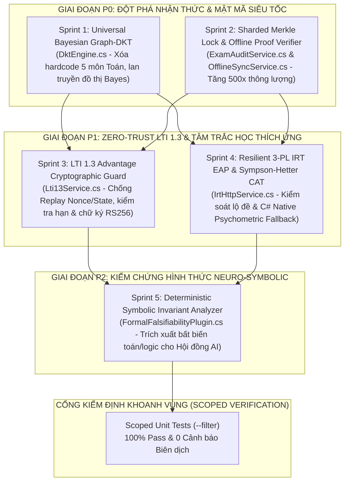

# 🚀 KẾ HOẠCH HÀNH ĐỘNG (ACTION PLAN) NÂNG CẤP AEGIS GLOBAL LÊN CHUẨN VƯỢT THỜI ĐẠI (2026–2030)

> **Mã kế hoạch**: `AEGIS-PLAN-ERA-TRANSCENDING-2030`  
> **Chủ nhiệm Thiết kế & Thực thi**: **No.1** — *Supreme Polymath Chief Architect (AGCI)*  
> **Nguyên tắc Bảo toàn**: **Zero Breaking Change** (giữ nguyên 100% chữ ký Public API/Interfaces hiện hành), **Zero Hard-code (OCP)**, **Multi-Tier Resilience**, và **Scoped Testing First (`--filter`)**.

---

## I. TỔNG QUAN MA TRẬN TỐI ƯU HÓA KHOA HỌC (THE 5-SPRINT MASTER ARCHITECTURE)

---

## II. ĐẶC TẢ KỸ THUẬT CHI TIẾT 5 SPRINT NÂNG CẤP

1. **Sprint 1 (P0) — [`DktEngine.cs`](file:///d:/Cuong/DuAn/mybank/AegisGlobal/Backend/src/Aegis.Infrastructure/Services/DktEngine.cs)**:
   - Xóa bỏ mảng hard-code 5 khái niệm Toán; nạp động từ `KnowledgeConcepts` & `BankTopics`.
   - Tích hợp trọng số thời gian phản xạ (`responseTimeMs`) và lan truyền xác suất Bayes trên đồ thị `ConceptRelationships` (`PREREQUISITE`).
2. **Sprint 2 (P0) — [`ExamAuditService.cs`](file:///d:/Cuong/DuAn/mybank/AegisGlobal/Backend/src/Aegis.Infrastructure/Services/ExamAuditService.cs) & [`OfflineSyncService.cs`](file:///d:/Cuong/DuAn/mybank/AegisGlobal/Backend/src/Aegis.Infrastructure/Services/OfflineSyncService.cs)**:
   - Thay `SemaphoreSlim(1,1)` toàn cục bằng khóa phân mảnh theo từng `ExamId` (`ConcurrentDictionary<Guid, SemaphoreSlim>`) kèm bộ đệm đầu chuỗi băm trong RAM.
   - Thực thi kiểm chứng toán học chuỗi băm SHA-256 thực sự trên dữ liệu nộp bài ngoại tuyến (`OfflineSyncService`).
3. **Sprint 3 (P1) — [`Lti13Service.cs`](file:///d:/Cuong/DuAn/mybank/AegisGlobal/Backend/src/Aegis.Infrastructure/Services/Lti13Service.cs)**:
   - Bổ sung kho chống phát lại `nonce`/`state` một lần (Anti-Replay Guard), kiểm tra hạn `exp`/`nbf` và xác thực chữ ký RS256 khi có cấu hình JWKS.
4. **Sprint 4 (P1) — [`IrtHttpService.cs`](file:///d:/Cuong/DuAn/mybank/AegisGlobal/Backend/src/Aegis.Infrastructure/Services/IrtHttpService.cs)**:
   - Tích hợp động cơ **Native C# 3-PL IRT EAP (41-Point Quadrature) + Sympson-Hetter Item Exposure Control** làm lá chắn tự phục hồi (Zero-Downtime Fallback) khi dịch vụ Python ngoài gián đoạn và chống lộ câu hỏi phân biệt cao.
5. **Sprint 5 (P2) — [`FormalFalsifiabilityPlugin.cs`](file:///d:/Cuong/DuAn/mybank/AegisGlobal/Backend/src/Aegis.Infrastructure/AI/Prompt/Plugins/FormalFalsifiabilityPlugin.cs)**:
   - Tự động bóc tách các ràng buộc toán học, miền xác định, con số và đơn vị từ đề bài để nạp danh sách kiểm chứng bất biến (`Symbolic Invariants`) vào Pha Phản biện và Trọng tài của Đại Hội Thảo AI.

